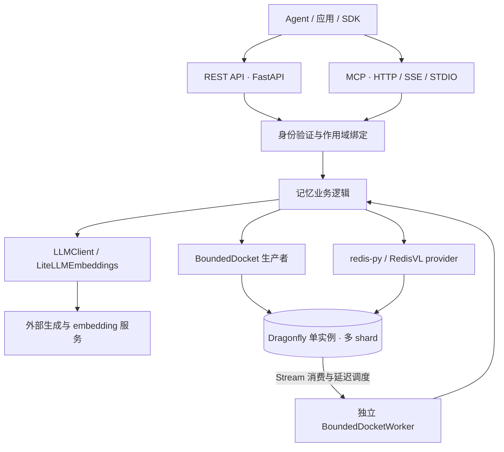
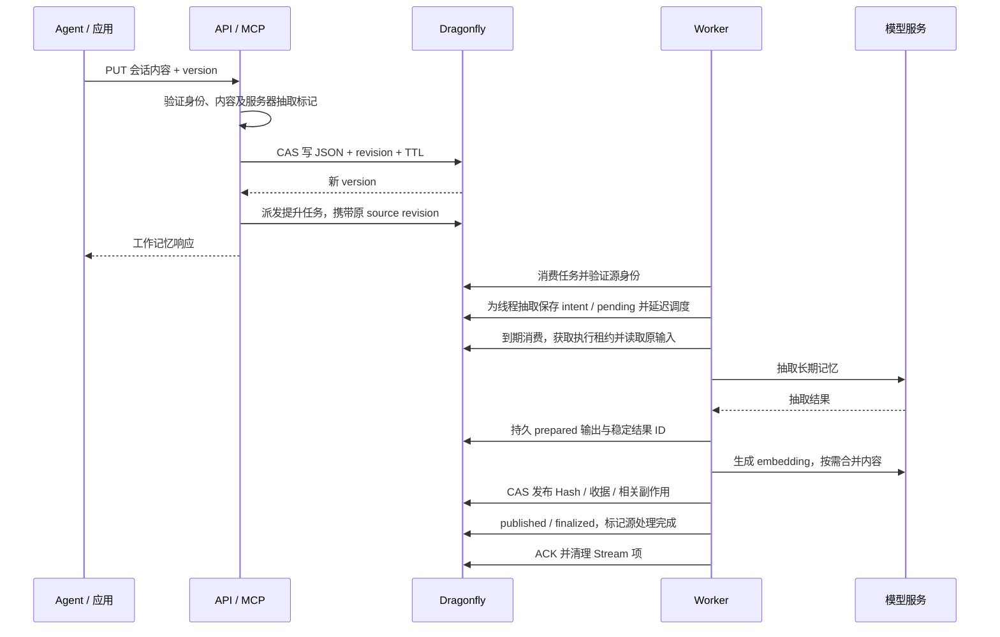

# AMS 架构

[概览](README.md) · [当前状态](current-status.md) · [运行合同](compatibility.md)

本文描述同级 `agent-memory-server/V0` 在当前工作区中的架构，更新于 2026-10-01。包含 AMS 原有设计和本次 Dragonfly 适配后的实现；具体区分见第 8 节。历史调研基线保留在[实施报告](implementation-report.md)。

AMS（Agent Memory Server）是独立的 Python 记忆服务：接收会话内容，调用模型生成或整理记忆，将其保存到数据库，再为应用提供召回和上下文组装。Dragonfly 承担数据、索引、原子操作及队列存储，生成模型和 embedding 模型通过 AMS 调用。

## 1. 总体结构与进程



API、MCP 和 worker 可以是独立进程，共享数据库、队列名称、索引定义与模型配置。图中的队列和记忆存储使用同一个 Dragonfly 实例。CLI 提供启动、任务恢复、迁移与维护入口。

`HybridBackgroundTasks` 提供两种执行方式：

| 方式 | 执行位置 | 使用边界 |
| --- | --- | --- |
| Docket | 请求进程入队，独立 worker 执行 | 持久队列、延迟任务、重复交付及进程接管 |
| asyncio | 请求进程内的 event loop | 便于开发；不承诺进程退出后的任务恢复 |

AMS 的 Python 异步运行时与 Dragonfly 的 C++ fiber/shard 是两个独立系统，模型调用在 AMS 进程中执行。

## 2. 模块职责

以下链接指向同级 AMS 当前源码。

| 层 | 主要模块 | 职责 |
| --- | --- | --- |
| 接入与启动 | [main.py](../../../agent-memory-server/V0/agent_memory_server/main.py)、[api.py](../../../agent-memory-server/V0/agent_memory_server/api.py)、[mcp.py](../../../agent-memory-server/V0/agent_memory_server/mcp.py) | 生命周期、REST 路由、MCP 工具；工作记忆写入共用 `put_working_memory_core`，其他入口调用共同业务模块 |
| 身份与配置 | [auth.py](../../../agent-memory-server/V0/agent_memory_server/auth.py)、[config.py](../../../agent-memory-server/V0/agent_memory_server/config.py) | 身份解析、owner 绑定、模型/存储/队列配置 |
| 数据模型 | [models.py](../../../agent-memory-server/V0/agent_memory_server/models.py) | WorkingMemory、MemoryRecord、SummaryView、Task 与请求校验 |
| 工作记忆 | [working_memory.py](../../../agent-memory-server/V0/agent_memory_server/working_memory.py)、[working_memory_index.py](../../../agent-memory-server/V0/agent_memory_server/working_memory_index.py) | 会话 JSON、revision、incarnation、TTL、会话枚举和旧格式迁移 |
| 长期记忆编排 | [long_term_memory.py](../../../agent-memory-server/V0/agent_memory_server/long_term_memory.py) | 提升、线程抽取、去重/合并、结构补充、访问统计、压缩、遗忘及恢复派发 |
| 抽取与模型 | [extraction.py](../../../agent-memory-server/V0/agent_memory_server/extraction.py)、[llm/](../../../agent-memory-server/V0/agent_memory_server/llm/) | 抽取策略、主题/实体抽取、统一生成与 embedding 调用；可选本地 BERTopic/NER 路径 |
| 存储与查询 | [memory_vector_db.py](../../../agent-memory-server/V0/agent_memory_server/memory_vector_db.py)、[memory_vector_db_factory.py](../../../agent-memory-server/V0/agent_memory_server/memory_vector_db_factory.py) | `MemoryVectorDatabase` 抽象、默认 RedisVL 实现、schema、向量编码和查询 |
| 后台执行 | [dependencies.py](../../../agent-memory-server/V0/agent_memory_server/dependencies.py)、[docket_tasks.py](../../../agent-memory-server/V0/agent_memory_server/docket_tasks.py)、[bounded_docket.py](../../../agent-memory-server/V0/agent_memory_server/bounded_docket.py)、[docket_worker.py](../../../agent-memory-server/V0/agent_memory_server/docket_worker.py) | 后台任务入口、任务注册、队列准入、调度及 worker 生命周期 |
| 摘要与任务 | [summary_views.py](../../../agent-memory-server/V0/agent_memory_server/summary_views.py)、[tasks.py](../../../agent-memory-server/V0/agent_memory_server/tasks.py)、[summary_task_dispatch.py](../../../agent-memory-server/V0/agent_memory_server/summary_task_dispatch.py) | 摘要视图、分组物化结果、用户可查询任务、持久派发与取消 |
| 运维与维护 | [operations.py](../../../agent-memory-server/V0/agent_memory_server/operations.py)、[readiness.py](../../../agent-memory-server/V0/agent_memory_server/readiness.py)、[cli.py](../../../agent-memory-server/V0/agent_memory_server/cli.py) | 指标、启动就绪、worker/服务启动、恢复与迁移命令 |

provider 工厂允许替换长期记忆后端，但工作记忆、Docket、摘要与恢复元数据仍直接依赖 Redis 命令。替换 `MemoryVectorDatabase` 不等于整个 AMS 已脱离 Redis/Dragonfly。

## 3. 数据模型与数据库结构

工作记忆是会话当前状态；长期记忆是可跨会话召回的独立记录。二者通过抽取/提升建立关系，生命周期分别管理。

| 数据 | 实际结构 | 主要内容与作用 |
| --- | --- | --- |
| 工作记忆 | RedisJSON，`working_memory:v2:<namespace>:<user>:<session>` | messages、memories、context、data、tokens、策略、时间、version 和内部 incarnation；可设置整键 TTL |
| 会话目录 | JSON 搜索索引，默认 `working_memory_idx` | 身份 TAG、创建/更新时间 NUMERIC；过期会话随索引消失 |
| 长期记忆 | Hash，默认 `memory_idx:v2:<encoded identity>` | 正文、二进制 vector、类型、标签、来源、metadata、时间、访问统计、pinned、内部 publication generation |
| 长期检索 | Hash 搜索索引，默认 `memory_records` | TEXT 关键词、TAG 过滤、NUMERIC 时间/统计、VECTOR 相似度 |
| 防旧写入元数据 | String 等独立键 | 工作 revision、四级删除 generation；位于业务索引前缀之外 |
| 发布恢复记录 | String 中的 JSON 等 | prepared 输出、逐记录收据、语义合并计划和 durable outbox |
| AMS Task | String 中的 JSON，`task:<scoped id>` | 用户可查询的摘要运行状态、owner、task/view generation 和 Docket key |
| 摘要视图 | String 中的 JSON + Set 目录 | 配置、view generation、各 partition 的物化摘要；结果按 generation 区分 |
| Docket | Stream + consumer group、ZSet、Hash、结果 String | 待消费任务/PEL、延迟队列/载荷、runs/progress、执行结果与 worker 元数据 |

工作键组件采用固定位置和转义编码；长期键由 `[namespace, user_id, logical_id]` 编码，因此同一个业务 ID 可以在不同 owner 下存在。具体生成规则见 [utils/keys.py](../../../agent-memory-server/V0/agent_memory_server/utils/keys.py)。

messages/memories 是工作记忆 JSON 内的数组。topics/entities 是 Hash 中编码后的标签字段；两者分别不是独立 Redis List 或 Set。搜索索引是业务数据的检索结构，不能用索引替代正文备份。

长期向量按实际 schema 的 datatype 与维度编码；默认工厂使用 float32，维度来自模型配置或显式设置。provider 校验维度和有限数值，支持已验收的 float32/float64 schema。模型、维度与版本必须和索引合同一致。

## 4. 主要数据流

### 4.1 写入工作记忆并生成长期记忆



这是启用 Docket 和线程抽取时的代表性路径。结构化 `WorkingMemory.memories` 可以直接提升；消息线程使用尾沿防抖，将未抽取消息和 context 作为输入。直接创建长期记忆则从长期写入入口开始，不必先创建会话。

每个阶段是独立操作，整条流程不是跨模型服务的数据库事务。请求成功保存会话，也不代表抽取和 embedding 已完成。具体抽取/发布阶段用持久记录恢复，源标记由服务器维护。

### 4.2 召回与上下文组装

1. 验证身份，将 namespace/user 过滤条件绑定到已认证 owner。
2. 语义检索生成查询向量，执行 KNN 或 VECTOR_RANGE；关键词检索使用 TEXT；混合检索组合文本与向量分支。
3. 可选 recency 重排综合相似度和时间衰减，AMS 生成查询，Dragonfly 计算聚合表达式。
4. 解码记录、核对作用域，返回 ID、正文和评分；访问统计任务携带此次查询的原快照。
5. `memory_prompt` 将工作记忆、长期召回与系统指令按上下文预算组装，供调用方使用。

recency 是有界候选池内的排序，不能据此承诺全库最优排序或跨请求快照分页。查询和数据库评分合同见[运行方式](compatibility.md)。

### 4.3 摘要与遗忘

工作记忆摘要在上下文预算需要时压缩历史到 context。未完成发布的消息受到保护，避免提前摘要破坏恢复输入。摘要视图则按配置检索长期记忆，分组生成并保存物化摘要；全量刷新裁剪消失的分组，配置删除清理对应结果。

遗忘策略按年龄、不活跃时间及预算选择候选，保护 pinned 和作用域。实际删除再次核对查询原快照与 generation，只统计真正删除的对象。会话 TTL 和长期记忆遗忘分别作用于不同数据，删除会话不意味着所有长期记录自动删除。

## 5. 后台任务、状态和故障恢复

Docket 承担执行状态，AMS Task 承担用户可查询的业务状态。当前 `TaskTypeEnum` 主要用于摘要全量运行，并非每个抽取、统计任务都对应一个 `/v1/tasks` 记录。

AMS Task 状态为 `PENDING → RUNNING → SUCCESS/FAILED/CANCELLED`；PENDING 也可直接失败或取消。终态不重开。Docket 的 runs、generation、结果、PEL 与 AMS Task 分开保存，验收需要分别核对。

恢复机制各自解决不同阶段的问题：

| 机制 | 作用 |
| --- | --- |
| durable outbox | 保存待派发 intent；extraction、structure、summary、task_cancel 四类，由启动/周期/手动 reconciliation 重派 |
| 稳定 Docket key | 即时派发和恢复派发指向同一工作身份，减少重复入队 |
| prepared 输出与逐记录收据 | 已持久输出按原结果重放；部分发布和响应丢失后跳过已完成部分 |
| 模型执行租约 | 默认 30 秒租约、10 秒续租；丢 owner 后取消，结果保存检查 owner |
| 原查询快照与 generation CAS | 模型运行或任务等待期间发生删除/替换时，拒绝旧结果与旧副作用 |
| Stream PEL / XAUTOCLAIM | worker 中断后重新交付尚未 ACK 的任务，由业务幂等机制处理 |
| 持久取消 intent | 先 fence AMS 任务状态，再发送 Docket 取消信号；信号失败保留恢复输入 |

四级删除 generation 分别覆盖精确 owner、namespace、user 和全局选择器。晚到任务携带原 generation，不能在执行时重新绑定当前 generation 来绕过删除。

这是一套重复交付下的恢复设计，不承诺外部模型调用 exactly-once。线程模型准备最多自动尝试三次；发布失败保留 prepared/收据/pending。Docket 终态 FAILED 后需要按原身份和载荷显式重投，reconciliation 不自动扫描此类失败 thread pending。

## 6. 隔离、容量与保留规则

启用认证时，namespace 和用户由已验证身份决定；请求过滤条件只能收窄允许范围。HTTP/SSE MCP session 绑定 owner；STDIO 要求显式服务身份。开发 disabled 认证不作为生产租户隔离。旧无 owner 或无版本载荷拒绝执行，迁移必须显式证明来源。

| 控制 | 当前规则 |
| --- | --- |
| 工作 JSON | 默认编码后最多 1MiB；版本冲突拒绝覆盖 |
| 向量写入 | 单次批量默认最多 100 条，模型/发布前拒绝超限 |
| Docket 容量 | `ZCARD(queue)+XLEN(stream)` 原子上限默认 64，包含活跃 Stream 项 |
| 到期调度 | 每轮最多 64，默认间隔 250ms |
| active AMS Task / pending | 不设置 TTL，保留恢复所需状态 |
| terminal AMS Task | 保留七天 |
| revision / generation / 业务收据 | 当前永久保留；没有自动安全 GC |

队列上限不限制 outbox 和永久保护记录的总量。`GET /v1/operations` 以显式 operations 角色提供聚合指标、索引就绪、Lua/重投/容量故障和错误窗口告警，详见[运维说明](operations.md)。

## 7. 部署、索引合同与维护

推荐理解为三个服务入口和一个共享存储：

```text
agent-memory api --task-backend docket
agent-memory mcp --mode streamable-http --task-backend docket
agent-memory task-worker
```

API、MCP、worker 启动均检查长期索引实际 schema 和持久 model/version 合同。启动检查不是模型服务可用性测试；凭据由实际模型调用验证。当前验证范围为 Linux 单实例多 shard，不将这一结论外推为 Redis Cluster 支持。

Dragonfly 保留 Lua 原子性，仅定向允许已审计 bounded scheduler 的动态键 SHA。升级依赖后重新审计脚本，不全局关闭原子模式。

同布局的索引定义重建可以保留原 Hash/向量。模型、维度或布局变化走重新 embedding 迁移，保存原字节和 journal，支持显式恢复与回滚。维护须停止 API/MCP/worker 并排空已开始请求；维护 owner 只阻止新入口，不自动排空请求。细节见[模型迁移](embedding-migration.md)、[租户迁移](tenant-migration.md)和[发布与回滚](release-compatibility.md)。

数据库持久化和复制承载业务数据及队列，已验证的范围是原生 SAVE 恢复与同步单副本显式提升；自动 failover、未同步零丢失与 Cluster 不在当前声明内，见[持久化验收](persistence.md)。

## 8. 原有架构与本次适配的区别

| 范围 | AMS 原有设计 | 当前适配后的变化 |
| --- | --- | --- |
| 分层 | REST/MCP、工作/长期记忆、模型调用、RedisVL、Docket | 继续沿用原分层，无数据库内模型执行引擎 |
| 查询 | 向量/文本/混合与 recency | 修正锁定 SDK 的查询合同、参数、评分和分页 |
| 工作状态 | JSON 会话与 TTL | 增加原子 revision/incarnation/TTL、并发冲突与输入限制 |
| 身份 | 认证与作用域字段 | 强制 owner 绑定、scoped 键、历史无 owner 数据显式迁移 |
| 后台一致性 | Docket 交付业务任务 | 增加原版本载荷、outbox、prepared/收据、lease fencing、删除保护与恢复协议 |
| 运维 | 服务/worker/维护 CLI | 增加硬队列容量、有界调度、运维指标、模型/索引迁移和回滚 |
| Dragonfly | 现有 JSON/Hash/搜索/Stream/Lua/复制能力 | 新增 max/pow/coalesce 评分函数；其余主要是应用适配与验收 |

当前兼容性和确定性业务链路已验收，真实生成/embedding 服务及最终端到端门槛仍未完成。最新证据统一见[当前状态](current-status.md)，本文不替代验收记录。
