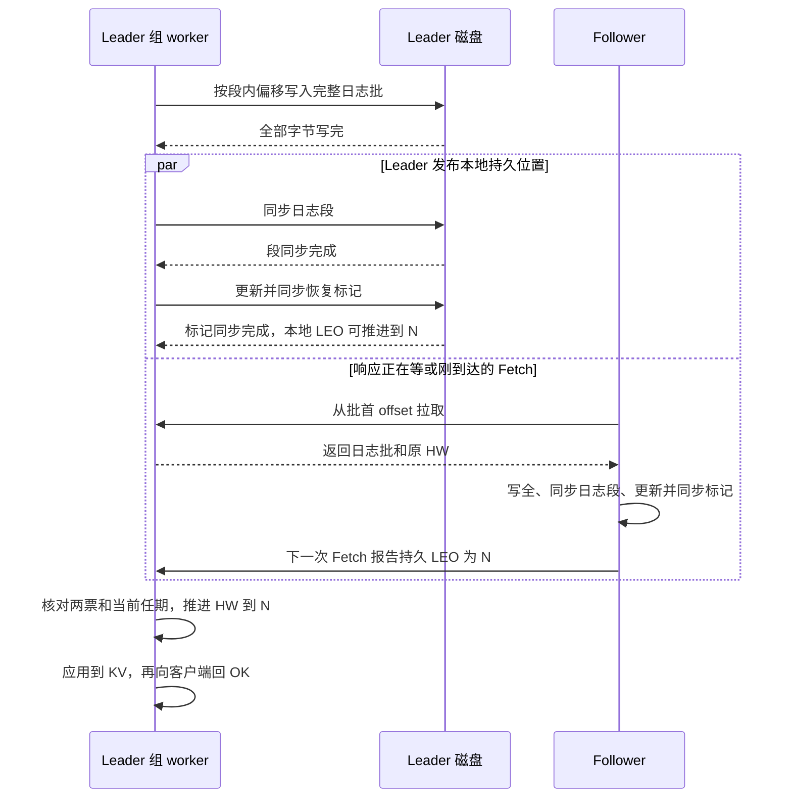

# Linux 下用 io_uring 优化 Raft 数据组刷盘

**先验证 leader 等磁盘时能否继续处理 Fetch，让 follower 提前开始落盘。** 这个改动有机会缩短单笔写入从追加到多数提交的时间。并发写入还有另一项收益可测：让同一轮已经就绪的多个批次共享刷盘。两项试验都沿用现有 Kafka 日志批、DFE4 恢复标记和 Fetch 协议。

## 试验实现（默认关闭）

Linux 数据组现在提供两个独立开关，便于用同一个二进制比较：

| 开关 | 行为 |
| --- | --- |
| `--raft_async_io` | 同段、DFE4 标记窗口内的普通数据追加使用 io_uring，编译时选择 Helio 或 Folly 实现。WRITE、段 FSYNC、标记 FSYNC 分别检查完成结果，短写补写，两个 FSYNC 均使用 `flags=0`。网络仍可使用 epoll。 |
| `--raft_drain_writes` | worker 可接受下一轮追加时，从就绪 SET 队列取最多 32 笔；积压不足 4 MiB 时每轮约 1 MiB，达到 4 MiB 时每轮约 4 MiB，不主动等满。条件 SET 单独执行；RESP V2 的普通 SET 可按序提前提交，见下节。队列最多 256 笔、8 MiB，满时让提交 fiber 等待；单笔超过字节预算的合法请求仅在队列为空时进入。 |

每组只有一轮追加在途。批次字节和文件描述符保留至完成；`End()` 始终返回已经完成两次同步的 LEO。已写全的尾部可响应新到达的合法 Fetch；follower 提前报告未在本地发布的位置时，该 RPC 等本地发布后重新校验。其他 worker 操作先等在途追加排空，因此换主、截断、快照安装和关闭不能复用正在写的文件。完成回调也核对 leader 角色和任期，失败则封锁存储确认。

换段、超出 DFE4 窗口、控制批及 follower 追加继续走同步路径。drain 遇到不能装入当前段的一轮也回到同步换段路径。队列预算不含已经交给 I/O 的一轮及连接自身的请求缓冲。非 Linux 后端保留同步追加；本次未试验 SQE 链接、`fdatasync`、直接 I/O 或预分配。

### 同连接 SET 提交与确认解耦（本轮）

`raft_drain_writes=true` 时，RESP V2 的普通 `SET key value` 使用非等待入队接口，
后续 SET 无须等前一笔确认。入队顺序决定日志顺序，同 key 也可连续提交。
每个请求持有自己的 key/value 和完成状态；连接断开只释放回复，不取消已入队写入。
完成 fiber 继续等待多数持久化及 leader 应用，连接只按原命令顺序发送回复，
并在回复时更新本连接的 `raft_last_write`。GET、WAIT、NX/XX、SELECT、RESET、鉴权等
命令只能在队首执行，保留读己之写和条件求值顺序。

异步票据按数据组限制为 256 笔 / 8 MiB，预算包含等待确认及等待发送回复的票据。
队列满或入队锁竞争时，非队首命令返回 WOULD_BLOCK 且没有入队副作用；
成为队首后可使用原来的等待入队路径。连接解析缓冲继续使用 facade 自身的反压。
V1 及关闭 drain 时保留串行行为；文件 I/O 仍使用原来的 Folly 分支，未改变确认边界。

本轮回归直接暂停 follower，确认同连接 64 笔全部进入 leader 日志且客户端没有 OK，
再恢复 follower 检查回复；旧二进制不能满足提前提交断言。Debug/Release 分发单测、
真实集群断连、同 key、条件写、WAIT、DB 切换、窗口饱和、超限请求、崩溃恢复和关机
回归通过；新增三个集群用例另在 ASAN+UBSAN（开启泄漏检查）下通过。

未插桩旧/新 Release 和原 cluster 共 27 轮配对测试：单连接 pipeline 64 的复制确认吞吐
中位数由 81.48 增至 163.75 MiB/s（2.01 倍），批次 P95 降低 49.4%。单连接逐笔吞吐
回退 9.5%；64 连接 SET 返回窗口吞吐回退 7.6%，需继续减少提交与完成调度开销。
原 cluster 相同 pipeline 负载为 613.00 MiB/s。完整口径、范围、回退及数据见
[复制 benchmark](replication-benchmark.md#本轮同连接-set-已能提前提交)。

最新逐档 pipeline 64 实测见 [复制 benchmark](replication-benchmark.md#最新结论pipeline-64-逐档测试8-连接停止)：
最新 Raft 在 1/2/4/8 连接下的副本确认吞吐为 166.75/178.51/189.51/186.90 MiB/s。
4→8 无收益且批次 P95 增长，已停止更高连接数测试。当前只确认提前提交有效，
队首容量回退、票据释放、WAL 排空与应用等待的实际占比尚待 trace/火焰图分析。

### Folly 编译变体

backend 仍为 io_uring。CMake 的 `WITH_RAFT_FOLLY` 生成 `raft_io_config.h` 中的 `DFLY_RAFT_USE_FOLLY` 宏：`0` 编译原 Helio 分支，`1` 编译 Folly 分支；没有运行时库选择参数。`--raft_async_io` 和 `--raft_drain_writes` 的作用不变。Folly 仅链接到 Raft transport 的文件 I/O 适配库，不替换 Redis/Raft 网络栈。[宏模板](../../src/server/cluster/raft/storage/io_config.h.in) · [Folly 适配](../../src/server/cluster/raft/storage/folly_io.cc)

Folly 分支使用 `ScopedEventBaseThread` 和 `IoUringBackend::queueWrite/queueFsync`，提交、CQE 回调和重试均在 Folly EventBase 中运行，不经 Helio proactor、fiber 或等待器。完成回调只尝试把结果投递给原 Raft worker；队列满时在后续 Folly 循环重试投递，不重复 I/O。组关闭先等追加及两次同步排空，再停止 Folly 线程，最后销毁 worker。与原实现一样，每组一轮追加在途，短写补写和持久水位发布由同一 `PartitionLog` 状态机处理。

本次使用同级 Folly `b20004566`，liburing 从 2.13 升级到 2.15，两个实现使用相同 liburing 版本。保留 Folly 默认调度选项，CQ capacity 256、maxSubmit 128（默认 SQ 256），不启用 SQPOLL、DEFER_TASKRUN 或请求等待合批。Folly 源码不打兼容补丁。liburing 下载固定 tag 和 SHA-256；升级位于 Helio 子模块的依赖声明中。

首次从源码配置 Folly 前，先构建新版 liburing，供 Folly 的头文件探测使用：

```bash
./helio/blaze.sh -release -DWITH_GCP=OFF -DWITH_SEARCH=OFF -DWITH_TIERING=OFF \
  -DWITH_GPERF=OFF -DWITH_RAFT_FOLLY=OFF
ninja -C build-opt uring_project
./helio/blaze.sh -release -DWITH_GCP=OFF -DWITH_SEARCH=OFF -DWITH_TIERING=OFF \
  -DWITH_GPERF=OFF -DWITH_RAFT_FOLLY=ON -DRAFT_FOLLY_SOURCE_DIR="$PWD/../folly" \
  -DLIBURING_INCLUDE_DIR="$PWD/build-opt/third_party/libs/uring/include" \
  -DLIBURING_LIBRARY="$PWD/build-opt/third_party/libs/uring/lib/liburing.a"
ninja -C build-opt dragonfly raft_storage folly_io_test partition_log_test fetch_replication_test
./build-opt/folly_io_test
./build-opt/partition_log_test
./build-opt/fetch_replication_test
```

也可省略 `RAFT_FOLLY_SOURCE_DIR`，通过 `CMAKE_PREFIX_PATH` 指向已经构建并安装的 Folly。关闭 `WITH_RAFT_FOLLY` 后重新构建即可恢复 Helio 实现。分别保留两个构建目录中的 `dragonfly` 和 `raft_storage`，使用[对照脚本](../../tests/integration/raft_commit_benchmark/dragonfly/library_compare.py)在真实磁盘目录轮换测试：

```bash
python3 tests/integration/raft_commit_benchmark/dragonfly/library_compare.py \
  --helio-build /path/to/helio-build --folly-build /path/to/folly-build \
  --output-dir "$PWD/folly-comparison"
```

脚本固定 1 / 8 连接、64 MiB、32 笔预热、5 秒静置，两种实现都开启异步追加和 drain。各跑三轮，每轮交换先后顺序，保留二进制哈希、逐轮日志和 CSV；每轮都重启离线 voter 并核对全部 288 个值。故障探针也支持 Folly，`probe.py prepare --faults` 会单独插桩 `folly_io.cc`，不将测量及延迟代码编入正式二进制。

Folly + liburing 2.15 已通过 Debug / Release 的 37 项单测（新增 2 项真实 Folly 文件 I/O 和完成队列重试测试，原有 18 项日志与 17 项 Fetch 测试），两种构建的 `uring_file_test` 也通过。新增 2 项 Folly 适配器测试另在 ASAN+UBSAN 下通过，Debug 的 `fiber_socket_test` 通过。真实集群验证了两票组、条件写与 WAIT、整集群崩溃恢复、成员提升与换主、快照追赶、在线多数及失去多数。延迟 leader 段同步和标记同步时，重启的 follower 可先持久化，客户端仍等待 leader；在途 I/O 下 SIGTERM 等排空后成功退出。

#### 同版 liburing 2.15 的实测对照

在 `172.31.23.2` 的 i7-13700KF / WD_BLACK SN770 上运行上述脚本，日志实际位于 ext4；网络均为 epoll、每个数据节点 2 个网络线程。使用未插桩 Release 二进制，三票组停掉第三票后测量在线多数写入。共 12 轮，每轮恢复后均读回全部 288 个值。下表各列取三轮中位数；[逐轮 CSV](benchmarks/folly-io-uring-ubuntu-20261123.csv) · [环境、依赖版本及二进制哈希](benchmarks/folly-io-uring-ubuntu-20261123.environment.json)。

| 连接数 | io_uring 实现 | 写入耗时 ms | MiB/s | SET P50 ms | SET P95 ms | 重启至 WAIT 2 ms |
| --- | --- | ---: | ---: | ---: | ---: | ---: |
| 1 | Helio | 936.48 | 68.34 | 3.37 | 4.23 | 602.86 |
| 1 | Folly | 865.85 | 73.92 | 3.17 | 4.25 | 603.06 |
| 8 | Helio | 381.93 | 167.57 | 11.52 | 14.81 | 501.91 |
| 8 | Folly | 390.56 | 163.87 | 10.75 | 15.58 | 603.57 |

Folly 单连接吞吐中位数提高 8.2%，P95 基本持平（增加 0.5%）；8 连接吞吐下降 2.2%，P95 增加 5.2%。三轮吞吐范围明显重叠：单连接 Helio / Folly 分别为 63.98–72.35 / 64.51–76.38 MiB/s，8 连接分别为 154.75–181.78 / 156.15–175.87 MiB/s。样本较少，尚不能判定 Folly 存在稳定的整体性能优势，`WITH_RAFT_FOLLY` 保持默认关闭。

这是相同持久化协议下两种适配及其调度策略的整体对照，不能单独归因于库本身：例如本机 Helio 启用 DEFER_TASKRUN，而 Folly 保持默认关闭。吞吐以 64 MiB 客户端有效负载除以写入耗时；重启至 WAIT 2 包含进程启动、追赶和客户端轮询，不是纯磁盘恢复耗时。当前以在线副本确认完成为终点的对照见 [复制 benchmark](replication-benchmark.md#本轮同连接-set-已能提前提交)。完整日志和二进制保留在远端 `~/workspace/db/dragonfly-io-uring-20261123/results-folly/`。

### Folly 压测源码审查与后续试验

以下审查基于同级 Folly `b20004566`，是源码结论，不是本机新跑出的性能数据。Raft 允许多个日志批共享同步；每组仅一轮追加在途、drain 最多 32 笔和约 1 MiB 都是当前实现的限制，不是协议要求。ring 有 256 个槽位也不意味着业务有 256 个 I/O 在途。

| 例子 | 实际负载和可借鉴之处 | 与当前 WAL 的区别 |
| --- | --- | --- |
| [IOBenchmark](../../../folly/folly/io/async/test/IOBenchmark.cpp) | 1024 次 4 KiB 读取，提交批量 1/64/256，比较 ring 复用及固定缓冲区 | 优先 O_DIRECT，失败回退；没有写入同步。持久实例分支即使不使用固定缓冲区读，也会先注册缓冲区，不能把结果当作纯注册成本对照 |
| [IoUringBackendBench](../../../folly/folly/io/async/test/IoUringBackendBench.cpp) | 1/16/64/128/256 个 eventfd，持久或重新注册事件，跨线程 refill | 测事件循环和唤醒，不测磁盘；源码中的历史数字不能当成本机性能 |
| [RegisteredFdBenchmark](../../../folly/folly/io/async/test/RegisteredFdBenchmark.cpp) | 注册 FD 与普通 FD 的事件通知开销，包含非持久事件对照 | 本版本将 bool 传给表示槽位数量的 `setUseRegisteredFds(uint32_t)`，true 只有 1 个槽位，不能视为 64/128 个 FD 全注册。当前文件 `queueWrite` 使用普通 FD；仅开启注册配置不会自动改变文件写操作 |
| [ProvidedBufferRingBenchmark](../../../folly/folly/io/async/test/IoUringProvidedBufferRingBenchmark.cpp) | 64 B/4 KiB/64 KiB 缓冲，批量 1/8/32/128，链长 2/4/8/16，2/4/8 线程归还及增量切片 | 预热并触页后测缓冲区获取/消费/回收，不是 WAL 或网络端到端吞吐 |
| [FileWriteMany / FileReadMany](../../../folly/folly/io/async/test/IoUringBackendTest.cpp) | 排入 8192 × 4 KiB，CQ 256，maxSubmit/maxGet 32；全部写完成后一次 fdatasync，另测 2 MiB 写后 fsync | 展示超出 ring 容量的用户态排队与同步摊销。Raft 可以采用，但还需恢复标记同步和多数确认 |
| 同文件的 FileReadWrite / FileReadvWritev | 512 条写→读链，回调直接排下一步；向量写每次 4 × 4 KiB | 可借鉴同线程衔接和减少拼接复制；写完成后读回不等同于崩溃恢复验证 |
| [IoUringTest / AsyncBaseTestLib](../../../folly/folly/io/async/test/AsyncBaseTestLib.h) | 1000 次串行/并发/多线程/有界排队读取；1024 次批量读取；注册缓冲读写 | 区分请求排队量、提交批量和实际在途深度，避免把三者混用 |
| [SimpleAsyncIOTest](../../../folly/folly/io/async/test/SimpleAsyncIOTest.cpp) | 1000 条写→读链、100 次待完成写的析构排空、8 线程各创建 250 个实例 | 生命周期和完成通知压力验证，可作为适配器回归设计参考 |
| [RingStats](../../../folly/folly/io/async/test/IoUringRingStatsTest.cpp)、EventFDOverflow | SQ 满、强制提交、CQ 峰值/溢出；容量 64 承接 2048 个 eventfd | 为调参提供利用率证据；应先测是否真的填满队列，再增大 ring |
| [动态缓冲池压力测试](../../../folly/folly/io/async/test/IoUringDynamicProvidedBufferRingTest.cpp)、[大包 socket 测试](../../../folly/folly/io/async/test/AsyncIoUringSocketBigBufferTest.cpp) | 多线程归还与销毁竞争，缓冲耗尽/扩缩容，1 MB echo | 适用于未来共享缓冲或网络改造，不直接证明 WAL 能更快 |

文件负载的 [TempFileUtil](../../../folly/folly/io/async/test/IoTestTempFileUtil.cpp) 会预先写满随机数据并 fdatasync，再测覆盖读写，因此避开了首次扩展成本；这不等于已经测过 `fallocate` 的收益。当前 Raft 的 SQ/CQ 已在初始化时分配，WAL 没有物理空间预分配，也未使用固定写缓冲。

有意义的尝试按下面顺序分开验证，未测项不作为已实现功能或性能结论：

| 顺序 | 试验 | 假设及验收重点 |
| --- | --- | --- |
| 1 | 扩大就绪 drain：1 → 4 → 8 MiB，仍最多 32 笔 | 不主动等满；观察每轮日志批数、两端同步次数、吞吐、P95 和 8 MiB 队列反压。保留单连接回归，并以 64 连接提供足够排队负载 |
| 2 | 配对扩大 Fetch：1 → 4 → 8 MiB | 当前 `kMaxFetchBytes=1 MiB`，只扩大 leader 批次可能仍被 follower 分批同步限制。先测仅 drain，再测 drain+Fetch，区分贡献；核对 follower 提前取数、任期变化和恢复 |
| 3 | Folly 同线程执行纯 I/O 依赖，减少 worker 往返 | 保留 worker 对可读尾部、任期和持久位置的所有权；独立测 CQE→下一次提交间隔，不能用更少通知掩盖 Fetch 发布延迟 |
| 4 | 共享 payload / writev、缓冲复用 | 减少序列化后的重复复制与分配；校验短写、iovec 生命周期和内存峰值。连续大块写不必为了填 SQ 拆成许多小写 |
| 5 | 多组共享 Folly EventBase，多批 WRITE 在途 | 独立偏移并行写，跟踪连续写全边界后共享同步；覆盖乱序完成、局部失败、换段和关闭排空。每组有界反压，防止大组饿死小组 |
| 6 | WAL `fallocate(FALLOC_FL_KEEP_SIZE)` | 提前分配块而不改变逻辑长度；单独比较新建/换段和稳态，计入预分配成本。保留 DFE4 长度编码，ext4 未写入 extent 转换和两次同步成本仍存在 |
| 7 | DEFER_TASKRUN、固定缓冲/文件、SQPOLL | 分别对照吞吐、CPU、低负载延迟及关闭线程约束；固定缓冲/文件需要实际对应的操作 API，不能只改选项 |

筛选阶段只调整测试二进制中的 drain / Fetch 常量，保留每组单轮追加模型及两次 FSYNC。使用 Folly + liburing 2.15、相同插桩、真实 ext4、256 KiB SET；比较 `(drain MiB, Fetch MiB)=(1,1),(4,1),(4,4),(8,8)`。每组固定 128 MiB、64 笔预热、5 秒静置，1/8/64 连接各三轮，轮换四种变体顺序。每轮重启离线 voter 并校验所有值，保存逐轮 CSV、源码变换、二进制哈希及 I/O trace。单连接每次仅一笔在途，预期无法展示合批收益；8 连接最多约 2 MiB 未完成负载，64 连接用于压力验证。测试超段或 DFE4 窗口时仍走原同步回退，因此统计实际同步次数，不按配置推算收益。

复现入口为 [drain_compare.py](../../tests/integration/raft_commit_benchmark/dragonfly/drain_compare.py)，要求 `build-opt` 已配置 Folly。`probe.py prepare --drain-mib N --fetch-mib N` 只改结果目录里的源码副本并重新链接，保存变换后的源码；仓库源码和正式二进制不受试验参数影响。

```bash
python3 tests/integration/raft_commit_benchmark/dragonfly/drain_compare.py \
  --build-dir build-opt --output-dir "$PWD/folly-drain-comparison"
```

固定 4 MiB drain/Fetch 在 64 连接下改善吞吐及同步摊销，但 8 连接出现吞吐回退，因此实现改为积压驱动的 1/4 MiB drain：读取就绪队列字节数，达到 4 MiB 才扩大当轮预算。普通数据 Fetch 上限为 4 MiB，元数据和快照仍为 1 MiB。这个实现另用未插桩 Release 二进制对照原固定 1/1 MiB 版本，结果见下文；复测负载提高到 256 MiB，1/8/64 连接各三轮，64 笔预热，每轮完整恢复校验。此前各表均保留其原有版本与负载口径，不能视为本次改进后的数字。

#### 固定批次筛选结果（128 MiB，插桩）

36 轮全部成功，每轮重启离线 voter 后读回 64 笔预热和 512 笔测量值。[逐轮 CSV](benchmarks/folly-drain-screening-ubuntu-20261123.csv) · [环境和二进制哈希](benchmarks/folly-drain-screening-ubuntu-20261123.environment.json)。每列取三轮中位数；leader/follower 批数列先计算该轮平均每次追加包含多少日志批，再取三轮中位数。同步列是两个在线节点在测量窗口内的段同步次数之和，同窗口标记同步次数相同。

| 连接数 | drain MiB | Fetch MiB | MiB/s | SET P95 ms | leader 平均批数 | follower 平均批数 | 段同步次数 |
| --- | ---: | ---: | ---: | ---: | ---: | ---: | ---: |
| 1 | 1 | 1 | 81.00 | 3.52 | 1.00 | 1.00 | 1024 |
| 1 | 4 | 1 | 80.61 | 3.63 | 1.00 | 1.00 | 1024 |
| 1 | 4 | 4 | 81.04 | 3.50 | 1.00 | 1.00 | 1024 |
| 1 | 8 | 8 | 80.08 | 3.60 | 1.00 | 1.00 | 1024 |
| 8 | 1 | 1 | 181.62 | 14.11 | 2.02 | 2.18 | 488 |
| 8 | 4 | 1 | 171.80 | 15.45 | 1.91 | 2.16 | 505 |
| 8 | 4 | 4 | 169.21 | 15.63 | 2.02 | 2.32 | 474 |
| 8 | 8 | 8 | 171.66 | 14.43 | 2.06 | 2.27 | 476 |
| 64 | 1 | 1 | 206.64 | 123.06 | 2.98 | 2.99 | 343 |
| 64 | 4 | 1 | 173.33 | 103.31 | 3.30 | 2.98 | 327 |
| 64 | 4 | 4 | 240.46 | 92.64 | 10.67 | 14.22 | 85 |
| 64 | 8 | 8 | 212.24 | 98.84 | 11.91 | 18.96 | 69 |

64 连接的 4/4 MiB 相对 1/1 MiB 吞吐提高 16.4%，P95 下降 24.7%，同步次数减少 75.2%；仅扩大 drain 的 4/1 MiB 没有收益。8/8 MiB 同步更少却吞吐更低，说明最少同步次数不等于最低总成本。8 连接固定 4/4 MiB 吞吐下降 6.8%、P95 增加 10.8%，因此不直接把所有负载都切到固定大批次。单连接始终一笔在途，各组合表现接近。测量仍是短窗口，最终参数以未插桩复测为准。

远端结果在 `results-folly/drain-comparison-validated/`，对应源码副本在 `results-folly/drain-comparison/*/probe/`。初次运行因 runner 漏传 `RAFT_COMMIT_BENCH_VALUES` 在集群初始化失败，修复后重新跑满 36 轮；失败运行没有进入测量，不计入本表。

#### 自适应合批复测

两个未插桩 Release 二进制均使用 Folly / liburing 2.15，开启异步追加和 drain，确认语义相同。每轮 256 MiB（1024 × 256 KiB）、64 笔预热、5 秒静置；同一连接只有一笔 SET 在途。各负载三轮，原版与改进版交替先后顺序。18 轮全部通过恢复校验，每轮重启离线 voter 并读回 1088 个预热及测量值。[逐轮 CSV](benchmarks/folly-drain-adaptive-ubuntu-20261123.csv) · [环境及二进制哈希](benchmarks/folly-drain-adaptive-ubuntu-20261123.environment.json)。

| 连接数 | 版本 | 写入耗时 ms | MiB/s | SET P50 ms | SET P95 ms | 重启至 WAIT 2 ms |
| --- | --- | ---: | ---: | ---: | ---: | ---: |
| 1 | 原固定 1/1 MiB | 3246.55 | 78.85 | 3.11 | 3.67 | 1403.96 |
| 1 | 自适应 drain / 4 MiB Fetch | 3142.02 | 81.48 | 2.98 | 3.49 | 1106.00 |
| 8 | 原固定 1/1 MiB | 1437.68 | 178.06 | 10.66 | 14.67 | 1405.91 |
| 8 | 自适应 drain / 4 MiB Fetch | 1504.01 | 170.21 | 11.22 | 14.86 | 1204.43 |
| 64 | 原固定 1/1 MiB | 1302.95 | 196.48 | 65.35 | 124.02 | 1414.37 |
| 64 | 自适应 drain / 4 MiB Fetch | 1125.05 | 227.55 | 67.04 | 90.33 | 1314.38 |

每列取三轮中位数。64 连接吞吐提高 **15.8%**、P95 下降 **27.2%**；三轮吞吐区间原版 189.49–202.03、改进版 226.67–231.88 MiB/s，区间不重叠。单连接吞吐提高 3.3%、P95 下降 4.9%，但改进版波动较大（76.00–85.82 MiB/s），不能把小幅变化归因于合批。8 连接吞吐下降 **4.4%**、P95 增加 1.3%，因此自适应策略也没有消除低并发代价，不能宣称所有负载都更快。恢复列包含启动和轮询，并同时受更大 Fetch 影响，不是纯刷盘延迟。异步追加及 drain 开关继续默认关闭。

实现改动已通过 Debug / Release 各 37 项日志、Fetch 和 Folly 适配单测；7 项真实集群回归覆盖条件写、WAIT、多数丢失、成员提升、换主、整集群崩溃恢复及快照追赶。额外插桩验证中，8 连接的 leader 最大追加为 786,762 字节，64 连接为 3,933,808 字节，确认大小批次分支实际生效；队列峰值分别为 2,097,228 和 8,126,826 字节，均不超过 8 MiB。每端 trace 都完整覆盖 512 笔测量写。延迟 leader 的段同步、标记同步及在途 I/O 关闭排空再次通过。插桩验证数据仅用于检查分支、反压及顺序，不混入上表。

未插桩复测可使用以下命令；两个目录分别保留对应源码构建出的 `dragonfly` 和 `raft_storage`：

```bash
python3 tests/integration/raft_commit_benchmark/dragonfly/library_compare.py \
  --baseline-build /path/to/original-build --candidate-build /path/to/adaptive-build \
  --labels original adaptive --clients 64 8 1 --mib 256 --warmup 64 \
  --output-dir "$PWD/folly-adaptive-comparison"
```

远端证据位于 `results-folly/drain-adaptive-release-comparison/`、`drain-adaptive-validation/` 和 `drain-adaptive-integration.log`。本次只落地自适应 drain 和数据 Fetch 容量调整；同线程 I/O 衔接、减少复制、多批 WRITE 在途、共享执行器和 WAL 预分配仍为待验证尝试。

### 复现

在日志数据实际落盘的目录内运行，不能把 tmpfs 的结果作为磁盘刷盘结果。新的 runner 记录 `findmnt`，并把测试夹具的 `TMPDIR` 固定在结果目录所在文件系统。插桩仅编译进独立测试二进制，生产路径不写测量文件。

```bash
./helio/blaze.sh -release -DWITH_GCP=OFF -DWITH_SEARCH=OFF -DWITH_TIERING=OFF -DWITH_GPERF=OFF
ninja -C build-opt dragonfly raft_storage partition_log_test fetch_replication_test
./build-opt/partition_log_test
./build-opt/fetch_replication_test
python3 tests/integration/raft_commit_benchmark/dragonfly/probe.py prepare \
  --build-dir build-opt --work-dir "$PWD/io-results"
python3 tests/integration/raft_commit_benchmark/dragonfly/io_run.py "$PWD/io-results"
```

runner 交替运行三组单笔追加探针、三组单连接客户端，以及三组 8 连接的同步 / 异步 / 异步加 drain 对比。每轮预热 32 笔，测量 256 笔 × 256 KiB，第三票离线，完成后重启并逐值核对 288 个值。`summary.json` 包含提交和客户端延迟、两端同步次数、每轮批数及队列峰值。`io-*/<pid>-<tid>.csv` 内存缓冲的时间戳在进程退出时写出；异步同步区间取准备 SQE 前至 CQE 回调，包含提交和内核排队时间，同步区间取 `fsync` 调用前后。

上述命令使用当前源码的合批策略；若要固定为下方历史结果的 1/1 MiB 参数，在 `probe.py prepare` 时显式加 `--drain-mib 1 --fetch-mib 1`。这只控制测试副本，不是服务端运行时参数。

故障测试可用 `probe.py prepare --faults` 另建二进制，设置 `RAFT_IO_FAULT_DIR`、`RAFT_IO_TRACE_DIR`、`RAFT_COMMIT_BENCH_VALUES`、`DRAGONFLY_PATH` 和 `RAFT_TEST_DATA_FLAGS="--raft_async_io --raft_drain_writes"` 后运行 `io_fault_trial.py`。它分别延迟 leader 的段和标记同步，重启 follower 强制使用新 Fetch，验证 follower 已同步而客户端仍未收到 OK。单测另外覆盖短写、零进展、同步错误、任期改变后的完成事件，以及段同步后、标记选择后、标记同步后退出进程再恢复。进程崩溃测试不等同于设备掉电测试。

本轮 35 项分区日志 / Fetch 单测在 Debug、Release 和 ASAN+UBSAN 下通过，另有 24 项快照、成员历史和 voter 变更回归通过。真实集群验证了两票组、条件写与 WAIT、整集群崩溃恢复、成员提升与换主、快照追赶、在线多数及失去多数。另以 64 连接验证 drain 反压和恢复读回，队列峰值 8,126,826 字节，未超过 8 MiB；带在途 I/O 的 SIGTERM 关闭会等待该轮完成后再退出。

## Ubuntu 26.04 NVMe 结果（2026-11-23）

当前原 cluster 与 Folly 异步 Raft 的比较见 [复制确认完成 benchmark](replication-benchmark.md#本轮同连接-set-已能提前提交)。下面只保留历史 Helio 异步追加的独立插桩数据，用于分析 Fetch、刷盘重叠和 drain 摊销，不与当前客户端对照混算。同步 Raft 样本已删除。

主机 `172.31.23.2`，i7-13700KF、Linux 7.0.0-43 x86_64、GCC 15.2 Release，WD_BLACK SN770 1TB，日志目录位于 `/dev/nvme0n1p4` 的 ext4。网络固定 epoll、数据节点 2 个网络线程。每项三轮交替运行，下表各列取三轮中位数；[逐轮结果 CSV](benchmarks/io-uring-ubuntu-20261123.csv)。最初的 `/tmp` 位于 tmpfs，相关调度诊断数字未计入下表。

| 负载 / 模式 | P50 ms | P95 ms | MiB/s | 每千笔段同步 / 标记同步 |
| --- | ---: | ---: | ---: | ---: |
| 进程内追加 → HW，异步 | 3.76 | 4.57 | 49.24 | 2000 / 2000 |
| 单连接 SET，异步 | 2.75 | 3.70 | 85.64 | 2000 / 2000 |
| 8 连接 SET，异步及原合批 | 11.27 | 15.15 | 170.67 | 1078 / 1078 |
| 8 连接 SET，异步及 drain | 10.64 | 14.38 | 180.89 | 980 / 980 |

同步次数为两个在线数据节点合计，分别统计段和标记；单笔在途每千笔各为 2000 次。异步三轮分别有 1、176、202 笔出现两端同步区间交集，交集时间 P50 的三轮中位数为 0.176 ms。数据组 Fetch 入队至处理 P95 的中位数为 1.249 ms。

8 连接下，drain 相比仅启用异步，段和标记的同步次数各下降约 9%，吞吐提高约 6%；drain 排队字节峰值为 2,097,228。进程内探针与客户端测试的计时范围、应用成本和下一笔调度不同，不能把两者延迟直接相减。

这说明新 Fetch 路径和 drain 在本机、该负载下有效，尚不足以作为所有设备默认开启的依据，两个开关保持关闭。没有测量设备掉电，也没有把 tmpfs 的结果外推到 NVMe。

本轮原始 CSV、逐轮恢复日志、二进制及哈希位于远端 `~/workspace/db/dragonfly-io-uring-20261123/results-disk/`；延迟同步及关闭排空证据在 `results-faults/shutdown-trial.log`。原有远端 `~/workspace/db/dragonfly` 未改动。

## 与 Folly 的实现对照（2026-11-23）

下面保留引入 Folly 变体前对同级 Folly `b20004566` 的源码审查，以及原 Helio 路径的 trace 分析。它们不代表 Folly 变体的实测性能；新变体的构建和验证入口见[上文](#folly-编译变体)。

当前 Raft 没有自行创建和维护原生 ring：`group.cc` 使用 Helio `Pool::IOUring`、`GetSubmitEntry`、`PrepWrite`、`PrepFSync`，提交循环和 CQE 回收都在 Helio。Helio 已有批量提交、批量回收和 `DEFER_TASKRUN` 支持；`LinuxFile::WriteAsync`、`FSyncAsync` 也已经封装相同操作。Raft 自己负责的是跨线程适配，以及日志写全、段同步、恢复标记同步和持久位置发布的状态机。[Raft 适配](../../src/server/cluster/raft/runtime/group.cc) · [Helio 事件循环](../../helio/util/fibers/uring_proactor.cc) · [Helio 文件接口](../../helio/util/fibers/uring_file.h)

| 观察点 | Folly | 当前 Raft / Helio 组合 |
| --- | --- | --- |
| 文件 API | `IoUringBackend::queueWrite` / `queueFsync`，结果回调由 backend 事件循环执行 | Raft 直接取 Helio SubmitEntry，每个完成事件新建 fiber，再回到组 worker |
| I/O 实例共享 | `IoUringEventBaseLocal` 支持一个 EventBase 挂一个 backend，多个使用者共享 | 每个数据组创建一个单线程磁盘 pool，另有该组原来的 worker 线程；规模随组数增长 |
| write → fsync 顺序 | 明确要求调用者从 write 完成回调提交 fsync；单纯排队不保证顺序 | 写完成回到 worker，发布可读尾部，再派发段 fsync；段同步完成再次回 worker，更新标记，再派发标记 fsync |
| 批处理 | 将多项 SQE 集中提交；文件 API 不理解 Raft 日志批和提交水位 | Helio 同样可批量提交，但每组仅一轮追加在途；drain 才负责多笔 SET 共享同步 |
| 数据所有权 | `queueWrite` 保存指针和长度，调用者保活缓冲区 | 异步路径先复制到 `FetchReplication` 的共享 payload，再复制到 `PendingAppend::bytes`；命中挂起 Fetch 时还会复制响应数据 |

[Folly 文件 API 与顺序约定](../../../folly/folly/io/async/IoUringBackend.h#L144) · [Folly 回调派发](../../../folly/folly/io/async/IoUringBackend.cpp#L949) · [EventBase 共享](../../../folly/folly/io/async/IoUringEventBaseLocal.cpp) · [当前追加状态机](../../src/server/cluster/raft/log/partition_log.cc) · [当前缓冲区复制](../../src/server/cluster/raft/quorum/fetch_replication.cc)

重新分析已有 `results-disk/client-1-async-{1,2,3}` 插桩 trace，各取正式计时窗口内数据组 10 的 256 笔异步追加，按节点、epoch、旧 LEO 关联相邻事件。下表各列为三轮分位数的中位数，共 768 笔；这次是复算已有数据，不是新的 Folly 性能测试。[逐轮分位数](benchmarks/io-uring-handoff-ubuntu-20261123.csv)

| Leader 路径 | P50 µs | P95 µs |
| --- | ---: | ---: |
| 写 CQE 回调 → 准备段 FSYNC SQE | 76.58 | 138.64 |
| 段 FSYNC CQE 回调 → 准备标记 FSYNC SQE | 15.72 | 30.14 |
| 准备段 FSYNC SQE → CQE 回调 | 529.48 | 703.84 |
| 准备标记 FSYNC SQE → CQE 回调 | 351.42 | 453.85 |

前两项包含 fiber / worker 排队、跨线程通知，以及 Fetch 发布或标记 `ftruncate`，不能全归为线程切换。后两项包含提交调度、内核等待和完成回收，也不是纯设备耗时。这些间隔表明衔接有优化空间，但尚未隔离 Helio 与 Folly 各自的开销；follower 目前仍走同步追加，换 leader 的 I/O 库不会自动改变该路径。

本次 Folly 变体使用 `IoUringBackend`，不是底层 `folly::IoUring::submitOne` 接口。完成结果直接非阻塞投递给 worker，省掉原分支每次完成后的 Helio fiber；依赖顺序、每组单轮追加、日志批复制和 follower 的同步追加保持一致。节点级共享执行器、连续 I/O 减少 worker 往返以及批次共享内存仍可作为后续独立变量测量，不与本轮替换 I/O 库的结果混为一谈。

## 先让 Fetch 与本地刷盘并行

每组由一个 worker 串行修改日志、选举状态和 HW。异步普通数据批写全后，已经挂起及新到达的合法 Fetch 均可提前取到数据和原 HW，无需等待 leader 完成段和标记同步。[组内 Fetch 调度](../../src/server/cluster/raft/runtime/group.cc) · [提前响应及 voter 进度](../../src/server/cluster/raft/quorum/fetch_replication.cc)

下面是已实现的普通异步追加路径。假设稳定的三票配置，第三台离线，普通数据批的排他末端为 N。图中两条落盘路径可以重叠。



第一版每组只允许一轮磁盘追加在途。组 worker 分配 offset，把不可变批次交给文件 I/O 所属的 Helio proactor，随后返回队列处理请求。I/O 完成后由同一组 worker 发布进度。网络和磁盘可各用所属 proactor。网络侧沿用 follower 发起的 Fetch，由 leader 在响应中返回数据，无须为并行刷盘引入 AppendEntries。若后续单测 `SEND_ZC`，发送缓冲区还须等内核的释放通知才可复用。Linux 上已有 `WriteAsync` 和 `FSyncAsync` 可用，其他后端继续走现有同步路径。[Helio 文件接口](../../helio/util/fibers/uring_file.h) · [Raft peer 连接](../../src/server/cluster/raft/transport/peer_connection.cc)

- **可发送与可确认的边界。** 只对已写全的普通数据批开放提前 Fetch。核对组、角色、任期及请求的日志前缀，遵循原有批次大小规则，响应携带原 HW。只有本地段和标记都同步成功，才能发布本地持久日志末端（LEO）。follower 用下一次 Fetch 报告自己的持久 LEO；发送 CQE 只表明本地发送操作完成。
- **处理提前到达的确认。** 若 follower 已报告 N 而 leader 仍在刷盘，暂挂这次进度，待本地发布 N 后按原路径重新校验，避免把 N 误判为分叉或提前推进 HW。沿用当前任期和 voter 集合计算多数，稳定三票中 leader 加一个 follower 即可提交。[多数位置计算](../../src/server/cluster/raft/replication/high_watermark.cc)
- **处理换主与失败。** 在途操作持有批次缓冲和文件资源到完成，回调核对任期、段和写入范围。换主、截断、安装快照或关闭时，先停止该批的提前响应，排空旧 I/O 后才改动或复用文件，过期完成事件不能推进新任期状态。写入或同步失败沿用现有存储错误路径，停止确认。若数据已发出，客户端超时仍可能得到未知结果。[追加失败处理](../../src/server/cluster/raft/quorum/fetch_replication.cc) · [恢复与截断](../../src/server/cluster/raft/log/partition_log.cc)

## 批量提交与 Group Commit

Dragonfly 已有组提交。普通 SET 首笔立即派发，同组在 worker 摘取前到达的请求可以合并，当前上限为 32 笔，按积压自适应选择约 1/4 MiB 键值预算。每笔保留自己的 Kafka RecordBatch 和 offset，多批连续追加，共用一轮段同步和标记同步。条件 SET 单独等前序写入应用后再求值。KRaft 的 `maybeAppendBatches` 在一次 `drain()` 中取走就绪批次，逐批追加后统一调用 `log.flush(false)`。[Dragonfly 合批](../../src/server/cluster/raft/runtime/data_node.cc) · [KRaft drain 与 flush](../../../kafka/raft/src/main/java/org/apache/kafka/raft/KafkaRaftClient.java#L3092)

可借用 KRaft 的做法：上一轮 I/O 在途时收集同组同任期的普通写；上一轮完成后，一次取走已经就绪、能装进当前段和预算的连续批次，写段并把标记发布到该轮末端。用笔数和字节数限制排队内存，达到上限时给提交者反压。空闲时立即发出首笔。单连接逐笔等 OK 时没有第二笔可合并，只有并发负载能检验每千笔刷盘次数是否下降。

任期和投票另存于 `quorum-state`，投票应答前要完成临时文件同步、原子替换和目录同步。第一版仅合并普通数据批；选举持久化、成员变更、条件写及换段继续遵循各自的顺序。[选举状态存储](../../src/server/cluster/raft/storage/file_quorum_state_store.cc) · [DFE4 恢复标记](raft-replication-design.md#日志恢复标记)

## WRITE、FSYNC 与完成顺序

DFE4 同段热路径是 **写全日志段 → 同步日志段 → 用 `ftruncate` 更新标记长度 → 同步标记文件 → 发布 LEO**。换段、超出标记窗口或替换检查点时，还需要同步新文件和目录。只给段文件提交一对 WRITE / FSYNC，只完成了前半段。[追加路径](../../src/server/cluster/raft/log/partition_log.cc) · [标记发布](../../src/server/cluster/raft/log/log_files.cc)

| 做法 | 提交与完成条件 |
| --- | --- |
| 首版用显式回调 | 用明确的文件偏移提交 WRITE，检查完成字节数。短写按实际进度补写剩余部分，无进展或 I/O 错误则结束这一轮。全部写完才允许提前 Fetch，并提交段 FSYNC。段同步成功后执行标记更新和同步。两次同步均先用 `flags=0`，便于与基线对照。 |
| 后续试验链接 SQE | 同一次提交中放入 `WRITE [IOSQE_IO_LINK]` 和紧随其后的 `FSYNC`，可将两个 SQE 合在一次内核提交中。预留两格 SQ 空间，保留两个 CQE，分别检查写入长度和同步结果。短写或链取消后，仅在补全并重新同步成功后发布。若试验 `fdatasync`，将 `IORING_FSYNC_DATASYNC` 放在 **FSYNC SQE** 的 `fsync_flags`。 |
| 跳过成功 CQE | Linux 5.17 起支持 `IOSQE_CQE_SKIP_SUCCESS`，可通过 `IORING_FEAT_CQE_SKIP` 探测。首版保留写完成事件，用它触发提前 Fetch、核对短写并管理缓冲的生命周期。Helio 目前也通过 CQE 回收回调槽。若链中带此标志的操作失败，后续取消项的 CQE 可能同样被省略，清理逻辑不能只等待链尾。 |

Helio 的两个高级异步接口各自申请 SQE，连续调用不会自动建立顺序。使用完成回调或显式链接才能建立写入与刷盘的依赖。[Helio SQE 准备](../../helio/util/fibers/uring_file.cc) · [Linux 链接与完成语义](https://man7.org/linux/man-pages/man2/io_uring_enter.2.html) · [FSYNC 标志](https://man7.org/linux/man-pages/man3/io_uring_prep_fsync.3.html)

## 存储介质与 I/O 模式

| 可单独试验的优化 | 适用条件与代价 |
| --- | --- |
| WAL 段预分配 | 可先试 `fallocate(FALLOC_FL_KEEP_SIZE)` 预留块，保留现有逻辑 EOF。普通定长预分配会改变文件长度，当前恢复代码对无标记的 Kafka 段按文件长度扫描，预留尾部会被当成日志解析。追加扩展 EOF 时，`fdatasync` 仍须同步恢复数据所需的元数据。应实测分配耗时与 P95，磁盘 I/O 次数没有固定降幅。[段恢复](../../src/server/cluster/raft/log/partition_log.cc) · [fallocate](https://man7.org/linux/man-pages/man2/fallocate.2.html) |
| `O_DIRECT` 与注册缓冲区 | 分开测量直接 I/O 和 `WRITE_FIXED`。前者绕过页缓存，后者复用预注册的用户缓冲区。按目标文件系统核对地址、偏移和长度的对齐要求，可用时查询 `STATX_DIOALIGN`。现有日志批为变长格式，任意补零会改变连续批次和恢复边界；还要测追赶副本读取近期 WAL 的成本。[Linux 直接 I/O](https://man7.org/linux/man-pages/man2/open.2.html) |
| 同步写与设备 FUA | 普通 `O_DIRECT` 写完成仍可能只到设备易失缓存。评估以一次写替代段同步时，要为该写明确请求 `RWF_DSYNC` 或使用 `O_DSYNC`，验证目标文件系统、设备及掉电恢复。NVMe 支持 FUA 本身不能作为删除刷盘的依据。段写的持久性只覆盖相应文件，DFE4 标记和目录仍各有发布顺序。[同步写语义](https://man7.org/linux/man-pages/man2/pwritev2.2.html) · [数据与目录同步](https://man7.org/linux/man-pages/man2/fsync.2.html) |

## 怎样决定是否采用

1. **先测单笔在途。** 固定内核、文件系统、磁盘、网络后端、二进制配置和预热条件。只对照异步实现的优化前后版本。按同组、任期和 offset 记录 Fetch 入队至处理、两端段同步及标记同步的起止、下一次 Fetch 回报与 HW 推进。用两端实际 I/O 区间的交集统计重叠时间，避免用两个完成时刻推断重叠。主指标为追加至 HW 的 P95，另用单 Redis 连接独立核对 SET 往返 P95。若 Fetch 排队缩短而提交 P95 没有稳定下降，优先查剩余等待。[多数提交探针](../../tests/integration/raft_commit_benchmark/dragonfly/probe.py) · [单连接与恢复用例](../../tests/integration/replication_comparison_test.py)
2. **再测并发合批。** 固定一个并发档（如 8 连接）和相同的值大小，对比原有合批与按就绪批次 drain。记录每轮批数、每千笔段和标记各自的同步次数、排队字节峰值、吞吐和客户端 P95，分别判断刷盘摊销和等待代价。
3. **用故障验证确认边界。** 延迟 leader 的段或标记同步，观察 follower 可先落盘，单台在线 follower 的回报仍不能让客户端收到 OK。覆盖短写、同步失败、完成事件迟于换主，以及在段同步后、标记更新后、标记同步后分别崩溃重启。检查未发布尾部的处理、所有已确认值及恢复副本逐值读回。现有分区日志和 Fetch 单测可作为同步基线，异步版本还需覆盖新到达的 Fetch 和迟到回调。[分区日志回归](../../src/server/cluster/raft/log/partition_log_test.cc) · [Fetch 提前响应回归](../../src/server/cluster/raft/quorum/fetch_replication_test.cc)
