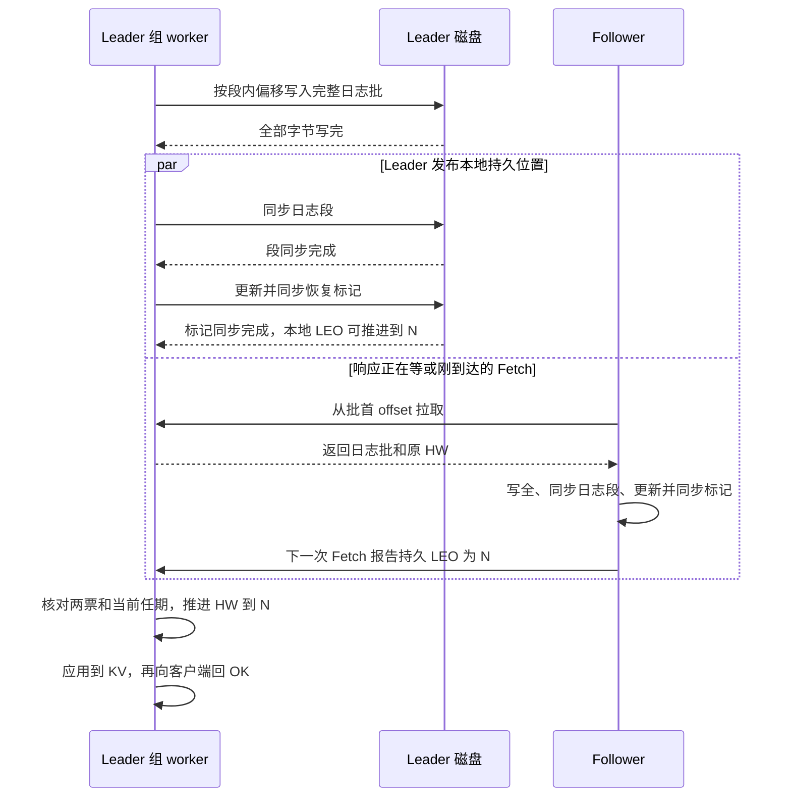

# Linux 下用 io_uring 优化 Raft 数据组刷盘

**先验证 leader 等磁盘时能否继续处理 Fetch，让 follower 提前开始落盘。** 这个改动有机会缩短单笔写入从追加到多数提交的时间。并发写入还有另一项收益可测：让同一轮已经就绪的多个批次共享刷盘。两项试验都沿用现有 Kafka 日志批、DFE4 恢复标记和 Fetch 协议。

## 已测基线

在同一台 Linux 6.8 ARM64 虚拟机上，用同一个 DFE4 插桩二进制和 epoll 网络启动真实多进程集群。三票数据组停一台，确认在线多数可提交后静置 5 秒，预热 32 笔，再由 leader 进程内探针串行提交 256 笔 × 256 KiB，每次一笔在途。两端只替换日志段和恢复标记的同步调用。io_uring 组每个 worker 线程复用一个 ring，提交 `IORING_OP_FSYNC(flags=0)` 后原地等待完成。[测试负载与恢复核对](../../tests/integration/raft_commit_benchmark/dragonfly/trial.py)

| 三轮配对，各列取三轮中位数 | 追加 → 多数提交 P50 | 追加 → 多数提交 P95 | 首笔追加 → 末笔提交吞吐 |
| --- | ---: | ---: | ---: |
| 同步 `fsync` | 3.98 ms | 6.45 ms | 48.55 MiB/s |
| io_uring 提交后立即等待 | 3.88 ms | 6.58 ms | 49.82 MiB/s |

三组配对的 P95（同步 / io_uring）依次为 7.62 / 5.38、6.29 / 7.52、6.45 / 6.58 ms，尾延迟没有稳定改善。每轮都是 2 个在线节点 ×（1 次段同步 + 1 次标记同步）× 256 笔，共 1,024 次成功同步。第 3 台节点重启后逐个读回了 288 个值。这次用临时 `LD_PRELOAD` 探针切换同步方式，两组的 worker 等待行为相同。表中延迟止于提交水位（HW）覆盖该笔，客户端 SET 往返还包含命令处理、应用和回复。[客户端及 KRaft 的计时口径](replication-benchmark.md)

## 先让 Fetch 与本地刷盘并行

当前每组由一个 worker 串行修改日志、选举状态和 HW。普通数据批写全时，已经挂在匹配日志末端的 Fetch 可以提前取到数据和原 HW。此时才到达的 Fetch 要进入同一个 worker 队列，往往要等 leader 同步完日志段和标记。若只是把同步调用换成等待 CQE（完成事件）的调用，队列仍然卡在同一处。[组内 Fetch 调度](../../src/server/cluster/raft/runtime/group.cc) · [提前响应及 voter 进度](../../src/server/cluster/raft/quorum/fetch_replication.cc)

下面是拟试验的路径。假设稳定的三票配置，第三台离线，普通数据批的排他末端为 N。图中两条落盘路径可以重叠。

第一版每组只允许一轮磁盘追加在途。组 worker 分配 offset，把不可变批次交给文件 I/O 所属的 Helio proactor，随后返回队列处理请求。I/O 完成后由同一组 worker 发布进度。网络和磁盘可各用所属 proactor。网络侧沿用 follower 发起的 Fetch，由 leader 在响应中返回数据，无须为并行刷盘引入 AppendEntries。若后续单测 `SEND_ZC`，发送缓冲区还须等内核的释放通知才可复用。Linux 上已有 `WriteAsync` 和 `FSyncAsync` 可用，其他后端继续走现有同步路径。[Helio 文件接口](../../helio/util/fibers/uring_file.h) · [Raft peer 连接](../../src/server/cluster/raft/transport/peer_connection.cc)

- **可发送与可确认的边界。** 只对已写全的普通数据批开放提前 Fetch。核对组、角色、任期及请求的日志前缀，遵循原有批次大小规则，响应携带原 HW。只有本地段和标记都同步成功，才能发布本地持久日志末端（LEO）。follower 用下一次 Fetch 报告自己的持久 LEO；发送 CQE 只表明本地发送操作完成。
- **处理提前到达的确认。** 若 follower 已报告 N 而 leader 仍在刷盘，暂挂这次进度，待本地发布 N 后按原路径重新校验，避免把 N 误判为分叉或提前推进 HW。沿用当前任期和 voter 集合计算多数，稳定三票中 leader 加一个 follower 即可提交。[多数位置计算](../../src/server/cluster/raft/replication/high_watermark.cc)
- **处理换主与失败。** 在途操作持有批次缓冲和文件资源到完成，回调核对任期、段和写入范围。换主、截断、安装快照或关闭时，先停止该批的提前响应，排空旧 I/O 后才改动或复用文件，过期完成事件不能推进新任期状态。写入或同步失败沿用现有存储错误路径，停止确认。若数据已发出，客户端超时仍可能得到未知结果。[追加失败处理](../../src/server/cluster/raft/quorum/fetch_replication.cc) · [恢复与截断](../../src/server/cluster/raft/log/partition_log.cc)

## 批量提交与 Group Commit

Dragonfly 已有组提交。普通 SET 首笔立即派发，同组在 worker 摘取前到达的请求可以合并，当前上限为 32 笔、约 1 MiB 键值。每笔保留自己的 Kafka RecordBatch 和 offset，多批连续追加，共用一轮段同步和标记同步。条件 SET 单独等前序写入应用后再求值。KRaft 的 `maybeAppendBatches` 在一次 `drain()` 中取走就绪批次，逐批追加后统一调用 `log.flush(false)`。[Dragonfly 合批](../../src/server/cluster/raft/runtime/data_node.cc) · [KRaft drain 与 flush](../../../kafka/raft/src/main/java/org/apache/kafka/raft/KafkaRaftClient.java#L3092)

可借用 KRaft 的做法：上一轮 I/O 在途时收集同组同任期的普通写；上一轮完成后，一次取走已经就绪、能装进当前段和预算的连续批次，写段并把标记发布到该轮末端。用笔数和字节数限制排队内存，达到上限时给提交者反压。空闲时立即发出首笔。单连接逐笔等 OK 时没有第二笔可合并，只有并发负载能检验每千笔刷盘次数是否下降。

任期和投票另存于 `quorum-state`，投票应答前要完成临时文件同步、原子替换和目录同步。第一版仅合并普通数据批；选举持久化、成员变更、条件写及换段继续遵循各自的顺序。[选举状态存储](../../src/server/cluster/raft/storage/file_quorum_state_store.cc) · [DFE4 恢复标记](raft-replication-design.md#日志恢复标记)

## WRITE、FSYNC 与完成顺序

DFE4 同段热路径是 **写全日志段 → 同步日志段 → 用 `ftruncate` 更新标记长度 → 同步标记文件 → 发布 LEO**。换段、超出标记窗口或替换检查点时，还需要同步新文件和目录。只给段文件提交一对 WRITE / FSYNC，只完成了前半段。[追加路径](../../src/server/cluster/raft/log/partition_log.cc) · [标记发布](../../src/server/cluster/raft/log/log_files.cc)

| 做法 | 提交与完成条件 |
| --- | --- |
| 首版用显式回调 | 用明确的文件偏移提交 WRITE，检查完成字节数。短写按实际进度补写剩余部分，无进展或 I/O 错误则结束这一轮。全部写完才允许提前 Fetch，并提交段 FSYNC。段同步成功后执行标记更新和同步。两次同步均先用 `flags=0`，便于与基线对照。 |
| 后续试验链接 SQE | 同一次提交中放入 `WRITE [IOSQE_IO_LINK]` 和紧随其后的 `FSYNC`，可将两个 SQE 合在一次内核提交中。预留两格 SQ 空间，保留两个 CQE，分别检查写入长度和同步结果。短写或链取消后，仅在补全并重新同步成功后发布。若试验 `fdatasync`，将 `IORING_FSYNC_DATASYNC` 放在 **FSYNC SQE** 的 `fsync_flags`。 |
| 跳过成功 CQE | Linux 5.17 起支持 `IOSQE_CQE_SKIP_SUCCESS`，可通过 `IORING_FEAT_CQE_SKIP` 探测。首版保留写完成事件，用它触发提前 Fetch、核对短写并管理缓冲的生命周期。Helio 目前也通过 CQE 回收回调槽。若链中带此标志的操作失败，后续取消项的 CQE 可能同样被省略，清理逻辑不能只等待链尾。 |

Helio 的两个高级异步接口各自申请 SQE，连续调用不会自动建立顺序。使用完成回调或显式链接才能建立写入与刷盘的依赖。[Helio SQE 准备](../../helio/util/fibers/uring_file.cc) · [Linux 链接与完成语义](https://man7.org/linux/man-pages/man2/io_uring_enter.2.html) · [FSYNC 标志](https://man7.org/linux/man-pages/man3/io_uring_prep_fsync.3.html)

## 存储介质与 I/O 模式

| 可单独试验的优化 | 适用条件与代价 |
| --- | --- |
| WAL 段预分配 | 可先试 `fallocate(FALLOC_FL_KEEP_SIZE)` 预留块，保留现有逻辑 EOF。普通定长预分配会改变文件长度，当前恢复代码对无标记的 Kafka 段按文件长度扫描，预留尾部会被当成日志解析。追加扩展 EOF 时，`fdatasync` 仍须同步恢复数据所需的元数据。应实测分配耗时与 P95，磁盘 I/O 次数没有固定降幅。[段恢复](../../src/server/cluster/raft/log/partition_log.cc) · [fallocate](https://man7.org/linux/man-pages/man2/fallocate.2.html) |
| `O_DIRECT` 与注册缓冲区 | 分开测量直接 I/O 和 `WRITE_FIXED`。前者绕过页缓存，后者复用预注册的用户缓冲区。按目标文件系统核对地址、偏移和长度的对齐要求，可用时查询 `STATX_DIOALIGN`。现有日志批为变长格式，任意补零会改变连续批次和恢复边界；还要测追赶副本读取近期 WAL 的成本。[Linux 直接 I/O](https://man7.org/linux/man-pages/man2/open.2.html) |
| 同步写与设备 FUA | 普通 `O_DIRECT` 写完成仍可能只到设备易失缓存。评估以一次写替代段同步时，要为该写明确请求 `RWF_DSYNC` 或使用 `O_DSYNC`，验证目标文件系统、设备及掉电恢复。NVMe 支持 FUA 本身不能作为删除刷盘的依据。段写的持久性只覆盖相应文件，DFE4 标记和目录仍各有发布顺序。[同步写语义](https://man7.org/linux/man-pages/man2/pwritev2.2.html) · [数据与目录同步](https://man7.org/linux/man-pages/man2/fsync.2.html) |

## 怎样决定是否采用

1. **先测单笔在途。** 固定内核、文件系统、磁盘、网络后端、二进制配置和预热条件。同步基线与异步 Fetch 原型交替运行。按同组、任期和 offset 记录 Fetch 入队至处理、两端段同步及标记同步的起止、下一次 Fetch 回报与 HW 推进。用两端实际 I/O 区间的交集统计重叠时间，避免用两个完成时刻推断重叠。主指标为追加至 HW 的 P95，另用单 Redis 连接独立核对 SET 往返 P95。若 Fetch 排队缩短而提交 P95 没有稳定下降，优先查剩余等待。[多数提交探针](../../tests/integration/raft_commit_benchmark/dragonfly/probe.py) · [单连接与恢复用例](../../tests/integration/replication_comparison_test.py)
2. **再测并发合批。** 固定一个并发档（如 8 连接）和相同的值大小，对比原有合批与按就绪批次 drain。记录每轮批数、每千笔段和标记各自的同步次数、排队字节峰值、吞吐和客户端 P95，分别判断刷盘摊销和等待代价。
3. **用故障验证确认边界。** 延迟 leader 的段或标记同步，观察 follower 可先落盘，单台在线 follower 的回报仍不能让客户端收到 OK。覆盖短写、同步失败、完成事件迟于换主，以及在段同步后、标记更新后、标记同步后分别崩溃重启。检查未发布尾部的处理、所有已确认值及恢复副本逐值读回。现有分区日志和 Fetch 单测可作为同步基线，异步版本还需覆盖新到达的 Fetch 和迟到回调。[分区日志回归](../../src/server/cluster/raft/log/partition_log_test.cc) · [Fetch 提前响应回归](../../src/server/cluster/raft/quorum/fetch_replication_test.cc)
