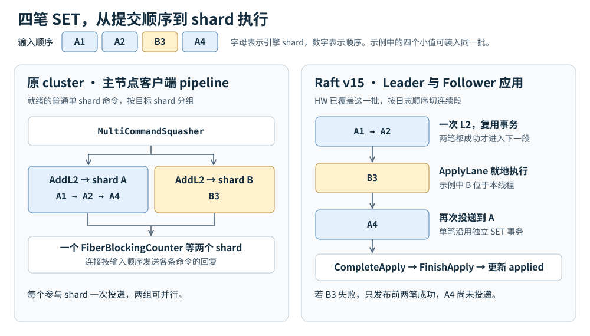

# v15 已提交 SET 的 shard 合批

v15 在 `cluster_mode=raft` 的 ApplyLane 上合并相邻、同 shard 的 SET。上一轮选用 v14b，沿用累计基线 `v3` 和原 cluster 参照 `v0:cluster`。 [实验平台](http://172.31.23.2:8787/#/v15/overview) · [v14b 计划](v14b-batch-progress.md#下一步批次传递到-shard)

标准负载逐笔交替访问两个 shard，实测均为单笔段。宿主机复测及多笔合批诊断见对应小节。 [8 MiB 复测](#8-mib-复测) · [shard 诊断](#shard-诊断与收益边界)

## 为什么从 shard 开始

v5 将连续 effect 批量投递给 owner，v14b 再将普通缓存前缀交给独立 ApplyLane。v14b 的一次独立诊断有 1024 笔 SET、257 个 WAL 批和 379 个 ApplyLane 批。GroupLoop 每批只向 ApplyLane 交接一次，但 ApplyLane 收到批次后仍循环调用 `ExecuteSetEffect → JournalExecutor::ExecuteSet → DispatchCommand(ONLY_SYNC)`。当 key 属于另一引擎线程，每一笔都可能等待一次远端事务调度。Leader 的 ApplyLane 执行区间为 **86.53 ms**，其中 **85.85 ms** 落在 `journal.apply`，包含锁等待、跨线程调度和实际写入。v15 从这里切入，沿用 32 笔 / 1 MiB 编码字节预算以及 v14b 的 WAL、Fetch 和 WAIT 实现。 [v5 批量应用](v5-batched-apply.md#实现范围与后续边界) · [v13 瓶颈复核](v13-fetch-borrow.md#trace-复核) · [v14b 诊断](v14b-batch-progress.md#独立诊断)

## 与原 cluster 的复制路径对照

| 阶段 | 原 cluster | v15 raft.memory |
| --- | --- | --- |
| 接收 | 解析 RESP 参数并执行 SET | 解析 RESP 参数，为普通异步 SET 预留额度并入队 |
| 复制准备 | shard 写入 journal，按 flow 推送 | 将 SET effect 编入 Kafka 日志批，聚合到 WAL 缓冲，供 Follower Fetch |
| 应用与重放 | 副本 flow 逐条执行 journal | GroupLoop 将已提交的普通 SET 批交给 ApplyLane，按相邻同 shard 段执行。缓存复用不可变日志缓冲，缺口从 WAL 重放 |
| 确认 | 本地 SET 完成后回复，`WAIT` 追踪副本应用 | 依据本地 WAL 写入、Follower 接收形成的 HW 和本地连续应用进度回复 SET，`WAIT` 追踪副本应用 |

两种模式的 SET 回复条件不同。正式吞吐都计到原连接的 `WAIT 1` 完成。Raft 由各数据组维护任期、日志顺序、HW 和恢复切点。 [复制协议对照](../raft-replication-design.md) · [Raft 回复水位](../raft-batch-event-loop.md#2-数据单位与水位)

## 原 cluster 的哪些实现用于 v15

**原 cluster 主节点。** 非原子客户端 pipeline 由 `Service::DispatchSquashedBatch` 收集已就绪且可合批的命令。`MultiCommandSquasher::TrySquash` 计算 key 所属 shard，将命令放入该 shard 的队列。同一 shard 内保留输入顺序。`ExecuteSquashed` 给每个参与 shard 投递一次 `AddL2`，用一个 `FiberBlockingCounter` 等整批完成。各 shard 在 `SquashedHopCb` 中复用本地事务和命令上下文，逐条调用 `MultiSwitchCmd → InitByArgs → InvokeCmd`。连接按输入顺序返回回复。 [客户端入口](../../../src/server/main_service.cc) · [分组、投递与 shard 回调](../../../src/server/multi_command_squasher.cc)

**原 cluster 副本。** 主节点将复制 flow 连接迁到对应 shard 线程，副本在分配给该 flow 的线程上读取 journal，由 `JournalApplier → JournalExecutor` 逐条重放。普通命令在线程与目标 shard 匹配时可以就地执行，全局命令经 `MultiShardExecution` 协调。这提供了把执行放在数据所属线程的另一处源码参照。 [主节点 flow 迁移](../../../src/server/dflycmd.cc) · [副本读循环](../../../src/server/replica.cc) · [journal 屏障](../../../src/server/journal/journal_applier.cc)

**Raft 的实现选择。** 装有 `raft_data_commands_` 的服务会在 `DispatchSquashedBatch` 入口返回 0，普通写先经过 Raft 提交。v15 在提交后的 ApplyLane 复用了引擎的 shard 路由、L2 队列和 `SHARD_LOCAL` 事务。原 cluster 可把图中的 A1、A2、A4 一起送到 A。Raft 先送 A1、A2，等 B3 成功后才送 A4。若 B3 失败，已执行的数据恰好对应成功前缀，恢复时无需识别提前执行的 A4。 [Raft 提交后入口](../../../src/server/cluster/raft/runtime/data_node.cc) · [引擎 shard 路由](../../../src/server/sharding.cc)

## 一批已提交 SET 如何执行

1. **取批。** Leader 和 Follower 的 GroupLoop 都由 `PrepareApply` 从已提交、连续的缓存记录中取出普通 replacement。每批持有底层数据所有权，`View(i)` 只借用 key/value。no-op、控制与迁移记录截断普通批，WAL 缓存缺口走已有的有序重放路径。对于 256 KiB 的 value，计入编码开销后，每批最多 3 笔。 [批次边界与数据所有权](../../../src/server/cluster/raft/data/set_effect.cc)
2. **切段和投递。** ApplyLane 调用新增的 `ExecuteSetBatch`，用引擎的 `Shard(key, shard_count)` 扫描出相邻同 shard 的一段。目标是本线程时直接执行。远端段使用 `AddL2` 进入目标 shard 的次级队列，投递方等待一次。回调若遇到锁竞争，主事务队列仍能运行。 [切段与等待](../../../src/server/cluster/raft/data/set_executor.cc) · [L2 队列](../../../src/server/engine_shard_set.h)
3. **执行 SET。** 单笔段沿用独立事务，多笔段调用新增的 `JournalExecutor::WithShardLocalTransaction`，为整段建立非原子的 `SHARD_LOCAL` 事务。每条记录依然校验 key 的 slot、选择 DB、刷新复用事务的操作时间，并通过同步 SET 检查锁、OOM 和实际回复。每笔仍有自己的命令上下文和回复检查。多笔段复用的是事务与线程交接。 [事务复用](../../../src/server/journal/executor.cc) · [事务 inline 条件](../../../src/server/transaction.cc)
4. **发布进度。** 每收到一个成功的 SET 回复，`completed` 增加 1。首错立即结束本段与本批，`CompleteApply` 把长度和状态送回 GroupLoop。`FinishApply` 只为前缀更新 offset、slot generation 和 applied 字节数，保留首错供后续组操作处理。快照取切点时仍受在途 apply 屏障约束。 [完成通知](../../../src/server/cluster/raft/runtime/data_node.cc) · [组屏障](../../../src/server/cluster/raft/runtime/group.cc) · [快照切点](../../../src/server/cluster/raft/runtime/data_snapshot.cc)

## 首次三轮正式结果

Raft memory、1 连接、pipeline 64、256 MiB、256 KiB/value。与 v14b 使用同一份测试脚本，吞吐计入原连接的末尾 `WAIT 1`，批次 P95 只计算每批 SET。

每轮共 16 个 pipeline。脚本按最近秩取百分位，`ceil(16 × 0.95) = 16`，因此每轮的批次 P95 取该轮最慢的一批。三轮表中再对这三个值取中位数。 [百分位和逐批计时](../../../tests/integration/replication_comparison_test.py#L36)

| 指标 | v14b | v15 | 变化 |
| --- | ---: | ---: | ---: |
| 吞吐中位数（MiB/s） | 499.85 | 493.28 | −1.3% |
| 吞吐均值（MiB/s） | 501.83 | 495.49 | −1.3% |
| 批次 P95 中位数（ms） | 38.21 | 34.70 | −9.2% |
| 批次 P95 均值（ms） | 44.66 | 36.84 | −17.5% |

三轮吞吐分别为 **465.02 / 493.28 / 528.16 MiB/s**，批次 P95 为 **42.85 / 34.70 / 32.97 ms**。末尾 WAIT 为 **0.15 / 0.43 / 7.81 ms**。三轮均通过副本确认、离线节点恢复和全部 1024 个值的读回。

## 8 MiB 复测

三组测量都使用原版 v15 Release 二进制（SHA-256 `3cd512c8633a…`）、同一负载和测试脚本。首次直接在宿主机执行，随后在 `profile-web` 容器内复测得到 **511.12 MiB/s / 38.74 ms**。最新复测恢复首次的宿主机执行方式和同一个 ext4 文件系统，三轮均通过 `WAIT 1`、离线副本恢复、`WAIT 2` 与全量读回。 [容器复测 Trace](http://172.31.23.2:3007/project/dragonfly-performance/traces/6f7cf193d347565ca7d2cbd8126eef77)

| 正式轮 | SET（ms） | 末尾 WAIT（ms） | 含 `WAIT 1` 吞吐（MiB/s） | SET 批次 P95（ms） |
| --- | ---: | ---: | ---: | ---: |
| 1 | 473.82 | 19.98 | 518.43 | 33.12 |
| 2 | 523.62 | 0.14 | 488.77 | 61.55 |
| 3 | 496.87 | 0.19 | 515.03 | 33.59 |

下表列出四个归档的三轮中位数。v15 宿主机复测较 v3 首版吞吐提高 **203.7%**，达到原 cluster 参照的 **85.1%**，相差 **90.44 MiB/s**。v3、v14b 和原 cluster 使用各自的历史归档，表中差值包含跨轮变化。 [v3 基线](v3-baseline.md) · [v14b 实验](v14b-batch-progress.md#实验结果) · [原 cluster 参照](http://172.31.23.2:8787/#/v10/overview)

| 归档 | 含 `WAIT 1` 吞吐（MiB/s） | SET 批次 P95（ms） |
| --- | ---: | ---: |
| v3 首版 `v3` | 169.56 | 113.75 |
| v14b | 499.85 | 38.21 |
| v15 宿主机复测（8 MiB 准入） | **515.03** | **33.59** |
| 原 cluster `v0:cluster` | 605.47 | 34.63 |

第二轮最慢批次为 **61.55 ms**，另两轮都在 **34 ms** 内。首次和这次宿主机复测的 P95 中位数相差 **1.11 ms**，逐轮波动更大。后续候选使用同宿主机交替 A/B 判断收益。 [平台宿主机复测](http://172.31.23.2:8787/#/v15/runs)

宿主机独立诊断记录 **1024** 次成功准入、**36** 次字节额度拒绝和 **33** 次完成的准入等待，等待区间并集 **405.52 ms**，P95 **15.13 ms**。SET 窗口内，Leader 编码与 WAL 写入的区间并集分别为 **79.75 / 60.74 ms**，两者重叠为 **0 ms**。原始数据位于 `~/.local/state/dragonfly-raft-workflow/runs/v15-host-refresh-aWX4jCqh/v15/`。 [宿主机复测 Trace](http://172.31.23.2:8787/#/v15/trace)

## 与 v14 首版的 Trace 对照

v14、v14b 和 v15 使用同一个 benchmark 脚本和负载。三轮正式结果的末尾 WAIT 中位数依次为 **200.42 / 0.15 / 0.43 ms**。v14b 已修复 Follower 携带旧 applied 的长轮询和 Leader WAIT 的 100 ms 轮询。v15 沿用这两个修复。 [v14 首版](v14-batch-event-loop.md) · [v14b 修正](v14b-batch-progress.md)

下表从三份独立诊断的原始 Trace 重新裁剪，只取客户端开始 SET 到最后一批 SET 回复的窗口。除最后两行外，数值是该节点各阶段的区间并集，阶段之间可以重叠。 [v14 Trace](http://172.31.23.2:8787/#/v14/trace) · [v14b Trace](http://172.31.23.2:8787/#/v14b/trace) · [v15 首次 Trace](http://172.31.23.2:3007/project/dragonfly-performance/traces/8c69ab4854e4536d9e0b0817ea0fdcb3)

| 独立诊断（ms） | v14 | v14b | v15 |
| --- | ---: | ---: | ---: |
| Leader `raft.apply.lane_run` | 96.83 | 86.53 | 85.07 |
| Leader `raft.set.encode` | 81.96 | 82.55 | 81.67 |
| Follower `raft.apply.lane_run` | 92.19 | 92.54 | 104.81 |
| Follower `raft.fetch.rpc` | 379.29 | 342.91 | 361.71 |
| Follower 单次 Fetch RPC 最长耗时 | 5.77 | 5.25 | 7.79 |
| 客户端 SET 窗口 | 465.48 | 492.75 | 525.00 |

平台 Trace 的完整窗口包含末尾 WAIT。v14 的 Follower Fetch RPC 区间并集为 **579.40 ms**，裁剪到 SET 后为 **379.29 ms**。因此完整窗口里 v14 与 v15 的差距主要来自 v14 的末尾等待。SET 窗口内，v15 的 Leader ApplyLane 较 v14 缩短 **11.76 ms**，Follower 则增加 **12.62 ms**。v15 新测得 Follower 的 512 次 L2 调度排队并集 **43.83 ms**，其中最长一次 **3.02 ms**。单笔段在目标 shard 上没有可合并的 SET，适合用同轮 A/B 核对额外的 L2 交接是否值得保留。

## shard 诊断与收益边界

下表使用 v15 首次独立插桩运行的计时窗口。时间是各阶段在该节点上的区间并集，阶段之间有重叠。`shard_run` 包含事务执行和可能的锁等待。`shard_queue` 从投递 L2 计到回调开始，包含入队反压。`shard_run.arg0` 记录该段笔数，`arg1` 为 key 加 value 的字节数。 [工具说明](../../../tools/profile/README.md) · [v15 首次诊断](http://172.31.23.2:3137/v15-run-001-after-8e13ac49-a1/index.html)

| 标准负载的 1024 笔 SET | Leader | Follower |
| --- | ---: | ---: |
| v14b → v15 ApplyLane 批数 | 379 → 381 | 379 → 381 |
| v14b → v15 ApplyLane 执行（ms） | 86.53 → 85.07 | 92.54 → 104.81 |
| v15 shard 段数 / 每段笔数 | 1024 / 1 | 1024 / 1 |
| v15 本线程直接执行 / 跨线程 L2 投递 | 512 / 512 | 512 / 512 |
| v15 shard 执行 / 远端排队（ms） | 55.14 / 12.05 | 51.22 / 43.83 |
| v14b → v15 CPU 采样估算（ms） | 504 → 504 | 258 → 274 |
| v14b → v15 峰值 RSS（MiB） | 668.01 → 668.68 | 420.39 → 421.43 |

**标准负载测到了跨线程调度。** 脚本交替使用两个固定 hash tag，Leader 和 Follower 各有 1024 个单笔段，每端处理的 key/value 合计 **268,447,146 字节**。v15 Leader 的 `journal.apply` 从 85.85 降至 54.45 ms，但远端排队已经移到该 span 之前。覆盖 shard 投递、等待和 SET 执行的 ApplyLane 只从 86.53 降至 85.07 ms。Follower 的 ApplyLane 增长了 12.27 ms。扩大 ApplyBatch 预算仍会遇到同一组交替的 key。 [标准负载的 key 顺序](../../../tests/integration/replication_comparison_test.py)

**连续写单独验证了合批。** 补充诊断使用同一插桩二进制和 1024 个 256 KiB 的值，将计时段的目标改为每 4 笔切换一次 shard。这次只采集 Trace，关闭了 CPU profiler。Leader 的 1024 笔写形成 **530 段**，其中单笔、双笔、三笔各 **196 / 174 / 160 段**。同样的 **512 笔远端写**，L2 投递由交替负载的 **512 次降到 257 次（−49.8%）**。Follower 同样用 257 次投递承载 512 笔远端写，普通缓存批覆盖 1023 笔，另 1 笔由 WAL 重放。两个节点均核对到 1024 笔 journal 应用，离线副本恢复后全量读回通过。这次单独诊断只用于验证投递计数。

**其余热点。** Leader WAL 提交 257 → 253 批（约 4.0 笔/批），编码 82.55 → 81.67 ms，追加准备 41.13 → 41.39 ms，worker 排队 25.78 → 16.48 ms。Leader 的 memcpy 和 CRC 叶子样本仍为 65/252 和 58/252。结合上表 RSS 与 CPU，本次可以确认相邻写节省投递，标准负载的吞吐与内存仍接近 v14b。 [首次火焰图](http://172.31.23.2:3137/v15-run-001-after-8e13ac49-a1/index.html)

## KRaft 如何回放一批提交

Kafka `5b648ca9cb` 中最接近 `ExecuteSetBatch` 的是备用 controller。一次 `handleCommit(BatchReader)` 可以接收多次追加的记录，回调将整个 reader 投递为一个事件。备用 controller 按 `baseOffset + recordIndex` 依次调用对应记录类型的 `replay`，整批成功才调用 `handleCommitBatch`。回放异常会把失败 offset 交给 fatal fault handler。Dragonfly 则须返回已经成功写入的笔数，供 `FinishApply` 推进连续前缀。两者都在一个批次内维持日志顺序。 [批次契约](../../../../kafka/raft/src/main/java/org/apache/kafka/raft/RaftClient.java#L42) · [备用 controller 回放](../../../../kafka/metadata/src/main/java/org/apache/kafka/controller/QuorumController.java#L969)

活跃 controller 在 `prepareAppend` 和 `schedulePreparedAppend` 之间就回放元数据，提交时按 stable offset 完成待确认请求。它能在退位时将内存状态回滚到该位置的快照。Dragonfly 若想提前执行 KV 写入，还需为读、快照和失败恢复提供等价的隔离与回滚。 [活跃 controller 写入](../../../../kafka/metadata/src/main/java/org/apache/kafka/controller/QuorumController.java#L816) · [退位回滚](../../../../kafka/metadata/src/main/java/org/apache/kafka/controller/OffsetControlManager.java#L260)

KRaft 的 `MetadataLoader` 也只为一个 reader 投递一个事件，逐批调用 `loadBatch`，按类型将记录应用到 `MetadataDelta`，发布时遵守元数据事务边界。这两处元数据回放均没有按目标 shard 并发投递。普通 Kafka topic 的追加入口收到的已经是按 partition 分组的 `MemoryRecords`，每个 partition 单独分配 offset。Dragonfly 同一数据组内的多个引擎 shard 共享一个 applied offset。 [MetadataLoader](../../../../kafka/metadata/src/main/java/org/apache/kafka/image/loader/MetadataLoader.java#L396) · [类型化回放与事务边界](../../../../kafka/metadata/src/main/java/org/apache/kafka/image/loader/MetadataBatchLoader.java#L134) · [普通分区追加](../../../../kafka/core/src/main/scala/kafka/server/ReplicaManager.scala#L1376)

## 单笔段调度复测

对照使用 v15 原归档二进制。候选让远端单笔段从 ApplyLane 直接调用 `ExecuteSetEffect`，由同步事务的 `ScheduleSingleHop → ScheduleInternal` 向目标 shard 主队列投递。带多笔 SET 的段继续使用 v15 的 L2 交接与事务复用。原构建命令重新链接出的对照二进制 SHA-256 与归档一致。 [同步命令等待](../../../src/server/cmd_support.cc#L27) · [事务调度](../../../src/server/transaction.cc#L769)

| 标准负载三对交替测试 | v15 原版 | 单笔段走主队列 | 变化 |
| --- | ---: | ---: | ---: |
| 含 `WAIT 1` 的吞吐中位数（MiB/s） | 507.85 | 517.02 | +1.8% |
| 含 `WAIT 1` 的吞吐均值（MiB/s） | 512.57 | 514.01 | +0.3% |
| SET 批次 P95 中位数（ms） | 36.25 | 38.38 | +5.9% |

六轮均通过副本确认、离线节点恢复和全量读回。候选第二轮吞吐从 **526.78** 降至 **468.98 MiB/s**，P95 从 **32.16** 增至 **46.75 ms**。三对结果不足以确认稳定的吞吐收益，P95 中位数也出现回退，因此保留 v15 正式结果。复测记录和补丁位于执行机 `~/.local/state/dragonfly-raft-workflow/runs/v15/v15-singleton-ab/`。

## 下一步

重新按准入、票据退役、Leader WAL 和副本进度对齐 v15 Trace 后，优先解决连接耗尽额度后等待整波回复才补发的问题。宿主机 Trace 的 GroupLoop 在已有额度退役时仍有 **229.66 ms** 因下条命令未重新准入而闲置。保持 8 MiB 的补发诊断把整波排空由 **32 次降为 0**，但后段复制和应用的 P95 增加。 [v16 改动与同机结果](v16-wal-encode-overlap.md)

v15 宿主机复测与原 cluster 各自吞吐居中的一轮，256 MiB 的端到端耗时为 **497.05 对 422.81 ms**，相当于 16 个 pipeline 平均每批要省 **约 4.6 ms**。其中 SET 阶段为 **496.87 对 322.26 ms**，末尾 `WAIT 1` 为 **0.19 对 100.55 ms**。优先追 SET 阶段的积压。 [v15 复测结果](http://172.31.23.2:8787/#/v15/overview) · [原 cluster 参照](http://172.31.23.2:8787/#/v10/overview)

用原 cluster 参照的归档二进制（SHA-256 `b8a53a9fcbfa…`）确认了三层限制。RESP 队列的内存阈值是 **每 I/O 线程 128 MiB**，命令数阈值是**每连接 10,000 笔**。`MultiCommandSquasher` 每个 shard 一次最多合 **100 笔**。用同一二进制和标准负载补测一轮，SET 窗口的 `pipeline_throttle_total` 增量为 **0**。1024 笔 SET 中有 **988 笔进入 18 个 squash 批次**，每次平均约 **55 笔**。这些限制管的是待处理命令和本地执行批，原 cluster 的 SET 在本地执行后回复，副本确认由 `WAIT` 完成。 [RESP 队列限制](../../../src/facade/dragonfly_connection.cc#L73) · [每 shard 合批限制](../../../src/server/server_state.cc#L43) · [原 cluster 分发入口](../../../src/server/main_service.cc#L1926)

1. **固定 8 MiB 准入额度。** 每个 pipeline 的 64 笔写仅 value 就占 16 MiB，加入 key 后，Raft 的 8 MiB 数据组额度最多容纳 31 笔。输入缓冲在追加后释放，准入额度到票据销毁才归还。若后续已解析的 SET 因额度不足返回 `WOULD_BLOCK`，连接会暂停分发。17 MiB 试验的吞吐中位数增加 **2.1%**，SET 批次 P95 同时增加 **16.2%**，因此采用原额度作为后续对照。 [票据生命周期](../../../src/server/cluster/raft/runtime/data_node.cc#L155) · [准入逻辑](../../../src/server/cluster/raft/runtime/data_node.cc#L635) · [连接分发](../../../src/facade/dragonfly_connection.cc#L3398) · [回复水位](../../../src/server/cluster/raft/runtime/data_node.cc#L859)
2. **按逐条 offset 和批尾分别定位补发后的瓶颈。** 连接补发后核对准入、Leader WAL、Follower Fetch 和追加、HW、本地 applied 与回复。如果整体复制水位差扩大，优先测 Follower Fetch 与追加的串行交接。首次 v15 诊断的 **253 个 WAL 提交批中有 221 个只有 1–3 笔**，继续用实际批形解释复制水位差。 [WAL 取批](../../../src/server/cluster/raft/runtime/data_node.cc#L885) · [Follower Fetch](../../../src/server/cluster/raft/runtime/group.cc#L628)
3. **如果 HW 已推进而 applied 滞后，再测类型化的 SET 回放。** 可借鉴 KRaft 的 `replay(record)`，让解码后的普通 replacement 通过共享的 SET 事务操作直接返回状态。目前 key/value 已按视图传入，每笔仍构造命令上下文、查找 SET、执行并捕获 `OK` 回复。候选需沿用 slot 校验、DB 激活、事务时间与锁、OOM 检查、`SetCmd::Set` 的类型替换与 TTL 清除，以及 WATCH 失效、journal 和 tiered storage 反压。CPU 采样中的 `DispatchCommand` 包含实际写入，现有数据无法单独量出这层开销。 [现有回放入口](../../../src/server/cluster/raft/data/set_executor.cc#L14) · [DB 选择与命令执行](../../../src/server/journal/executor.cc#L72) · [SET 的事务操作与反压](../../../src/server/string_family.cc#L1245)

正式结果看包含末尾 WAIT 的吞吐和批次 P95。正确性沿用锁竞争、非法 DB 首错及重启读回，并检查失败后的同 shard、跨 shard 后缀。若进一步讨论按原 cluster 将不相邻 offset 提前并行执行，需先解决图中 B3 失败时 A4 的读可见性、快照和重放。 [v14b 原始假设](v14b-batch-progress.md#下一步批次传递到-shard) · [现有失败前缀用例](../../../src/server/cluster/raft/data/set_executor_test.cc#L87)

## 验证与归档

Debug、Release、ASAN/UBSAN 各通过 **38 项相关单测**。新增用例让远端 shard 首条 SET 等待事务锁，在两个 DB 写入后，第 5 条记录选用未配置的 DB，验证只有前 4 条生效，同 shard 和跨 shard 后缀均未执行。Debug 另通过 **5 项集成回归**，覆盖 flush/memory pipeline、条件写与 WAIT、关闭排空和快照恢复。 [失败前缀用例](../../../src/server/cluster/raft/data/set_executor_test.cc) · [集成用例](../../../tests/integration/raft_data_group_test.py)

首次执行机归档为 `~/.local/state/dragonfly-raft-workflow/runs/v15/v15-run-001/`，包含三轮正式结果、源码快照、二进制和日志。首次独立诊断有 **23,927 个事件**，Langfuse 核验 **2,477 条观测**。补充诊断计数位于 `extra-validation/adjacent-tags/shard-counts.json`。 [首次 Langfuse Trace](http://172.31.23.2:3007/project/dragonfly-performance/traces/8c69ab4854e4536d9e0b0817ea0fdcb3)
