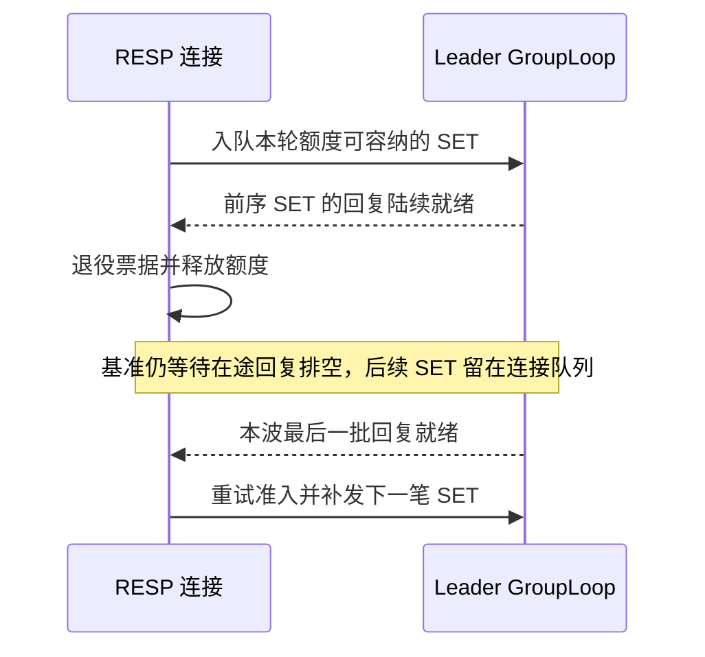
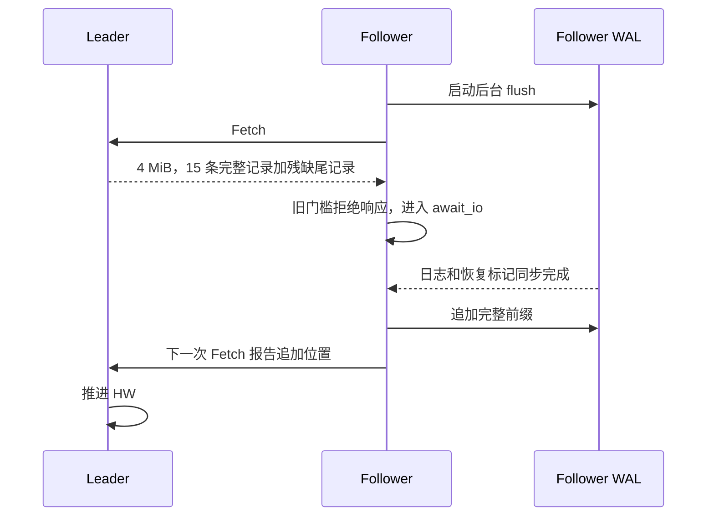

# v16 Raft SET 批量补发与 Follower 并发 flush

对照基准为 **v15 + 崩溃修复**（`a321ad2e`）。v16 包含相同的 `GroupLoop::Await` 修复。

## 1. 分析查询

使用补采的 v15 Trace，从事件排名逐步定位两处等待。

### 1.1 从全部事件中发现线索

```sh
capture=v15-native-20261126-025037
profile slow-path -id v15 -capture "$capture" -limit 5
```

| 排名 | 事件 | 耗时（ms） |
| --- | --- | ---: |
| 1 | `raft.set.admission.wait` | 1729.953 |
| 2 | `raft.set.admission.wal_idle` | 1720.024 |
| 3 | `raft.fetch` | 1714.944 |
| 4 | `raft.fetch.return_wait` | 1707.560 |
| 5 | `raft.fetch.await_flush` | 1707.530 |

前两项指向 Leader 准入等待，后三项指向 Follower 的 Fetch 等待。先看命令默认展开的第 1 项关联时序，再沿第 3–5 项查 Fetch。

### 1.2 沿首条准入事件检查补发

上一步的关联时序中，`raft.set.ticket.retired` 陆续出现，但 `raft.set.admission.retry/granted` 在整波 31 张票据全部退役后才出现：

| 顺序 | 观察 | 含义 |
| --- | --- | --- |
| 先 | 部分票据已退役 | 准入额度开始归还 |
| 期间 | `raft.set.admission.wal_idle` 持续，未出现 retry | 已归还额度尚未用于补发 |
| 最后 | 31 张票据全部退役后才 retry/granted | 连接等待整波回复排空 |

由此回查 v15 的 `DrainQueuedCommands` 和 `HasCommandToExecute`：恢复执行要求没有在途命令，额度归还本身不会触发补发。这解释了为什么需要在部分有序回复完成后重试准入。[连接分发路径](../../../src/facade/dragonfly_connection.cc)



此前首版补发将整波排空从 32 次降到 0 次，但字节额度拒绝从 32 次增到 183 次，因此最终选择累计 **8 个有序回复**再重试。本条 1729.953 ms 还可能包含复制停顿，不能全部算作连接策略的损失；下面继续核对排名中的 Fetch 等待。

### 1.3 沿排名中的 Fetch 等待查 flush gate

```sh
profile fetch-delay -id v15 -capture "$capture" -min-return-wait-ms 10
```

首条请求的 offset 为 **692–706**：

| 观察项 | 结果 |
| --- | ---: |
| RPC 耗时 | 2.751 ms |
| RPC 返回到响应处理 | 1707.560 ms |
| `raft.await_io` | 1707.265 ms |
| fsync 重叠 | 1706.958 ms |
| 响应 / 成功追加 | 4,194,304 / 3,933,802 bytes |

RPC 已经返回，长空档主要落在 I/O 等待。继续看同一请求的关联事件：gate 以 **`Incomplete suffix`** 拒绝 4 次，指向 flush **1134 / 3056**；相关 fsync 完成后才出现 gate ready，随后追加 15 条完整记录。

据此检查 v15 的 `CanAppendDuringFlush`：它遇到残缺尾记录就拒绝整个响应，而 `AppendAsFollower` 已能追加前面的完整记录。阻塞点因此落在 flush 期间的准入判断，优化就是允许完整前缀追加与后台 flush 重叠。[Follower 接收路径](../../../src/server/cluster/raft/runtime/group.cc) · [完整前缀追加](../../../src/server/cluster/raft/log/partition_log.cc)



## 2. 改动

### 2.1 批量补发 SET

普通 SET 因额度不足暂停时，连接累计回收 **8 个有序回复**后再重试。若该命令先到队首，则按正常路径执行。8 MiB / 256 笔的准入上限和有序回复规则继续生效。 [连接调度](../../../src/facade/dragonfly_connection.cc#L3407)

### 2.2 Follower 在 flush 期间追加完整前缀

Fetch 响应带残缺尾记录时，按前面的完整记录检查任期、日志位置和段容量，并继续追加该前缀。后台 flush 发布启动时捕获的恢复切点。 [追加门槛](../../../src/server/cluster/raft/log/partition_log.cc#L337) · [切点回归](../../../src/server/cluster/raft/log/partition_log_test.cc#L181)

## 3. 同机结果

原 v16 正式对照中，清理 Dragonfly 和 Helio 的 Release 对象文件并重新编译后，在宿主机 ext4 上复跑。负载使用 Release、`memory`、单连接、pipeline 64、256 MiB。交替测三对，表中取三轮中位数。吞吐包含原连接的 `WAIT 1`，批次 P95 只计 SET。

| 指标 | v15 + 崩溃修复 | v16 | 变化 |
| --- | ---: | ---: | ---: |
| 吞吐（MiB/s） | 514.96 | **603.09** | **+17.1%** |
| SET 批次 P95（ms） | 33.81 | **29.78** | **−11.9%** |

三对均改善。六轮均通过副本确认、离线副本恢复、`WAIT 2` 和全量读回。另通过 **45 项 C++ 单测**和 **7 项 Debug 集成回归**，覆盖准入预算、有序屏障、断连、停机排空和整集群崩溃恢复。Follower 在后台日志同步期间追加完整前缀由 `FollowerAppendsCompletePrefixDuringMemoryFlush` 用例验证。 [逐轮结果](http://172.31.23.2:8787/#/v16/runs) · [Trace](http://172.31.23.2:8787/#/v16/trace)
