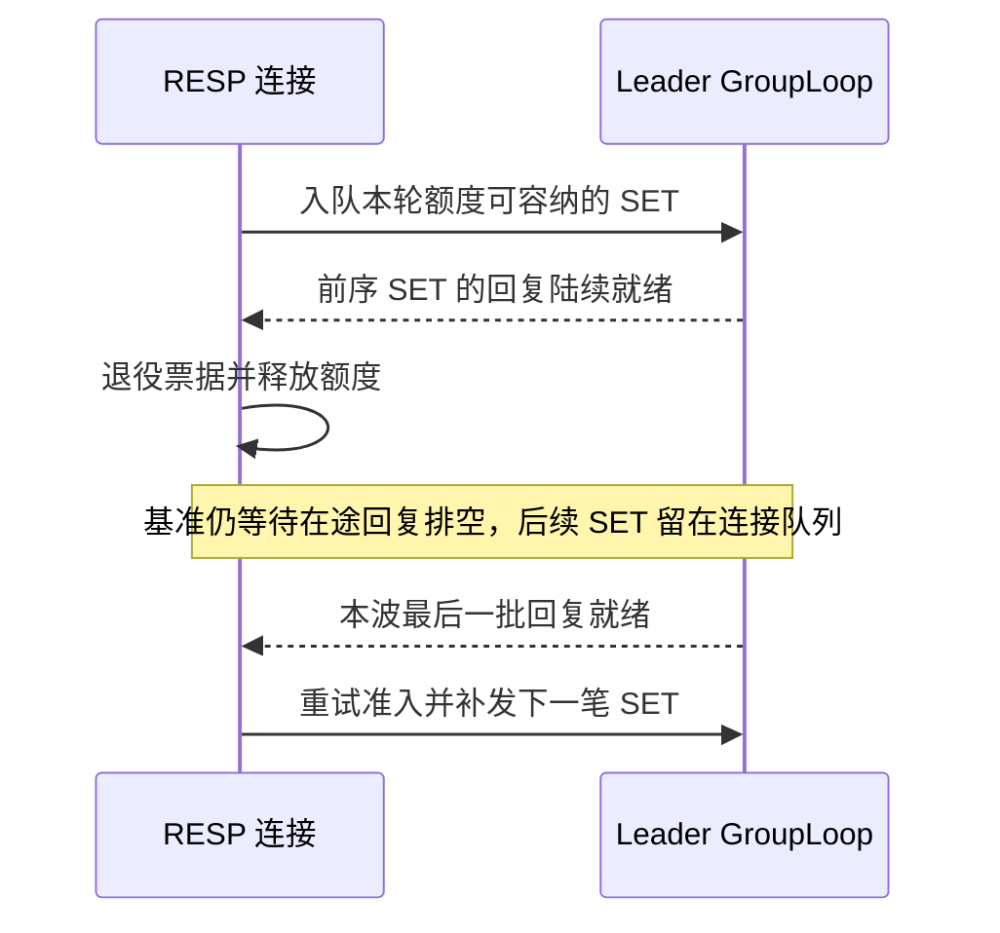
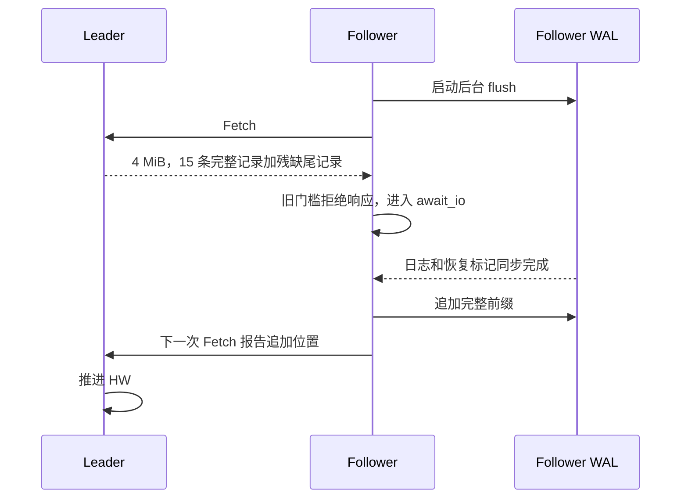

# v16 Raft SET 批量补发与 Follower 并发 flush

对照基准为 **v15 + 崩溃修复**（`a321ad2e`）。v16 包含相同的 `GroupLoop::Await` 修复。 [实验总览](http://172.31.23.2:8787/#/v16/overview)

## 分析查询

### 阶段分析

```sh
profile trace -id v15 -role client -sort union
profile trace -id v10 -run diagnostic-cluster -role client -sort union
```

**结果摘要**

| 客户端阶段 | v15 | 参照 `v10:cluster` | 差值 |
| --- | ---: | ---: | ---: |
| `client.pipeline` | 515.03 ms | 323.13 ms | +191.90 ms |
| `client.final_wait` | 0.14 ms | 100.48 ms | −100.34 ms |

两个已观测阶段合计，v15 比参照多 **91.56 ms**。SET 用时多 191.90 ms，较短的 WAIT 抵消了其中一部分，所以选 SET 继续查。平台阶段分析默认对比上一轮，点击 `client.pipeline` 后按节点查看该窗口内的指标。 [压测计时](../../../tests/integration/replication_comparison_test.py#L159) · [v15 阶段分析](http://172.31.23.2:8787/#/v15/stages)

```sh
profile trace -id v15 -stage raft. -sort union -limit 25
```

**结果摘要**

| SET 路径观测项 | 区间并集 | 事件数 |
| --- | ---: | ---: |
| `raft.set.admission.wait`（Leader） | 405.51 ms | 33 |
| `raft.fetch.rpc`（Follower） | 389.06 ms | 426 |

准入等待覆盖 SET 批次时间的 **78.7%**（405.51 ÷ 515.03）。各阶段可以重叠。下一步挑最慢批次，对齐额度归还、WAL 写入和重新准入，确认准入等待发生在哪里。 [v15 Langfuse Trace](http://172.31.23.2:3007/project/dragonfly-performance/traces/e9d79f0fe1505e3a9ebaa4cf525cacbe)

### 沿 WAL 空档查连接分发

```sh
profile trace -id v15 -analysis slow-path -role leader -stage raft.set.admission.wait
profile trace -id v15 -analysis admission-wait -tickets 31 -batch 12
profile trace -id v15 -analysis admission-wait -tickets 31 -limit 0
```

**结果摘要**

| 查询范围 | 准入等待 | 等到 31 个票据退役 | WAL 空档 |
| --- | --- | ---: | ---: |
| 最慢的第 12 批（39.00 ms） | 18.27 / 13.40 ms | 2 / 2 | 2.73 / 6.91 ms |
| 全轮 v15 | 33 个窗口 | 32 / 33 | 累计 229.66 ms |

8 MiB 额度能装 31 笔。查询按连接线程数窗口内退役的票据，取首个退役与同批最后一次 WAL 写完成中较晚的时间，到恢复准入为止。回查 `DrainQueuedCommands`，`HasCommandToExecute` 要等在途回复排空。随后用 **v15 + 崩溃修复**做对照，首版补发把整波排空由 **32 次降到 0 次**，字节额度拒绝却从 **32 次增到 183 次**，于是改为攒一批有序回复再重试。 [连接分发路径](../../../src/facade/dragonfly_connection.cc#L4230) · [首版补发 Trace](http://172.31.23.2:3007/project/dragonfly-performance/traces/d1b5cd7699325fb4916f840ff47be14e)



### 沿慢批次查 Follower

以下查询在执行机读取首版补发的独立复跑归档。

```sh
runs="$HOME/.local/state/dragonfly-raft-workflow/runs"
tail="$runs/v16-tail-retest-q5maGd"
for run in "$tail"/trace-*; do
  printf '%s\n' "${run##*/}"
  profile trace -timeline "$run/report/timeline.json" -analysis request-phases
done
for run in "$tail"/trace-*-candidate; do
  profile trace -timeline "$run/report/timeline.json" -analysis slow-path -limit 1
  profile trace -timeline "$run/report/timeline.json" -analysis fetch-delay -limit 1
done
```

**结果摘要**

| 复跑 | 最慢批次 | Fetch offset | RPC 返回到开始处理 |
| --- | ---: | --- | ---: |
| 1 | 3 | 218–232 | 13.09 ms |
| 2 | 3 | 223–237 | 12.15 ms |
| 3 | 3 | 218–232 | 16.07 ms |

同一归档的 `compare/summary.json` 显示，按组汇总的批次 P50 从 **31.78 降到 27.63 ms**，三轮批次 P95 的中位数从 **36.98 升到 52.78 ms**。整轮 WAL 到 Follower 追加耗时在三对 Trace 都下降，但第一轮最慢批里，这一段占 **41.30%**，在该批排第一。按 offset 对齐后，上表三个空档均与 RPC 线程的 `await_io` 和同节点后台 `fsync` 重叠。三份 Fetch 都是 4 MiB，含 15 条完整记录和残缺尾记录。旧 `CanAppendDuringFlush` 遇到残缺尾部就让整个响应等待，而 `AppendAsFollower` 已能写完整前缀，因此改动落在 flush 期间的准入判断。 [Follower 接收路径](../../../src/server/cluster/raft/runtime/group.cc#L688) · [完整前缀追加](../../../src/server/cluster/raft/log/partition_log.cc#L394)



## 改动

- **批量补发 SET。** 普通 SET 因额度不足暂停时，连接累计回收 **8 个有序回复**后再重试。若该命令先到队首，则按正常路径执行。8 MiB / 256 笔的准入上限和有序回复规则继续生效。 [连接调度](../../../src/facade/dragonfly_connection.cc#L3407)
- **Follower 在 flush 期间追加完整前缀。** Fetch 响应带残缺尾记录时，按前面的完整记录检查任期、日志位置和段容量，并继续追加该前缀。后台 flush 发布启动时捕获的恢复切点。 [追加门槛](../../../src/server/cluster/raft/log/partition_log.cc#L337) · [切点回归](../../../src/server/cluster/raft/log/partition_log_test.cc#L181)

## 同机结果

宿主机 ext4，Release、`memory`、单连接、pipeline 64、256 MiB。交替测三对，表中取三轮中位数。吞吐包含原连接的 `WAIT 1`，批次 P95 只计 SET。

| 指标 | v15 + 崩溃修复 | v16 | 变化 |
| --- | ---: | ---: | ---: |
| 吞吐（MiB/s） | 492.39 | **606.94** | **+23.3%** |
| SET 批次 P95（ms） | 46.38 | **29.76** | **−35.8%** |

三对均改善。六轮均通过副本确认、离线副本恢复、`WAIT 2` 和全量读回。另通过 **45 项 C++ 单测**和 **7 项 Debug 集成回归**，覆盖准入预算、有序屏障、断连、停机排空和整集群崩溃恢复。Trace 直接记录了 Follower 在后台日志同步期间追加完整前缀。 [逐轮结果](http://172.31.23.2:8787/#/v16/runs) · [Trace](http://172.31.23.2:8787/#/v16/trace)
