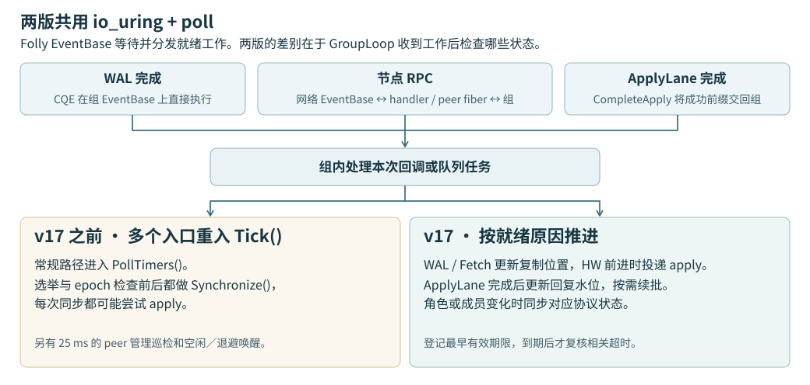
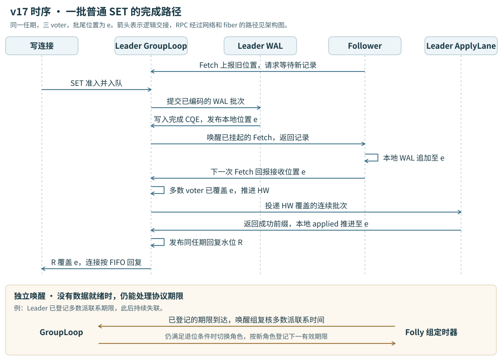

# v17 P1-8 Raft 数据组在 io_uring 事件循环中按就绪工作推进

**已实现。** poll 返回后，GroupLoop 根据发生的事件推进组状态。一次有效的 Fetch 让多数副本覆盖了新记录，组就更新提交水位并调度 apply。这条因果链可以从 Fetch handler 一直追到回复连接。只有条件本身取决于时间时才登记 timer，例如选举超时或重连退避。同机九对压测的吞吐和尾延迟中位数达到防退化门槛。 [Profile 索引](../profile.md)

## 架构对比

两版都使用 **io_uring + poll**。这里的 poll 指 Folly EventBase 等待并分发 I/O 完成和已投递的任务。RPC 在网络 EventBase 上收发，WAL 的 CQE（I/O 完成通知）直接在组的 EventBase 上执行。v17 以前，组内的 `PollTimers()` 由这些入口调用。25 ms 休眠出现在 peer 管理和空闲／退避路径，正常 WAL 完成和 Fetch 已经可以立即得到处理。 [组 EventBase](../../../src/server/cluster/raft/storage/folly_io.cc#L55) · [WAL 完成路径](../../../src/server/cluster/raft/runtime/group.cc#L648) · [peer 循环](../../../src/server/cluster/raft/runtime/group.cc#L929)

| 交接 | v17 之前 | v17 |
| --- | --- | --- |
| Follower 发 Fetch | peer fiber 交给 Folly RPC client 并在 `Done` 上挂起。网络回调唤醒 fiber，再经 `RunOnWorker` 交给所属组处理响应。 | 保留网络与组的所有权边界。回报到组后更新对应副本位置与 HW。 |
| Leader 收 Fetch | 网络 EventBase 收到整帧，交给有界的 `raft-rpc-slot` fiber。handler 经 `GroupLoop::Await` 访问组状态，响应回到网络 EventBase 写 socket。 | 沿用同步 handler 适配层。组收到请求后处理该副本的 Fetch，暂挂请求由日志或水位变化唤醒，到达请求期限时结束等待。 |
| WAL 与 apply 完成 | WAL CQE 直接在组内执行。独立 ApplyLane 则经 `CompleteApply` 将成功前缀交回组。两条路径在条件允许时都会调用 `Tick()`。 | WAL 完成只推进相关日志和复制进度。apply 完成发布前缀和回复水位，有积压再续批。 |

v17 之前，Fetch 入口可通过 `Tick → PollTimers` 在选举和 epoch 检查前后各执行一次 `Synchronize()`，两次都可能尝试 apply。v17 将触发点放回各自的事件。网络线程持有 socket，GroupLoop 持有 Raft 状态，ApplyLane 返回执行结果。 [出站 fiber](../../../src/server/cluster/raft/transport/peer_connection.cc#L43) · [入站 handler](../../../src/server/cluster/raft/transport/raft_listener.cc#L94) · [网络线程发送响应](../../../src/server/cluster/raft/transport/folly_rpc.cc#L241) · [组事件](../../../src/server/cluster/raft/runtime/group.cc#L494)

## 一批 SET 如何得到回复

图中取稳定任期、三个 voter、`memory` 确认模式，跟踪一批普通 SET 的排他结束位置 `e`。示例里 Follower 的 Fetch 已挂起，Leader 和这一个 Follower 构成多数。蓝色箭头表示工作投递或完成，底部单独画出无写入时到期唤醒的例子。

GroupLoop 只为本任期已绑定的写发布 `R = min(本地确认位置, HW, 本地 applied)`。连接按 FIFO 回复所有被 R 覆盖的命令。Follower 接收位置可以先于其 applied，后续 Fetch 独立回报 applied，供原连接的 `WAIT 1` 使用。 [多数派计算](../../../src/server/cluster/raft/quorum/fetch_replication.cc#L170) · [Fetch 回报](../../../src/server/cluster/raft/quorum/fetch_replication.cc#L373) · [回复水位](../../../src/server/cluster/raft/runtime/data_node.cc#L951)

## 数据组如何推进

| 触发条件 | GroupLoop 要做的事 |
| --- | --- |
| WAL 写入或同步完成、收到有效 Fetch | 按当前确认模式更新本地或副本位置，重新计算受影响的 HW，唤醒满足条件的 parked Fetch。HW 覆盖新的连续记录且 ApplyLane 空闲时，投递一批。 |
| ApplyLane 完成 | 发布本次成功的连续前缀并处理首错。按本地确认位置、HW 和 applied 中的最小值发布同任期可回复水位。若仍有已提交记录，续投下一批。 |
| 角色、任期、成员或快照状态变化 | 在组内完成复制、投票和快照状态同步后，再按新的角色推进数据。成员或 Leader 端点变化时更新 peer 集合，有投票、epoch 通知或拉取工作时唤醒对应 peer。 |
| 最近期限到达 | 用现有 Folly 组定时器登记最早有效期限，到期复核并重新安排。覆盖选举、Follower 联系超时、Leader 丢失多数派、epoch 通知重试、成员变更及 SET 票据超时。失败 peer 的发现和重连保留退避。 |

HW 变化、日志代次变化和 apply 完成都会标记有待检查的 apply。WAL 追加或 ApplyLane 忙时保留该标记，完成事件再次检查并续批。ApplyLane 完成后先发布连续前缀及同任期回复水位，再续批或因首个执行错误停组。成员和 Leader 端点变化刷新 peer 集合，RPC 回报交回组时重新核对成员身份和端点。 [组事件](../../../src/server/cluster/raft/runtime/group.cc#L459) · [取批与回放](../../../src/server/cluster/raft/runtime/data_node.cc#L471) · [缓存与日志校验](../../../src/server/cluster/raft/data/set_effect.cc#L289)

**空闲时的期限。** 启动或换任期时按角色登记选举和 epoch 期限。收到多数派联系时延后退位期限，定时器触发时按最新联系时间复核。有待同步的 `memory` 写入时，登记最老缓冲的时间阈值，达到字节阈值则立即检查 flush。peer 先订阅再检查待办，空闲时等待通知，失败时按退避期限重试。若期限被 WAL 屏障挡住，完成 CQE 先复核到期工作，再发下一批。 [epoch 超时](../../../src/server/cluster/raft/quorum/epoch_control.cc#L257) · [后台 flush 条件](../../../src/server/cluster/raft/log/partition_log.cc#L262) · [组定时器](../../../src/server/cluster/raft/runtime/group.cc#L567)

## 架构验收

- **数据就绪即可完成。** 在稳定任期、所有期限均未到达时，只依次交付图中的 SET、WAL、Fetch 和 apply 事件。检查组能发布回复水位，连接能按序回复。若必须额外调用一次通用 tick 才能继续，该路径仍依赖巡检。
- **时间到期也能独立生效。** 让无客户端流量的 Leader 与多数派失联，推进时钟至已登记的期限，检查组能复核联系时间并退位。若在到期前已恢复多数派联系，则按更新后的期限处理。
- **跨所有权边界不丢进度。** apply 在途时让 HW 连续推进，完成当前批后应续投直至追平。新增待办与 peer 挂起并发时应能唤醒 peer。旧任期的完成通知只能按旧任期收尾。

## 实现后的防退化验收

1. **同版本配对。** A 用实验起点的代码，B 只增加本步调度改动。两端共用修复、编译配置、宿主机与文件系统，留存二进制 SHA-256。用未插桩 Release 交替跑至少三对。主负载沿用 `memory`、8 MiB 准入、1 连接、pipeline 64、256 MiB、256 KiB/value，末尾在写连接执行 `WAIT 1`。v15 的 515.03 MiB/s 和 33.59 ms 只作历史参照。 [正式负载与复测](v15-shard-apply.md#8-mib-复测)
2. **吞吐与尾延迟同时过线。** 分别取 A、B 各轮中位数，要求 B 的含 `WAIT 1` 吞吐 ≥ A，且 B 的 SET 批次 P95 ≤ A。逐对列出两项差值，并保留每轮 16 批原始延迟。按当前最近秩算法，单轮 P95 就是该轮最慢的一批。若任一配对出现退化，交替顺序追加复测。退化可复现则判为未通过，波动仍无法区分则标为待验证。两种情况均暂缓采用。 [既有配对实验](v16-wal-encode-overlap.md)
3. **定位退化。** 若配对测试出现吞吐下降或尾延迟上升，按批次对齐 WAL、HW、applied 和有序回复，再检查相关队列等待、CPU 和定时器实际触发时间。 [v15 诊断参照](http://172.31.23.2:8787/#/v15/trace)
4. **验证协议活性与数据正确性。** 在无写流量时触发断主、丢失多数派及重连，比较选举、退位与恢复时间。核对有界队列饱和时仍能处理定时事件、低流量写入仍能触发后台 flush。覆盖 `memory` 和 `flush`、apply 在途换任期、快照安装与截断、部分批次失败。每轮保留原连接 `WAIT 1`、离线副本恢复、`WAIT 2` 与全量逐值读回结果。 [数据组回归](../../../tests/integration/raft_data_group_test.py) · [epoch 控制回归](../../../src/server/cluster/raft/quorum/epoch_control_test.cc)

### 同机结果

A 为 `bdfeb0bd`，B 为 v17。两组使用同机 ext4、Folly io_uring、未插桩 Release、`memory` 和 8 MiB 准入。每轮使用同一套 Go 驱动，按 1 连接、pipeline 64、256 MiB、256 KiB/value 执行写入。18 轮均通过原连接的 `WAIT 1`、离线副本恢复、`WAIT 2` 和 1,088 个值逐字节读回。

| 配对 | 顺序 | 含 WAIT 1 吞吐 A → B（MiB/s） | 吞吐变化 | SET 批次 P95 A → B（ms） | P95 差（ms） |
| ---: | :---: | ---: | ---: | ---: | ---: |
| 1 | B → A | 657.82 → 609.80 | −7.30% | 29.17 → 42.37 | +13.20 |
| 2 | A → B | 642.59 → 618.73 | −3.71% | 27.64 → 29.58 | +1.94 |
| 3 | B → A | 640.85 → 664.74 | +3.73% | 29.34 → 26.05 | −3.29 |
| 4 | A → B | 604.86 → 614.33 | +1.57% | 29.84 → 28.21 | −1.63 |
| 5 | B → A | 586.05 → 696.99 | +18.93% | 33.47 → 26.47 | −7.00 |
| 6 | A → B | 626.66 → 686.24 | +9.51% | 30.63 → 26.34 | −4.29 |
| 7 | B → A | 679.23 → 663.42 | −2.33% | 27.81 → 29.68 | +1.87 |
| 8 | A → B | 552.87 → 686.81 | +24.23% | 37.43 → 27.33 | −10.10 |
| 9 | B → A | 590.30 → 659.74 | +11.76% | 32.35 → 27.68 | −4.67 |
| **九对中位数** | | **626.66 → 663.42** | **+5.87%** | **29.84 → 27.68** | **−2.16** |

首组三对的中位数分别为 642.59 → 618.73 MiB/s 和 29.17 → 29.58 ms。后两组各自达到中位数门槛。六对同时改善，三对同时退化，单轮差异较大。该负载的合并中位数达标。各组结果有反转，现有数据无法从测量波动中确认稳定的性能收益。

平台 v17 的主对照展示最后三对，首轮与反序复测各保留为独立组。总览中的上一轮链接指向历史 v16，表中的 A 是本次按 `bdfeb0bd` 重建的同机基线。 [v17 运行记录](http://172.31.23.2:8787/#/v17/runs)

二进制哈希、`summary.json`、`rounds.csv` 和逐轮日志留在实验机的 `/data/dragonfly-observability/state/raft-workflow/experiments/v17/source/`。首组三对在 `matched/`，每轮留有 P95 汇总。后六对在 `matched-repeat/` 和 `matched-confirm/`，两组每轮 `result.json` 均含 16 个原始批次延迟。复测目录 `matched-repeat/` 将 A 标为 `candidate`、B 标为 `baseline`，借此反转起跑顺序。

Debug 通过 85 项 Raft C++ 单测及 14 项数据组集成回归，Release 通过 65 项 Raft C++ 单测。ASan/UBSan 通过 12 项 C++ 单测及 2 项集成回归。回归覆盖无客户端请求时的 Leader 退位与重连选主、空闲 memory flush、流水线饱和、停机排空、崩溃恢复、成员提升和两种确认模式的快照追赶。 [无请求退位测试](../../../tests/integration/raft_data_group_test.py#L289)

独立诊断使用归档的 v17 Release 二进制重跑，Langfuse 完整性校验通过，采集到 Leader、Follower 和压测客户端的 27,868 条事件。两张节点 CPU 火焰图与诊断日志已归档。 [v17 Trace](http://172.31.23.2:8787/#/v17/trace)
