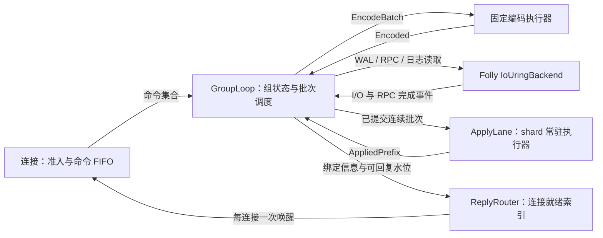

# Raft 批次事件驱动写入架构

**当前实现为 v15。** Folly io_uring 事件循环负责 Raft 写入与复制，ApplyLane 将相邻同 shard 的已提交 SET 交给所属引擎线程。v15 的性能上一轮为 v14b。 [v14 首版](profile/v14-batch-event-loop.md) · [v14b 进度修正](profile/v14b-batch-progress.md) · [v15 实验](profile/v15-shard-apply.md)

**实验约定：本提案按重大架构改造持续迭代，不因首版或后续某轮性能不佳自动回退代码。** 先形成可运行的第一版并测试，再沿当前实验实现分析和优化，详见[实验推进约定](#9-实验推进约定)。

核心结构是：**有界提交队列 → 批量编码与 WAL → 复制水位 → 批量应用 → 可回复水位 → 连接连续回复。** 每条命令保存必要的输入、序号和日志位置；等待、调度和完成通知以组、批次及连接为单位，不设置逐笔确认 fiber、逐笔完成回调或逐笔定时器。

当前实现范围

- 普通 SET 使用有界准入、固定编码执行器、共享任期回复水位和组级截止时间；没有逐笔确认 fiber 或 `WaitApplied` 回查。连接沿用 FIFO 回复，条件写保留串行屏障。
- Folly EventBase 持有组状态，WAL 完成直接回到组内；独立 ApplyLane 每批一次交接，应用在途时继续处理普通 Fetch。
- Follower 应用在途时避免携带旧 applied 进入长轮询，空响应等待本地批次事件；Leader WAIT 由副本进度唤醒，100 ms 检查上限仅用于关闭等兜底。
- 节点间收发使用 `AsyncIoUringSocket` / `IoUringBackend`，测试的外部 RESP 连接也使用 io_uring。同步 RPC handler 目前仍由有界、常驻的引擎 fiber 槽执行；它不承载网络 I/O。
- ApplyLane 对连续同 shard 的 SET 按段执行，本线程直接调用，跨线程每段投递一次 L2。多笔段复用非原子 shard 本地事务，每笔仍走同步 SET 的状态检查、锁和回复校验。控制、恢复和快照保留原有屏障。

## 1. 执行与所有权



| 组件 | 职责与约束 |
| --- | --- |
| GroupLoop | 每组一个串行状态所有权域，由固定数量的 Folly EventBase 线程承载。处理任期、日志位置、水位、批次与屏障事件；处理函数不等待磁盘、shard 或客户端 |
| 编码执行器 | 固定数量的执行上下文，处理不可变的批次输入，完成后返回编码缓冲与记录边界；不修改组状态 |
| Folly I/O | Raft 文件 I/O、节点间 RPC 和定时事件统一通过 Folly 调度；节点连接使用 `AsyncIoUringSocket`，io_uring 资源由 Folly 管理。CQE 和网络完成直接回传 GroupLoop |
| ApplyLane | 每组保持有序应用队列，向 shard 常驻执行器投递批次，返回已完成连续前缀；共享现有引擎数据结构和事务约束 |
| ReplyRouter | 每个客户端 proactor 上维护组进度及连接队首索引，按水位找到可回复连接，再由连接自己的循环发送回复 |

跨组件传递不可变缓冲、批次描述或进度事件。只有 GroupLoop 能改变本组控制状态。Raft 节点间连接从监听、接入到收发都由 Folly 的 io_uring 网络路径处理，不经过 RESP listener、Helio socket 或 epoll 转发。外部 RESP 客户端连接和 shard 继续由各自所属线程访问；只有 Raft 与这些宿主引擎线程之间需要有界 mailbox。

## 2. 数据单位与水位

| 单位 | 保存的内容 |
| --- | --- |
| CommandRecord | 连接 ID 与代次、连接内序号、输入所有权、准入额度、截止时间、绑定后的日志位置及最终协议结果；没有独立等待任务 |
| WriteBatch | 组实例代次、任期、批次 ID、连续日志区间、输入引用、编码缓冲及命令到日志位置的映射 |
| ApplyBatch | 已提交的连续记录视图、数据所有权和应用代次；完成事件携带成功前缀及首个错误 |
| Progress | 组实例代次、任期、单调递增的水位与事件序号；同一目标上未消费的普通水位可以合并 |

日志区间采用 `[begin, end)`，一条写用自己的排他 `end_offset` 判断是否完成。

- `W`：本地 WAL 写入完成的连续末端；短写必须补齐后才推进。
- `D`：日志及恢复标记均达到现有持久化要求的连续末端。
- `H`：依据既有 Raft 任期、选民集合和多数确认规则得到的提交水位。
- `A`：本地状态机已成功应用的连续末端，始终不超过 `H`。
- `R`：当前 Leader 任期可对普通写发布成功结果的水位。

`flush` 使用本地 `D` 和副本持久位置计算确认条件；`memory` 使用本地 `W` 和副本接收位置。令本地相应水位为 `L`，则 **`R = min(L, H, A)`**。只有本任期已接纳且已绑定的写可以用该水位完成。控制记录、任期状态及恢复标记保留原持久屏障。

`memory` 仍写 WAL page cache，后台刷盘仍决定恢复边界。I/O 完成、Fetch 返回和 shard 执行完成各自只推进对应阶段，不能单独产生 SET 成功结果。

## 3. 从提交到回复

1. **准入。** 连接为普通 SET 预留笔数和字节额度，将命令放入有界队列。容量不足时不转交输入、不产生提交副作用，沿用连接反压。提交使用非等待入队；空队列转为非空只安排一次组唤醒。
2. **取批。** GroupLoop 选取同组、同任期、同语义且能装入当前段及预算的连续前缀，分配日志位置。空闲时立即发出首笔；上一批编码或 I/O 在途期间收集后续请求，不设置人为凑批等待。
3. **编码与追加。** 编码执行器产出不可变 WAL 缓冲，GroupLoop 核对批次代次后交给 Folly。每组限制未完成追加批次数，只有连续完成前缀可以发布为 `W`/`D`；设计默认每组一个追加批次在途，其他组共享 io_uring 容量。
4. **绑定与复制。** 本地追加成功后，按批发送命令序号到日志位置的绑定信息。Follower Fetch 按模式报告接收或持久位置，GroupLoop 更新 `H`，把已提交前缀送入 ApplyLane。
5. **应用与发布。** `AppliedPrefix` 事件推进 `A`，GroupLoop 计算新的 `R`，向相关 ReplyRouter 发布一次进度。整个过程没有逐笔 `WaitApplied`，也没有为每条命令回查 worker。
6. **连续回复。** ReplyRouter 找到队首已被 `R` 覆盖的连接，每连接安排一次处理。连接连续消费可回复前缀，按原顺序发送 OK/错误、更新 `raft_last_write` 并释放额度。RESP 仍为每条命令返回一条回复。

连接的判定逻辑是：

```text
收到 BindBatch / Advance / Reject / EpochClosed：更新本地记录与组进度
while 队首已经有最终错误，或已绑定位置被有效成功水位覆盖：
    发送队首回复，更新本连接写位置，释放该记录
将尚未完成的队首登记到对应组的连接就绪索引
```

每个连接只有队首参与等待索引，后续命令保存在原 FIFO。水位先于绑定到达时保留最新进度，绑定到达后立即重检。GET、WAIT、条件写、SELECT 等命令仍遵守连接屏障；不同 key 可以提前提交，同 key 保留提交及应用顺序。

连接的延迟回复接口直接读取 ReplyRouter 缓存的进度和队首结果，等待订阅归连接所有。绑定、拒绝、进度和任期结束消息按组内事件序号有序处理；只合并不跨越其他事件的连续进度更新。已决定的超时或失败优先于随后覆盖该日志位置的水位，迟到绑定和进度都不能把它改成成功。

## 4. Fetch 与应用各自推进

**Fetch 服务只依赖复制状态和可读日志。** GroupLoop 校验请求，获取任期、水位和不可变数据引用；需要 WAL 读取时异步交给 Folly，完成后重新检查代次，再发送响应。长轮询由新可读数据或水位事件唤醒，处理 Fetch 不再顺带同步执行 apply。

Follower 收到数据后按批校验并追加，达到 `W`/`D` 后即可驱动下一次 Fetch；已提交记录进入独立、有界的 ApplyLane。应用完成再发布本地 `A`，供 `WAIT` 跟踪副本应用进度。应用落后会触发数据反压，控制消息和进度报告仍须能够前进。

**ApplyLane 按连续日志顺序消费。** 一个应用批次可以包含多条普通 SET；取相邻、同 shard 的连续记录作为一个 shard 任务，复用批次上下文，逐条执行必要的数据写入。返回成功前缀长度，随后再执行下一段。每个远端 shard 段有一次投递和等待，每个 ApplyBatch 有一次 GroupLoop 完成通知。交错访问 shard 的日志可产生多个单笔段。

shard 内批量执行必须保留逐条 SET 的 DbSlice、事务、watch、过期和内存错误处理等契约。条件求值、控制记录、slot 迁移及快照操作构成屏障，等待所需前缀应用后再执行。屏障等待由状态和完成事件表示，GroupLoop 同时仍可处理 I/O、Fetch 和任期事件。

## 5. io_uring 的位置

Raft 的 I/O 后端使用 **Folly EventBase + IoUringBackend**，复用成熟的提交、完成和资源管理。一个 WAL 批次对应必要的写入及同步操作，CQE 推进批次状态；多个完成在一次事件循环处理中汇总进度通知。

编码、CRC、SET 内存操作和 Raft 状态转换在用户态执行。为每条 SET 提交 NOP 或通知 SQE，仍会保留逐笔调度成本；此结构的基本单位是批次和进度。

节点间通信直接使用 Folly `IoUringBackend` 上的网络连接；接收完成驱动本机 GroupLoop，发送完成释放对应批次引用。不能仅把 EventBase 换成 io_uring backend，却仍用原来的 Helio/epoll socket 收发节点 RPC；启动和测试须验证实际 socket 类型及后端。

同机跨线程通知通过有界 mailbox 合并，每个目标只有一个待处理唤醒标记。**本实验关闭测试配置中的 epoll 客户端线程，节点 RPC 单测不启动 Helio 网络 proactor，集成测试的 RESP 线程也使用 io_uring。** 若使用 `MSG_RING`，须有发送和接收 ring 的支持，并通过 Folly 的可用能力接入。网络 I/O 的 io_uring 化不消除本机跨线程的所有权交接，通知只提示“队列有进展”，命令和缓冲保留在用户态队列中。

## 6. 反压与生命周期

- **入口预算贯穿回复。** 沿用每数据组 256 笔 / 8 MiB 的准入起点，覆盖待编码、在途、待应用及已完成未回复的记录。合法超预算单笔只允许独占窗口。执行收尾和回复消费（或断连）都完成后才归还整笔额度，且只归还一次。
- **缓冲单独计费。** 输入、编码 WAL、Fetch 接收和应用视图按唯一底层分配的实际容量计费；I/O 与视图共享所有权。队列容量和 effect 缓存容量分别受限，8 MiB 准入额度不代表进程总内存上限。
- **逐阶段释放。** 编码方确认不再读取后释放输入；WAL/Fetch 缓冲等最后一个 I/O、复制或应用引用释放后回收。连接断开可丢弃回复记录，已接纳写仍由组持有至完成或失败。
- **保证进度事件入队。** I/O 完成、任期变化、错误和关闭拥有预留的处理容量。普通水位可合并，绑定、失败和任期结束事件不可丢弃；数据队列满不能阻止释放额度的事件进入。
- **防止丢失唤醒。** 消费者清除待唤醒标记后重新检查队列；生产者先发布数据再置位通知。每轮处理限制笔数和字节数，让其他组及控制事件获得执行机会。

## 7. 异常与屏障

| 事件 | 处理规则 |
| --- | --- |
| 追加前失败 | 按命令序号发布拒绝结果；未写日志的请求不绑定成功水位 |
| 超时 | 每组用一个最早截止时间定时器扫描到期记录。已经进入追加的请求返回结果未知，不将超时解释为写入已取消；迟到事件仍须完成资源收尾 |
| 换主 / 换任期 | 关闭旧任期提交，发布其已决定的成功边界及剩余请求错误；旧绑定不能使用新任期水位。已决定的结果只发布一次 |
| I/O 或应用失败 | 停止推进失败点之后的连续水位，按既有存储故障规则隔离组。部分执行只返回实际成功前缀，不为后续写生成 OK |
| 截断 / 快照安装 / 迁移 | 建立日志或应用屏障，排空相关任务后切换代次。迟到事件只按其资源责任收尾，不能修改新代次状态；已提交前缀不得截断 |
| 断连 / 关闭 | 连接 ID 带代次，避免通知落到复用连接。关闭时停止准入，排空 I/O 与应用，完成必要刷盘，再清理订阅、批次引用及线程资源 |

所有最终结果由 GroupLoop 的串行事件顺序裁决。复制提交、应用完成和超时可以竞争，但同一命令不会既返回成功又返回错误。已经执行的数据不能靠丢弃一个迟到事件撤销。

## 8. 验证与衡量

架构验收应确认：请求数增加时只增加有界记录和批次，逐笔确认 fiber、逐笔 applied 回查和逐笔定时器的数量均为零。执行上下文数量由组、线程和连接决定。

需要记录以下指标，分别观察成本来源：

- 每千笔的编码批次、WAL 提交、shard 任务、完成通知和连接唤醒次数；每批笔数与字节数。
- 编码排队/执行、I/O 排队/执行、shard 入队/等待/执行、应用完成到回复的时间；事件携带代次、批次 ID 和 offset，便于关联。
- `W`/`D`/`H`/`A` 的距离、各队列容量、唯一缓冲字节数、执行上下文数量和 RSS 峰值。
- 同 key 顺序、跨 shard 连续前缀、FIFO 回复、GET/WAIT/条件写屏障，以及队列饱和时控制事件能否前进。
- 绑定与水位乱序到达、重复/迟到完成、超时、断连、换主、短写、I/O 失败、应用部分失败、截断及快照安装。

性能对照使用平台的 v13 归档，普通 `memory` 负载仍为 1 连接、pipeline 64、256 MiB、256 KiB/value，正式三轮与独立诊断分开。`flush` 同样做正确性回归。减少 fiber、队列访问或局部 CPU 不直接等于吞吐收益，最终同时检查吞吐、P95 和内存。

## 9. 实验推进约定

本提案采用持续演进的实验线路，不套用小范围优化“没有稳定收益就回退代码”的规则。

1. **先出第一版。** 实现能贯通提交、复制、应用和有序回复的新结构，完成构建与正确性验证，再通过 profile CLI 运行首轮 benchmark、Trace 和火焰图采集。首轮用来建立新结构的实测起点。
2. **性能不佳继续改。** 保留当前实验代码，如实记录吞吐、P95、CPU、内存和错误；从 Trace、火焰图及队列指标定位具体问题，在这一版本上修复、优化、再测，不自动恢复为 v13 或其他旧实现。
3. **正确性问题优先修复。** 构建或正确性验证失败时，保留失败证据并在当前实现上修正；通过相关验证后再做性能测量，不把失败运行记为有效 benchmark。
4. **每轮可追溯。** 保存源码快照或补丁、二进制指纹、改动说明、正确性结果和完整指标。平台记录各轮独立结果，不覆盖旧数据；固定基线引用 v13，上一轮引用本实验线路最近一次有效测量。
5. **按证据持续迭代。** 每轮明确瓶颈判断、针对性改动和实际变化。无收益的尝试同样保留结论，用来决定下一处调整；单轮下降不作为放弃新结构的依据。

**回退或放弃这条新架构线路，只按用户的明确指令执行。** 保留旧版本归档用于对照，不代表将实验代码切回旧版本。

[v13 Trace 背景](profile/v13-fetch-borrow.md#trace-复核) · [现有确认与持久化语义](io_uring.md)
