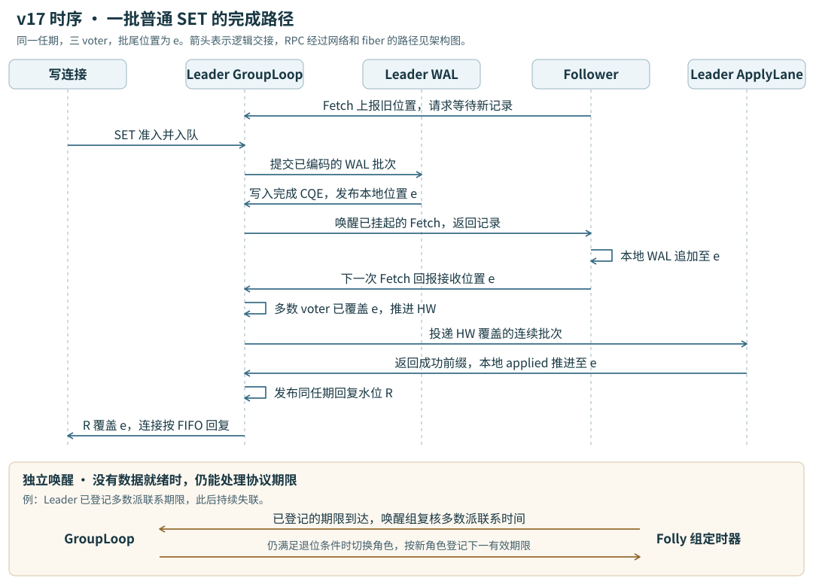

# Raft 数据组的批次与事件循环

当前数据组沿用 v15 的连续同 shard 应用，包含 v16 的连接准入补发和 follower 后台刷盘重叠，以及 v17 的就绪事件调度。普通 SET 从有界准入进入编码、WAL、复制和 ApplyLane，达到同任期的回复水位后由连接按序回复。[v15 shard 应用](profile/v15-shard-apply.md) · [v16 准入与刷盘](profile/v16-wal-encode-overlap.md) · [v17 调度与验证](profile/v17-group-scheduling.md)

WAL 提交与完成、节点 RPC 和引擎线程之间的联系见 Folly 专节的架构图。[Folly io_uring 优化路径](io_uring.md#folly-io_uring-优化路径)

## 1. 执行与所有权

| 执行位置 | 当前实现 |
| --- | --- |
| RESP 连接 | 支持异步分发的连接可提前提交多笔普通 SET，连接通过延迟回复队列保留命令顺序。容量不足时保持原参数以便重试，已有队首回复可推动下一轮准入。[命令分发](../../src/server/main_service.cc) · [连接队列](../../src/facade/dragonfly_connection.cc) |
| 组执行器 | 串行修改本组的角色、任期、日志、HW 和写入票据。Folly 构建由组的 EventBase 持有这些状态，WAL 完成直接回到组。Helio 构建使用串行 worker 和事件唤醒的 deadline fiber。[组运行时](../../src/server/cluster/raft/runtime/group.cc) |
| 编码执行器 | 接收已选定的批次，构造只读 WAL 缓冲。完成后交回组，组在追加前复核日志末端、内容代次、任期与 slot 归属。[批次准备与追加](../../src/server/cluster/raft/runtime/data_node.cc) |
| ApplyLane | 每个数据组在所属引擎 proactor 上有一个常驻 apply fiber。普通 SET 按相邻同 shard 的连续段执行，本线程直接调用，跨线程每段一次投递。批次完成报告成功前缀及首个错误。[提交回放](../../src/server/cluster/raft/runtime/data_node.cc) · [分片执行](../../src/server/cluster/raft/data/set_executor.cc) |
| 节点 RPC | Folly 构建使用独立网络 EventBase 上的 `AsyncIoUringSocket`。入站整帧交给有界 RPC handler fiber，handler 通过组执行器访问状态，响应回到网络线程发送。出站 peer fiber 等待 RPC 完成后将结果交回组。RESP 和引擎线程继续由宿主 proactor 调度。[RPC 接收](../../src/server/cluster/raft/transport/raft_listener.cc) · [Folly 网络](../../src/server/cluster/raft/transport/folly_rpc.cc) |

## 2. 数据单位与水位

日志区间使用排他末端 `end_offset`。设 `L` 为本地在当前模式下的确认位置，`H` 为组提交水位 HW，`A` 为本地已应用的连续末端。Leader 在同任期发布 **`R = min(L, H, A)`**，只有已绑定到该任期及位置的票据能由该水位完成。票据也可以独立返回已决定的错误。[回复水位](../../src/server/cluster/raft/runtime/data_node.cc) · [票据判定](../../src/server/cluster/raft/data/write_progress.h)

| 水位 | 推进条件 |
| --- | --- |
| 本地写全位置 | 完整 WAL 字节写入 page cache。已挂起的有效 Fetch 可以由此提前取得记录。 |
| 本地持久位置 | 同步日志段并完成恢复标记发布。使用 `flush` 时，本地确认位置及 voter 回报位置取这一边界。 |
| 本地确认位置 `L` | `flush` 取持久位置，`memory` 取写全后发布的日志末端。后台刷盘独立推进 `memory` 的恢复边界。 |
| 提交水位 `H` | Leader 按当前 voter 配置及任期约束计算多数位置。小于 HW 的 offset 已提交。 |
| 已应用位置 `A` | 各副本完成本地 KV 回放后推进。Follower 通过后续 Fetch 单独报告其已应用位置，供 `WAIT` 使用。 |

[确认模式及故障边界](io_uring.md#当前实现默认开启) · [Fetch 与多数派计算](../../src/server/cluster/raft/quorum/fetch_replication.cc)

## 3. 从提交到回复

1. **准入。** `raft_drain_writes=true` 时，异步普通 SET 按数据组保留最多 256 笔、8 MiB 键值的额度。合法超额度单笔只有在额度窗口空闲时才能独占进入。组和连接均持有票据，执行结束且连接消费回复或断开后才回收额度。该预算覆盖键值准入，WAL、Fetch、apply 和连接缓冲另占内存。[准入预算](../../src/server/cluster/raft/data/admission_budget.h)
2. **取批。** 组从就绪队列取最多 32 笔，按积压采用 1 或 4 MiB 编码预算，并按当前段实际可容纳的连续前缀截取。装不下的后缀回到队首，首笔需要换段时单独处理。条件写单独执行。组空闲时可以立即取批。[数据组取批](../../src/server/cluster/raft/runtime/data_node.cc)
3. **编码与追加。** 编码器将多个单记录 Kafka 批写入同一个 WAL 缓冲，每条写取得自己的排他 offset。组提交追加并绑定票据后，可释放原始输入。缓冲由追加和回放引用共同持有。异步提交接收成功时可能仍有 I/O 在途，票据先绑定，水位随后决定何时能回复。[WAL 缓冲与追加](../../src/server/cluster/raft/runtime/data_node.cc) · [追加完成](../../src/server/cluster/raft/quorum/fetch_replication.cc)
4. **复制与应用。** WAL 完成和有效 Fetch 报告推进各自的日志位置。HW 覆盖新的连续前缀后，组在 ApplyLane 空闲且追加屏障允许时投递一批。ApplyLane 应用普通 SET 并交回完成位置，组更新已应用前缀与回复水位。恢复、条件失败的空操作、迁槽和快照走各自的串行屏障。[组事件与应用](../../src/server/cluster/raft/runtime/group.cc) · [ApplyLane](../../src/server/cluster/raft/runtime/data_node.cc)
5. **有序回复。** 异步普通 SET 共享任期的进度通知，连接检查 FIFO 队首，连续回复已就绪项并更新连接的写入位置。该路径使用现有延迟回复和等待接口。条件写及同步回退路径可通过 `WaitApplied` 等待；GET、WAIT、NX/XX、SELECT 等命令须等到队首。连接断开仍由组收尾已接纳的写入。[命令分发与回复](../../src/server/main_service.cc) · [同步回退](../../src/server/cluster/raft/runtime/data_node.cc)

## 4. 就绪事件与期限

| 组收到的事件 | 数据组推进的工作 |
| --- | --- |
| 新写准入、编码完成 | 合并准入唤醒，收集待办，编码完成后复核批次并追加。 |
| WAL 写入或同步完成、有效 Fetch 请求或响应 | 更新相关位置和水位，唤醒满足条件的挂起 Fetch。有待应用前缀时尝试投递 ApplyLane。 |
| ApplyLane 完成 | 发布成功前缀和同任期回复进度。有积压时继续投递。若执行失败，停组前保留已经成功应用的前缀。 |
| 任期、成员、leader 端点或快照状态变化 | 同步受影响的组状态，更新 peer 集合。有投票、通知或拉取工作时唤醒相应 peer。迟到响应重新检查成员身份及端点。 |
| 有效期限到达 | 复核选举、leader 的多数派联系期限、epoch 通知、成员变更、写入票据和后台刷盘。被 WAL 屏障挡住的协议期限在 I/O 排空后复核。 |

数据组正常复制与写回复由就绪工作驱动。空闲 peer 等通知，失败、发现和重连保留退避。元数据组沿用 `TickMetadata`/`PollTimers`，数据节点的注册心跳与迁移驱动也保留各自的轮询。[数据组与元数据组调度](../../src/server/cluster/raft/runtime/group.cc) · [心跳及迁移](../../src/server/cluster/raft/runtime/data_node.cc)

Follower 可以先在 Fetch 中回报接收位置。ApplyLane 在途时发送零等待 Fetch，避免让旧 applied 位置挂在长轮询中。若即时响应为空，则等待本地应用事件或期限。Leader 上的 `WAIT` 由副本进度变化唤醒，并保留最多 100 ms 的复核间隔。[Follower Fetch](../../src/server/cluster/raft/runtime/group.cc) · [WAIT 实现](../../src/server/server_family.cc)

## 5. I/O 屏障、故障与验证

每组最多一轮异步追加在途。`memory` 下，一个后台 flush 可以与满足条件的同任期、同段普通数据追加重叠，leader 和 follower 均适用。flush 只发布开始时捕获的恢复边界，之后追加的尾部留待后续刷盘。换段、控制批、截断、快照安装及关闭仍可在组内执行同步 I/O，按各自的持久化和应用屏障推进。[刷盘与恢复边界](io_uring.md) · [日志追加和 flush gate](../../src/server/cluster/raft/log/partition_log.cc)

已追加的写遇到换主、超时或丢失回复时，客户端可能得到结果未知。旧任期票据不能使用新任期的回复水位。追加或应用失败会阻止失败点之后的成功水位继续前进。[客户端故障语义](raft-replication-design.md#6-kv-执行快照与客户端故障语义)

调度与故障验证见无流量退位与重新选主、空闲 `memory` 后台刷盘、pipeline 饱和、关闭排空和快照追赶用例。v17 与同机基线的九对结果、逐轮差异及诊断记录见版本实验页。[数据组集成用例](../../tests/integration/raft_data_group_test.py) · [v17 同机结果](profile/v17-group-scheduling.md#同机结果) · [Trace 查询](otel/trace.md)
