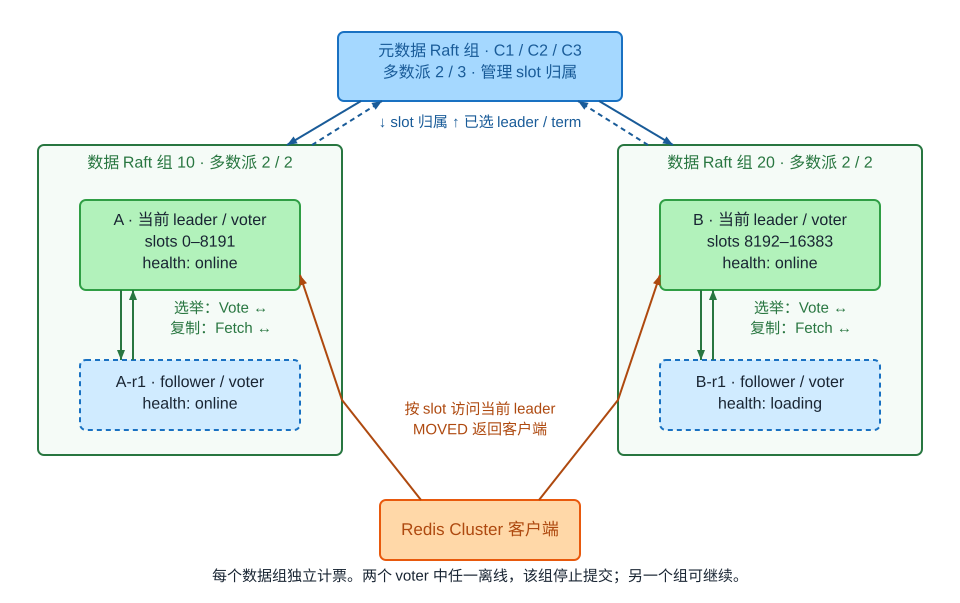
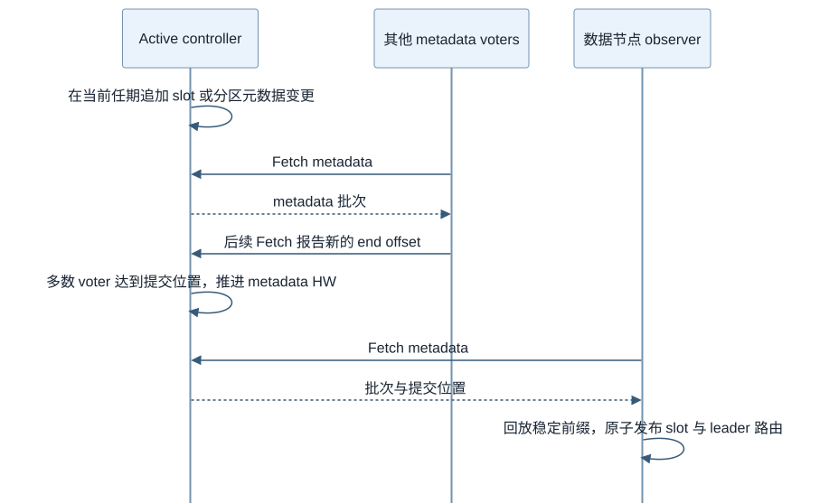

# Dragonfly 集群设计：KRaft 元数据与按复制组运行的 Raft

设计提案。Kafka 基线为同级仓库的 `5b648ca9cbeed3cebe553fba86c516b08bcaeb40`，Dragonfly 基线为 `fbc5370234e38bd983ffdd6238b4512ba47182c6`。文中的 Kafka 行为以这两个 checkout 中可核对的源码和测试为准；当前分支已运行原图的三个 controller 和两个数据组。本期以原图七节点建群、读写、迁槽和重启恢复为通过条件。[验收清单](todos.md)

## 1. 两层 Raft 管什么

在 `--cluster_mode=raft` 的目标设计中，每个逻辑集群将 `group_id = 0` 专用于 controller，数据组使用正整数 ID。公开的 Redis slots 0–16383 全部分配给数据组。业务键沿用现有键名和 hash tag 规则。独立的管理 RESP 入口直达组 0，管理键名无需参与业务选槽。管理员可通过该入口提交单槽迁移并查询进度。[集群控制器设计](cluster-controller.md)

| 问题 | `--cluster_mode=yes` | `--cluster_mode=raft` |
| --- | --- | --- |
| 谁管理 slot | 外部 cluster manager 向各节点推送配置 | 元数据 Raft 组提交 slot → group、节点身份和迁移状态 |
| 谁成为数据 leader | 副本跟随指定 master，由外部管理或接管流程提升 | 每个数据组的 voter 在本组 term 内选举 leader，向控制面报告结果供客户端发现 |
| 哪些业务写入成功 | 普通写由 master 执行并回复，journal 异步流向 replica | 数据组 leader 追加写入，按本组 voter 多数推进提交边界（HW），本地应用后回复 |
| 客户端访问谁 | 根据 slot 访问 master，处理 MOVED | 按 slot 访问该 Raft 集群通告的 RESP 地址，对外的 master 是数据组当前可服务的 leader |

**与 Kafka 的对应范围。** Kafka 上游的 KRaft 用于元数据，普通 topic 分区由 controller 选主并按 ISR 推进 HW。本提案取 KRaft 的选举、持久选票、voter 配置、Fetch、任期提交规则和快照作为协议基线，再为每个 Dragonfly 数据复制组运行独立实例。多组分发、KV 状态机和 Redis 路由属于 Dragonfly 扩展。按固定 Kafka 提交对照单个 quorum 的协议和测试。[KRaft 入口](../../../kafka/raft/src/main/java/org/apache/kafka/raft/KafkaRaftClient.java) · [Kafka 普通分区的 ISR 实现](../../../kafka/core/src/main/scala/kafka/cluster/Partition.scala)

### 集群拓扑

**现有拓扑。** A 和 B 分别负责上下半段 slots。外部 manager 发布配置，A-r1、B-r1 各自跟随指定 master；副本周期性回报执行位置，普通写成功不要求这些副本投票或确认。


**当前 Raft 分支的拓扑。** 在同样的数据节点和 slot 布局上画出三个独立 quorum。蓝线传递路由信息，绿线是组内协议，橙线是客户端请求。选举时由候选者向本组其他 voter 请求投票。稳定期由 follower 发起 Fetch，leader 返回日志和 HW，follower 持久化后通过下一次 Fetch 报告进度。



**按原图节点数，数据组各有两个 voter。** 组 10 的票来自 A、A-r1，组 20 的票来自 B、B-r1。多数派均为 2/2；A 故障时 A-r1 单独一票无法接任。若组 10 需要容忍一个节点故障，须先使第三个 voter A-r2 追平并完成成员变更，此时多数派为 2/3。元数据组的三个 voter 是控制面部署示例，其票不能算入数据组。loading 是 KV 服务状态；节点能否参与本次提交取决于它在当前 voter 配置中的身份及其持久日志进度。

[可编辑拓扑图](raft-cluster-topology.excalidraw) · [原集群设计](../cluster-mode.md) · [组复制、选举和故障时序](raft-replication-design.md)

### 对应关系与查表过程

一个 Redis 逻辑集群对应一个 KRaft cluster ID。每个 Raft 组的副本共同复制一条日志。组 0 的日志保存集群元数据，各数据组的日志保存其负责的 slots 的 KV 写入效果。

| Dragonfly 对象 | 对应身份与基数 | 权威来源 |
| --- | --- | --- |
| key → slot | 按现有规则提取 hash tag，有有效 tag 时对 tag 计算 CRC16，否则使用完整 key，再对 16,384 取模。所有逻辑 DB 使用同一映射 | Redis slot 算法 |
| slot → 复制组 | 每个已分配 slot 恰有一个 owner `group_id`，一组可拥有多个不连续的 slot 范围 | 新增 Dragonfly 元数据记录 `SlotAssignmentRecord`，提交到集群的 KRaft 元数据日志 |
| 数据组 → Raft 实例 | 内部数据 topic T 的 partition ID 对应稳定的 group ID；每组一套持久日志、当前 term、选票、voter 配置和 HW | 元数据登记组身份和初始成员；创建后，成员演进以该组 Raft 日志为准 |
| 数据组 → 当前 leader | 本组 voter 选举，leader 建立当前 term 的提交边界后报告组 ID、term、节点 ID 和成员配置位置 | 数据组是选举权威；controller 发布经核对的路由缓存，拒绝倒退的 term。请求到达时由数据组再次校验角色、term 和 slot generation |
| broker → Redis 节点及地址 | 保存稳定的 broker ID 与 Redis node ID 对应关系；从当前注册信息取得其通告的 RESP endpoint | 持久节点身份映射和 broker 注册元数据，供 `MOVED`、`CLUSTER SLOTS/SHARDS/NODES` 使用 |

以 T 表示内部数据 topic `__dragonfly_data`。表中假设 C1、A、B 分别是各组当前的 leader。

| slot 范围（含两端） | group_id | 组日志 | 当前 leader / voter | follower / voter |
| --- | --- | --- | --- | --- |
| 无业务槽 | 0 | `(__cluster_metadata, 0)` | C1 | C2、C3 |
| 0–8191 | 10 | (T, 10) | A (node-A) | A-r1 |
| 8192–16383 | 20 | (T, 20) | B (node-B) | B-r1 |

例如，业务键命中 slot 0 时，数据节点在本地已提交的 metadata image 里查 `slot_owner[0] → 10`、`partition[T,10].leader → A`、`broker[A] → RESP 地址`。写入携带 DB ID 和 slot，追加到 (T,10) 的下一个 offset。slot 43 的下一笔写可以紧接在同一条日志中。数据节点从组 0 拉取已提交元数据，业务客户端通过 `CLUSTER SLOTS/SHARDS` 发现对应数据组的地址。节点内负责执行 key 操作的线程 shard 由本地分片函数确定，与集群的 group ID 独立。

**组编号与恢复。** 首次建群为每个数据组分配正整数 ID，成员换主时组 ID 保持稳定。已初始化的 Raft 集群从自己的控制组日志和快照恢复组编号及其全部槽范围。[组日志目录](../../src/server/cluster/raft/runtime/group.cc) · [首次引导校验](../../src/server/cluster/raft/metadata/bootstrap_topology.cc)

**映射如何落盘。** `SlotAssignmentRecord` 是 Dragonfly 的元数据扩展，按范围记录 `first_slot, last_slot, expected_owner, expected_generation, new_owner, new_generation`。controller 在串行写事件中检查范围、旧值和目标分区是否存在，初始化用未分配作为旧值，运行中按相同 owner 和 generation 的连续区间拆分。通过元数据事务原子提交需要一起生效的变更；节点从稳定元数据日志或快照恢复同一份 slot 表。对外服务前校验 0–16383 全覆盖、无重叠且引用有效；无主分区返回暂不可用。迁移中的新 owner 可以准备数据，所有权在切换记录提交时生效。新记录使用独立类型及 feature gate，所有参与回放的节点都支持后才启用。

| 操作（独立示例） | 哪一层变化 | 客户端及复制结果 |
| --- | --- | --- |
| 增加 controller C4 | C4 追平组 0，经该组成员变更成为 voter | 仅改变元数据组的成员和多数门槛，业务 slots 继续按原表路由 |
| 组 10 计划内从 A 换到 A-r1 | 两个 voter 都在线，A 退位，A-r1 按 Raft 规则取得多数并建立新 term | 0–8191 一起转向 A-r1；任一节点不可达时两节点布局不能完成选举 |
| 组 10 用 A-r2 替换 A-r1 | 先让 A-r2 作为 observer 追平，经组内 KRaft 成员变更添加 voter；该变更提交后，再单独移除 A-r1 | 组 10 的多数门槛随配置从 2/2 变为 2/3，再变为 2/2；slot 归属不变 |
| 单独将 slot 42 从组 10 迁至组 20 | 两个数据组各自提交冻结或导入，元数据组提交新归属 | slot 42 路由到 B，slot 43 留在 A；各组的 term 和 HW 相互独立 |

### 独立建群

`--cluster_mode` 在进程启动时选定集群实现。两套集群分别建群、配置成员和恢复状态。

| 部署 | 首次建群 | 重启 |
| --- | --- | --- |
| `--cluster_mode=yes` | 启动数据节点，外部 manager 通过 `DFLYCLUSTER CONFIG` 下发槽表，通过 `REPLICAOF` 建立主从复制 | manager 向重启节点重新下发当前配置。[manager 管理流程](../cluster-mode.md) |
| `--cluster_mode=raft` | 为每个节点格式化独立目录，启动 controller 和数据组。控制组首次提交数据组成员、地址和槽范围，各数据组选出 leader | 保留各节点的目录及身份，controller 回放已提交的拓扑，数据组从本组日志恢复 KV。[节点身份与恢复](../../src/server/cluster/raft/bootstrap/raft_directory.cc) |

构建 `dragonfly` 和 `raft_storage` 后，在各 Raft 节点用 `build-dbg/raft_storage format <新目录> <cluster-id> <整数节点ID>` 初始化身份。用相同参数将 `format` 换成 `verify` 可核对身份。

在 C1、C2、C3 分别格式化目录，使用相同 cluster ID 和不同 node ID。下面是 C1 的启动方式。在另外两台机器上替换本机目录和 node ID，三台使用相同 voter 列表。示例另外开启本机 RESP 管理端口，三个 controller 可各自配置管理地址。

```sh
build-dbg/dragonfly --cluster_mode=raft --raft_role=controller \
  --dir=/var/lib/dragonfly/c1 --raft_cluster_id=HIJ1rG6XThu4T7D5Jg8xIg --raft_node_id=1 \
  --raft_quorum_voters=1@c1:9093,2@c2:9093,3@c3:9093 \
  --admin_bind=127.0.0.1 --admin_port=6380 \
  --raft_bootstrap_topology=/etc/dragonfly/topology.json
```

在 Linux 构建目录包含 `dragonfly` 和 `raft_storage` 后，从仓库根目录运行 `DRAGONFLY_PATH=build-dbg/dragonfly python3 tests/integration/raft_controller_test.py -v`。用例通过内部 DescribeQuorum 检查 leader、epoch、HW 和各 voter 日志位置，覆盖单 voter 重启、三进程换主、单票退位和多数恢复后的已提交前缀。[多进程验收](../../tests/integration/raft_controller_test.py)

三台 controller 首次建群使用同一份 `topology.json`。每个组列出对等的 `members` 和初始 `slot_ranges`。成员的 `id` 是向 Redis 客户端通告的节点身份，`broker_id` 是 Raft 节点编号。`ip` 和 `port` 是业务地址，`raft_port` 用于组内通信，内部主机名可以用 `raft_host` 单独指定。以下示例沿用拓扑图中的四台数据节点。

```json
{
  "groups": [
    {
      "group_id": 10,
      "members": [
        {"broker_id": 11, "id": "0000000000000000000000000000000000000011", "ip": "a", "port": 6379, "raft_port": 7100},
        {"broker_id": 12, "id": "0000000000000000000000000000000000000012", "ip": "a-r1", "port": 6379, "raft_port": 7100}
      ],
      "slot_ranges": [{"start": 0, "end": 8191}]
    },
    {
      "group_id": 20,
      "members": [
        {"broker_id": 21, "id": "0000000000000000000000000000000000000021", "ip": "b", "port": 6379, "raft_port": 7100},
        {"broker_id": 22, "id": "0000000000000000000000000000000000000022", "ip": "b-r1", "port": 6379, "raft_port": 7100}
      ],
      "slot_ranges": [{"start": 8192, "end": 16383}]
    }
  ]
}
```

控制组把首次拓扑作为一个元数据事务提交。各组通过投票选出 leader，配置文件中的成员顺序不决定角色。重启已初始化的集群时，已提交的元数据和节点目录足以恢复拓扑。以下命令启动 A，其余三个数据节点使用各自的 node ID、目录和地址。[七节点配置与测试](../../tests/integration/raft_data_group_test.py)

```sh
build-dbg/dragonfly --cluster_mode=raft --raft_role=data \
  --dir=/var/lib/dragonfly/a --raft_cluster_id=HIJ1rG6XThu4T7D5Jg8xIg --raft_node_id=11 \
  --raft_quorum_voters=1@c1:9093,2@c2:9093,3@c3:9093 \
  --raft_listen=a:7100 --port=6379
```

已在 Linux Debug 下用 redis-py 5.2.1 和 redis-cli 7 验证二进制 SET/GET、NX/XX、MOVED 和 WAIT。原图的 2/2 数据组失去一票后无法确认新写；另一组仍可写。七节点同时断电后，两组从持久日志恢复已确认值。另一个用例先把 A-r2 作为 observer 追平，再用 AddRaftVoter 加为第三票；原 leader 失效后，同一 slot 范围从新 leader 读回故障前确认的数据。未适配的写命令返回错误。[客户端和故障用例](../../tests/integration/raft_data_group_test.py)

### Redis 客户端在 Raft 集群中看到什么

一个数据进程有一个稳定的 Redis node ID、一个业务地址，属于一个数据组。客户端连接本集群的任一数据节点获取槽表。独立 controller 通过自己的管理端口接收请求。[路由与角色](../../src/server/cluster/raft/runtime/data_node.cc) · [Redis 命令入口](../../src/server/main_service.cc)

| 操作 | 预期行为 |
| --- | --- |
| `CLUSTER SLOTS/SHARDS/NODES` | 返回数据组的槽范围和当前节点地址。组内换主更新 leader 地址，保留原组及槽范围。 |
| `SET`、`SET … NX/XX` 和 `GET` | 业务键按 Redis 规则选槽。写入由所属数据组多数提交、在 leader 应用后应答，读取也经过数据组的归属与角色检查。 |
| `WAIT` | 按当前连接的写入位置计算已应用该位置的副本数。上报的日志末端与实际 KV 应用位置分别跟踪。 |
| slot 42 迁到另一数据组 | 冻结期间源 leader 对该槽的新读写返回 `TRYAGAIN`。归属切换后，源节点按新的 leader 地址返回 `MOVED`。slot 43 继续由原组服务。 |

七节点夹具分别验证拓扑、写确认、换主和整群原盘重启，还通过 controller 管理端口发起真实迁槽。[Redis 与 Raft 集成用例](../../tests/integration/raft_data_group_test.py)

## 2. 从哪些源文件开始

| 模块 | Kafka 源码 | Dragonfly 侧需要实现的职责 |
| --- | --- | --- |
| 元数据选举和拉取 | [KafkaRaftClient](../../../kafka/raft/src/main/java/org/apache/kafka/raft/KafkaRaftClient.java)、[QuorumState](../../../kafka/raft/src/main/java/org/apache/kafka/raft/QuorumState.java)、[LeaderState](../../../kafka/raft/src/main/java/org/apache/kafka/raft/LeaderState.java) | 把 poll、事件、计时器、请求和响应移植到 proactor/fiber；可注入时钟、随机退避和 I/O |
| 格式化及持久状态 | [Formatter](../../../kafka/metadata/src/main/java/org/apache/kafka/metadata/storage/Formatter.java)、[FileQuorumStateStore](../../../kafka/raft/src/main/java/org/apache/kafka/raft/FileQuorumStateStore.java)、[KafkaRaftLog](../../../kafka/raft/src/main/java/org/apache/kafka/raft/internals/KafkaRaftLog.java) | 节点及目录身份、选票、元数据 segment、epoch 索引与快照 |
| 元数据写入及发布 | [QuorumController](../../../kafka/metadata/src/main/java/org/apache/kafka/controller/QuorumController.java)、[OffsetControlManager](../../../kafka/metadata/src/main/java/org/apache/kafka/controller/OffsetControlManager.java)、[MetadataLoader](../../../kafka/metadata/src/main/java/org/apache/kafka/image/loader/MetadataLoader.java) | 单事件队列产生 records；各节点按 offset 回放成不可变 image，发布到路由和副本管理器 |
| Broker 生命周期 | [BrokerLifecycleManager](../../../kafka/server/src/main/java/org/apache/kafka/server/BrokerLifecycleManager.java)、[ClusterControlManager](../../../kafka/metadata/src/main/java/org/apache/kafka/controller/ClusterControlManager.java) | 注册、身份 fencing 与路由通告；数据组单独校验其 voter 身份、目录及 term |
| 数据日志和组内选举 | [KafkaRaftLog](../../../kafka/raft/src/main/java/org/apache/kafka/raft/internals/KafkaRaftLog.java)、[QuorumState](../../../kafka/raft/src/main/java/org/apache/kafka/raft/QuorumState.java)、[LeaderState](../../../kafka/raft/src/main/java/org/apache/kafka/raft/LeaderState.java) | 按组隔离 vote、epoch、批次、快照和多数派 HW。连接可复用，投票及 offset 不可跨组累加 |
| RESP 写完成 | [Raft 客户端提交回调](../../../kafka/raft/src/main/java/org/apache/kafka/raft/KafkaRaftClient.java) | 等待本次写对应的日志批次在正确历史上提交并 apply；失去领导权时取消或重新核实旧任期的等待者 |

### 协议与记录清单

从 [RPC schema](../../../kafka/clients/src/main/resources/common/message)、[元数据 schema](../../../kafka/metadata/src/main/resources/common/metadata) 生成 C++ 编解码器和 Java 对照样本。逐 API 记录支持版本、header、flexible/tagged fields、默认值、错误码和 feature gate。`ApiVersions` 只通告实现过的版本。单个 RPC 版本、`kraft.version`、`metadata.version` 分别协商或校验。[KRaftVersion](../../../kafka/server-common/src/main/java/org/apache/kafka/server/common/KRaftVersion.java)

| 场景 | 需要复制的消息或记录 | 对照重点 |
| --- | --- | --- |
| 元数据选举与复制 | `Vote`、`BeginQuorumEpoch`、`EndQuorumEpoch`、`Fetch`、`FetchSnapshot`、`DescribeQuorum` | cluster ID、voter/directory 身份、pre-vote、日志新旧比较、epoch、分歧与快照 |
| voter 变更 | `AddRaftVoter`、`RemoveRaftVoter`、`UpdateRaftVoter`；`KRaftVersionRecord`、`VotersRecord`、`LeaderChangeMessage` | Raft 控制批次由 quorum 自己读取，成员变更有自己的生效时序 |
| 节点管理 | `BrokerRegistration`、`BrokerHeartbeat`；`RegisterBrokerRecord`、`BrokerRegistrationChangeRecord`、`UnregisterBrokerRecord` | incarnation、broker epoch、metadata offset、fenced 状态、受控退出 |
| 数据组目录与 slot 归属 | Dragonfly 扩展记录组身份、初始及期望布局、slot generation、迁移和已观察到的 leader/term | controller 可提出成员变更；活动 voter 集合由数据组自己的成员协议确定。元数据里的 leader 提示不能授予写权限 |
| 数据组共识 | 在组 ID 对应的实例上复用 Vote、Begin/EndQuorumEpoch、Fetch 及 VotersRecord 的语义；KV 快照有独立格式 | 明确索引到 (cluster ID, group ID)，再检查 voter 身份、目录、term 和日志历史；管理 RPC 缺少分组字段时由组级端点或版本化封装显式选组 |

样本覆盖请求、响应及磁盘 record batch，包括批次 CRC、控制记录类型和快照 header/footer。Kafka 字段沿用上游 ID。Redis 命令效果写入数据 record 的 value，使用独立 payload 版本；KV 快照是 Dragonfly 的内部传输接口。

## 3. 元数据从启动到生效



<details>
<summary>查看新版 Mermaid 源码</summary>

```text
sequenceDiagram
    participant Q as Active controller
    participant V as 其他 metadata voters
    participant N as 数据节点 observer
    Q->>Q: 在当前任期追加 slot 或分区元数据变更
    V->>Q: Fetch metadata
    Q-->>V: metadata 批次
    V->>Q: 后续 Fetch 报告新的 end offset
    Q->>Q: 多数 voter 达到提交位置，推进 metadata HW
    N->>Q: Fetch metadata
    Q-->>N: 批次与提交位置
    N->>N: 回放稳定前缀，原子发布 slot 与 leader 路由
```

</details>

此处 HW 属于整个集群的元数据日志；业务写确认使用所属复制组独立的数据 HW。

1. **格式化与恢复。** 初次格式化确定 cluster ID、node ID、directory ID，根据静态或动态 bootstrap 模式初始化 voter。重启时核对磁盘身份，恢复选票、快照及连续日志尾，再参与 quorum。bootstrap 地址负责发现节点，现存 quorum 的成员状态从磁盘恢复。
2. **选举。** 移植 Unattached、Prospective、Candidate、Leader、Follower、Resigned 状态和超时。按协议版本处理 pre-vote，比较 last offset epoch、last offset 及候选身份。正式授票时先持久化 epoch/vote；同一 epoch 最多投给一个候选。取得 voter 多数才成为 leader。observer 可拉取但没有选票。
3. **推进元数据 HW。** 新 leader 追加当前 epoch 的 leader change 控制批次。follower 主动 Fetch；voter 按上游 flush 顺序处理批次，下一次 Fetch 携带新 end offset。leader 取 voter 多数已复制的位置，并要求该位置越过本 epoch 起始 offset 才建立本任期的 HW。offset 小于 HW 的记录已提交。长时间收不到多数 voter 的有效 Fetch/FetchSnapshot，leader 退位。
4. **回放与发布。** Active controller 可先在可回退状态上 replay 待写记录。涉及持久变更的请求按 deferred queue 等待 stable offset。支持 Begin/End/Abort 元数据事务，半个事务不能发布为路由。controller 切换后回退推测状态；observer 与 standby 消费已提交批次或快照，按完整 image 发布，记录已应用位置。重复发布相同位置应幂等。
5. **追赶与快照。** follower 报告 last fetched epoch 和 offset，分歧时找共同前缀并截断。若已落后于日志起点，按 `(endOffset, epoch)` 分块拉取元数据快照，校验后原子安装，从 endOffset 续拉。重启不能把未接收完的临时文件当成快照。
6. **变更 voter。** 固定提交支持 `kraft.version=0/1`，动态成员变更由 1 启用。每次处理一个增删，检查前一变更已提交。新增 voter 先协商版本并验证追平。KRaft 内部读取最新 `VotersRecord` 更新参与计算的集合，增删按新集合多数提交，截断时回退集合。按请求版本处理 `ackWhenCommitted`，移除当前 leader 后按提交结果退位。这个时序必须单独移植。[AddVoterHandler](../../../kafka/raft/src/main/java/org/apache/kafka/raft/internals/AddVoterHandler.java) · [RemoveVoterHandler](../../../kafka/raft/src/main/java/org/apache/kafka/raft/internals/RemoveVoterHandler.java)

**Broker 入群与故障。** Broker 以稳定 node ID、新进程 incarnation ID、目录 ID 和 endpoints 注册。controller 分配 broker epoch；broker 在心跳中报告 epoch 和已消费的 metadata offset，根据应答完成追赶、解除 fencing、运行和受控退出。旧 incarnation 的请求按各 API 的 epoch 字段检查。broker 心跳超时后，controller 记录注册状态并刷新发现信息。数据组以本组协议超时触发选举，节点的注册状态不能缩小本组多数门槛。网络隔离期间各节点收到 image 的时间可能不同。

| 版本号 | 推进方 | 用途 |
| --- | --- | --- |
| quorum epoch | KRaft 选举 | 拒绝过期的投票、leader 通告和元数据复制响应 |
| broker epoch / incarnation | 注册流程，区分重试和新进程 | 拒绝已淘汰进程的心跳及管理请求 |
| 数据组 term（leader epoch） | 本组 Raft 选举 | 校验数据复制、拒绝过期 leader 通告、核对写完成回调 |
| 数据组 voter 配置位置 | 本组成员变更日志 | 恢复有效成员集合、防止重复增删与过期请求 |
| metadata image offset | 节点应用元数据前缀 | 防止重复、倒序发布；衡量节点追赶位置 |

## 4. 单个 slot 跨组迁移


沿用原图的四条泳道。假设图中的 B-r1 已完成加载并追平；源副本 A-r1 省略。源组冻结和目标组导入分别由各自的数据日志提交。蓝色切换通知表示节点从 KRaft 拉取并应用已提交的归属变更。只有 slot 42 搬迁，slot 43 仍由 A 服务。[编辑新版迁移图](raft-slot-migration.excalidraw)

<details>
<summary>展开现有 Dragonfly 原图</summary>


</details>

管理员通过 controller 的 RESP 端口提交一次迁移。以 slot 42 从组 10 迁往组 20 为例，控制组和两个数据组各自持久化以下进度。[命令与返回值](cluster-controller.md#怎样通过-redis-管理集群)

1. active controller 校验当前 owner 和 generation，提交含操作 ID 的请求。源 leader 观察到请求后暂停该槽的新 GET 和 SET，已接受的写入排在冻结标记之前。组 10 的其他槽可继续服务。
2. 源 leader 为该槽所有 DB 生成 RDB，保留绝对过期时间，将镜像分块和 SHA-256 写入组 10 的日志。组 20 按源位置拉取这些字节，在自己的日志中提交分块、校验并安装，向控制器报告本组的已应用位置。源和目标的 offset 各自属于不同的日志。
3. controller 校验两份报告，在同一元数据事务内切换归属、增加 generation 并记录切换阶段。目标 leader 用本地已应用的导入位置核对新归属后才接受请求。源组即使路由落后也会拒绝旧 generation。源更新路由后返回 `MOVED`。
4. 源组清理旧数据，目标组释放暂存镜像。双方在各自日志中提交完成标记，控制器收齐后将操作标记为 `finished`。进程重启从已提交的标记接续。内部协议支持切换前取消，管理 RESP 端口目前只开放提交与查询。[数据组日志回放](../../src/server/cluster/raft/data/slot_transfer_state.cc) · [元数据阶段](../../src/server/cluster/raft/metadata/slot_migration.cc)

## 5. 引擎与路由接入

| 接入点 | 当前 Raft 路径 |
| --- | --- |
| 业务读写 | 服务端将受支持的 GET 和 SET 交给数据组。数据组按已提交的槽归属检查请求，将写入效果按序追加到同一条组日志，并按连续提交前缀应用到对应 DB 和引擎分片。[命令分发](../../src/server/main_service.cc) · [数据日志回放](../../src/server/cluster/raft/data/set_effect.cc) |
| 拓扑 | 数据节点从已提交的元数据生成 `ClusterShardInfo`。Raft 与 manager 模式共用 Redis 槽算法和拓扑响应编码，各自生成对外发布的路由表。[数据节点](../../src/server/cluster/raft/runtime/data_node.cc) · [拓扑响应](../../src/server/cluster/cluster_family.cc) |
| 管理变更 | 管理员向 active controller 提交带预期 owner 和 generation 的迁槽请求。controller 根据源、目标两组的已提交位置决定何时发布新归属。[控制器管理 API](cluster-controller.md) |

组日志、选举和故障时序见[复制设计](raft-replication-design.md)。本期可复现的构建、测试命令与通过条件见[集群验收清单](todos.md)。
