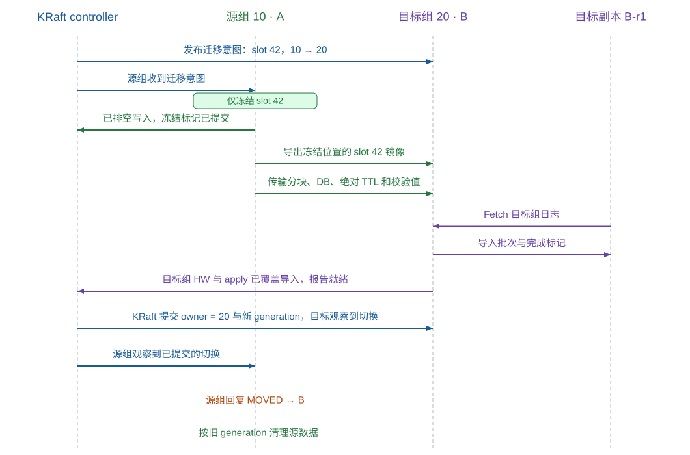

# Dragonfly 集群设计：KRaft 元数据与按复制组运行的 Raft

设计提案。Kafka 基线为同级仓库的 `5b648ca9cbeed3cebe553fba86c516b08bcaeb40`，Dragonfly 基线为 `fbc5370234e38bd983ffdd6238b4512ba47182c6`。文中的 Kafka 行为以这两个 checkout 中可核对的源码和测试为准；Dragonfly 新模式尚待实现。链接按两仓库同级放置。

## 1. 两层 Raft 管什么

| 问题 | 现有 Dragonfly | 提议的 Raft 集群 |
| --- | --- | --- |
| 谁管理 slot | 外部 cluster manager 向各节点推送配置 | 元数据 Raft 组提交 slot → group、节点身份和迁移状态 |
| 谁成为数据 leader | 副本跟随指定 master，由外部管理或接管流程提升 | 每个数据组的 voter 在本组 term 内选举 leader，向控制面报告结果供客户端发现 |
| 哪些业务写入成功 | 普通写由 master 执行并回复，journal 异步流向 replica | 数据组 leader 追加写入，按本组 voter 多数推进提交边界（HW），本地应用后回复 |
| 客户端访问谁 | 根据 slot 访问 master，处理 MOVED | 同一 slot 空间和 RESP 地址；对外的 master 是该数据组当前可服务的 Raft leader |

**与 Kafka 的对应范围。** Kafka 上游的 KRaft 用于元数据，普通 topic 分区由 controller 选主并按 ISR 推进 HW。本提案取 KRaft 的选举、持久选票、voter 配置、Fetch、任期提交规则和快照作为协议基线，再为每个 Dragonfly 数据复制组运行独立实例。多组分发、KV 状态机和 Redis 路由属于 Dragonfly 扩展。按固定 Kafka 提交对照单个 quorum 的协议和测试。[KRaft 入口](../../../kafka/raft/src/main/java/org/apache/kafka/raft/KafkaRaftClient.java) · [Kafka 普通分区的 ISR 实现](../../../kafka/core/src/main/scala/kafka/cluster/Partition.scala)

### 集群拓扑

**现有拓扑。** A 和 B 分别负责上下半段 slots。外部 manager 发布配置，A-r1、B-r1 各自跟随指定 master；副本周期性回报执行位置，普通写成功不要求这些副本投票或确认。


**提案拓扑。** 在同样的数据节点和 slot 布局上画出三个独立 quorum。蓝线传递路由信息，绿线是组内协议，橙线是客户端请求。选举时由候选者向本组其他 voter 请求投票。稳定期由 follower 发起 Fetch，leader 返回日志和 HW，follower 持久化后通过下一次 Fetch 报告进度。


**按原图节点数，数据组各有两个 voter。** 组 10 的票来自 A、A-r1，组 20 的票来自 B、B-r1。多数派均为 2/2；A 故障时 A-r1 单独一票无法接任。若组 10 需要容忍一个节点故障，须先使第三个 voter A-r2 追平并完成成员变更，此时多数派为 2/3。元数据组的三个 voter 是控制面部署示例，其票不能算入数据组。loading 是 KV 服务状态；节点能否参与本次提交取决于它在当前 voter 配置中的身份及其持久日志进度。

[可编辑拓扑图](raft-cluster-topology.excalidraw) · [原集群设计](../cluster-mode.md) · [组复制、选举和故障时序](raft-replication-design.md)

### 对应关系与查表过程

一个 Redis 逻辑集群对应一个 KRaft cluster ID。元数据 quorum 管整个集群；该集群的 16,384 个 slots 分给若干数据复制组。这里的 group 指共同复制一条数据日志的节点集合，与 Kafka consumer group 无关。

| Dragonfly 对象 | 对应身份与基数 | 权威来源 |
| --- | --- | --- |
| key → slot | 对 key 的 hash tag（如有）计算 Redis CRC16，取模 16,384；所有逻辑 DB 使用同一映射 | Redis slot 算法 |
| slot → 复制组 | 每个已分配 slot 恰有一个 owner `group_id`，一组可拥有多个不连续的 slot 范围 | 新增 Dragonfly 元数据记录 `SlotAssignmentRecord`，提交到集群的 KRaft 元数据日志 |
| 复制组 → Raft 实例 | 内部数据 topic T 的 partition ID 对应稳定的 group ID；每组一套持久日志、当前 term、选票、voter 配置和 HW | 元数据登记组身份和初始成员；创建后，成员演进以该组 Raft 日志为准 |
| 复制组 → 当前 leader | 本组 voter 选举，leader 建立当前 term 的提交边界后报告组 ID、term、节点 ID 和成员配置位置 | 数据组是选举权威；controller 发布经核对的路由缓存，拒绝倒退的 term。请求到达时由数据组再次校验角色、term 和 slot generation |
| broker → Redis 节点及地址 | 保存稳定的 broker ID 与 Redis node ID 对应关系；从当前注册信息取得其通告的 RESP endpoint | 持久节点身份映射和 broker 注册元数据，供 `MOVED`、`CLUSTER SLOTS/SHARDS/NODES` 使用 |

以 T 表示数据日志命名空间。表中显示当前 Raft 角色；每组的两个数据节点均配置为 voter。

| slot 范围（含两端） | group_id | 组日志 | 当前 leader / voter | follower / voter |
| --- | --- | --- | --- | --- |
| 0–8191 | 10 | (T, 10) | A (node-A) | A-r1 |
| 8192–16383 | 20 | (T, 20) | B (node-B) | B-r1 |

请求命中 slot 42 时，在同一份已提交 metadata image 里查 `slot_owner[42] → 10`、`partition[T,10].leader → A`、`broker[A] → RESP 地址`。写入携带 DB ID 和 slot，追加到 (T,10) 的下一个 offset。slot 43 的下一笔写可以紧接在同一条日志中。两组对应两份逻辑数据日志，每个副本各保存其所在组的日志副本。节点内负责执行 key 操作的线程 shard 由本地分片函数确定，与集群的 group ID 独立。

**映射如何落盘。** `SlotAssignmentRecord` 是本文建议的 Dragonfly 扩展，按范围记录 `first_slot, last_slot, expected_owner, expected_generation, new_owner, new_generation`。controller 在串行写事件中检查范围、旧值和目标分区是否存在，初始化用未分配作为旧值，运行中按相同 owner 和 generation 的连续区间拆分。通过元数据事务原子提交需要一起生效的变更；节点从稳定元数据日志或快照恢复同一份 slot 表。对外服务前校验 0–16383 全覆盖、无重叠且引用有效；无主分区返回暂不可用。迁移中的新 owner 可以准备数据，所有权在切换记录提交时生效。新记录使用独立类型及 feature gate，所有参与回放的节点都支持后才启用。

| 操作（独立示例） | 哪一层变化 | 客户端及复制结果 |
| --- | --- | --- |
| 组 10 计划内从 A 换到 A-r1 | 两个 voter 都在线，A 退位，A-r1 按 Raft 规则取得多数并建立新 term | 0–8191 一起转向 A-r1；任一节点不可达时两节点布局不能完成选举 |
| 组 10 用 A-r2 替换 A-r1 | 先让 A-r2 作为 observer 追平，经组内 KRaft 成员变更添加 voter；该变更提交后，再单独移除 A-r1 | 组 10 的多数门槛随配置从 2/2 变为 2/3，再变为 2/2；slot 归属不变 |
| 单独将 slot 42 从组 10 迁至组 20 | 两个数据组各自提交冻结或导入，元数据组提交新归属 | slot 42 路由到 B，slot 43 留在 A；各组的 term 和 HW 相互独立 |

### 用启动配置选择集群模式

建议沿用现有启动参数，只新增一个取值 `--cluster_mode=raft`。该值同时选择 KRaft 元数据管理和按组 Raft 数据复制。当前版本只识别空值、`emulated`、`yes`，传入 `raft` 会在启动时退出。以下是新版要实现的配置契约。[启动参数及解析](../../src/server/cluster_support.cc)

| 启动配置 | 节点行为 |
| --- | --- |
| 省略或空值 | 保持单机模式。 |
| `--cluster_mode=emulated` | 保持现有单节点模拟拓扑。 |
| `--cluster_mode=yes` | 保持现有真实集群。外部 manager 下发 `DFLYCLUSTER CONFIG`，副本通过 `REPLICAOF` 跟随主节点。仅升级二进制时继续走这条路径。 |
| `--cluster_mode=raft`（提案） | 启动时按已配置的集群身份和元数据 quorum 地址加入或恢复 Raft 集群。新建集群先初始化 quorum 和初始 slot 分配；已有 Raft 集群从自己的持久状态恢复。 |

实现时把“是否启用真实集群路由”和“由谁管理拓扑及复制”分开判断。`yes` 和 `raft` 共用 key → slot、拓扑响应编码和 `MOVED`；只有 `yes` 允许旧 manager 直接改 slot 或指定复制源。`raft` 从已提交元数据生成拓扑，由数据组确认普通写。模式在启动时确定，`CONFIG SET` 不提供在线切换；恢复时校验持久化的集群身份和模式，配置不符时拒绝对外服务。[现有模式判断](../../src/server/cluster_support.h) · [现有管理入口](../../src/server/cluster/cluster_family.cc)

**已有数据的集群需要一次停写切换。** 新二进制可以先按 `yes` 部署。切到 `raft` 前，按下文的[存量集群切换步骤](#存量集群切换步骤)导入拓扑和数据。Raft voter 需要组日志、任期和选票，旧副本的每线程 LSN 无法充当初始 Raft offset。切换以整个逻辑集群为单位，旧节点不能作为新组的 voter。切换完成后，客户端用原 seed 地址重连并刷新拓扑。

验收时用同一份旧配置分别启动旧版和新版，比对 `yes` 模式下配置下发、主从复制和客户端路由。再对同一布局做停写导入，用原客户端检查 node ID、通告地址、完整 slot 表和已有数据。模拟导入中断及带错模式重启，验证不会同时出现两个可写入口。

### 兼容目标与验收基线

优先让现有 Redis Cluster 客户端用原来的节点地址、命令和拓扑刷新逻辑工作。内部按各数据组的 Raft 任期、选票及多数派提交规则复制。分别用现有 Dragonfly 做行为回归、用固定版本的 Redis Cluster 检查客户端协议、用固定提交的 Kafka 检查内部协议。三者行为有差异时，在发布清单列出具体命令、版本和差异。

**节点身份与部署。** 现有 Dragonfly 拓扑校验要求一个 node ID 在整个 shard 列表中只出现一次；`CLUSTER NODES` 给每个副本返回一个上游 master ID。建议默认沿用这个模型：一个对外 Redis 节点（稳定 node ID、可单独连接的 RESP endpoint）只属于一个数据复制组。既有集群迁入时保留合法 node ID、通告地址和 slot 布局；组换主只改变角色和副本的上游指向。独立 controller 不出现在 Redis 的节点列表。多个组可以部署在同一物理机；同进程多组若要对外开放，须给每个组成员独立的节点身份、端点及连接上下文，再验证客户端缓存、ROLE 和重定向。单一端点无法向旧客户端无歧义地表示多个不同上游。[现有配置校验](../../src/server/cluster/cluster_config.cc) · [现有拓扑响应](../../src/server/cluster/cluster_family.cc)

| 客户端或工具观察什么 | 新模式的兼容约定 | 如何验收 |
| --- | --- | --- |
| 发现和重连 | 从同一 metadata image 派生 `MYID/NODES/SLOTS/SHARDS`、`ROLE` 和 `INFO REPLICATION`；复用现有 RESP 编码及通告地址。无主时返回对应不可用状态，不能把已失主节点继续通告为可写。只在内部使用 group ID、epoch 和 HW。 | 用 redis-cli -c、redis-py RedisCluster 及一个有独立拓扑缓存的客户端（如 Lettuce）从单个 seed 建连。分别测试 RESP2/RESP3 支持组合、持久连接、换主和重启后按原 node ID 刷新；检查 MOVED 的地址实际可连。 |
| 命令路由与迁移 | 复用现有 key/hash tag 计算。即使两个 slot 在同一组，跨 slot 多键命令仍返回 `CROSSSLOT`。首版冻结迁移只对尚未接受的受影响写请求返回 `TRYAGAIN`，切换生效后旧 owner 返回 `MOVED <slot> <endpoint>`。`ASK/ASKING` 对应 Redis 的临时导流语义，需另做导入中读写与连接状态测试后才列为支持。 | 用同 slot、同组不同 slot、不同组三组 keys 运行命令、脚本、事务和 pipeline。分别在迁移前、冻结中、切换后检查回复类型、重试目标和写入次数。 |
| 写确认和副本读 | 现有部署沿用旧模式；显式启用新模式后，普通写在本组多数提交并本地 apply 后回复。成功时仍返回 Redis 原命令的结果。失去本组多数后无法确认新写，延迟和超时语义也随之改变。追加后结果未知与追加前可重试拒绝分别处理，避免客户端把未知结果当作安全重试。`WAIT` 返回满足连接写入进度的副本数；Kafka Fetch 的 LEO 表示已追加，现有 Dragonfly ACK 反映已执行，两者需分别跟踪。现有 `READONLY` 是空操作，`READWRITE` 在 real cluster 中有兼容限制；新模式须实现连接级读偏好、只读副本与主节点切换后，才能承诺 Redis 副本读。 | 在同一连接测试 `SET/INCR → WAIT`、超时和角色变化；人为让副本已 append 但未 apply。让读副本客户端发送 `READONLY/READWRITE`，核对实际命中的节点、返回值和副本拒写行为。[WAIT 实现](../../src/server/server_family.cc) |
| 旧管理工具与升级 | 引导导入可读现有 `DFLYCLUSTER CONFIG` 的 `slot_ranges/master/replicas`，把每个旧 shard 映射成一个稳定组并保留节点身份。slot 归属由元数据 quorum 裁决，选主和成员变更由相关数据 quorum 裁决。旧工具若发送全量配置、`REPLICAOF` 或迁移命令，要么适配为有前置版本的 controller 操作，要么向调用者返回明确错误；成功响应必须对应已实现的操作。Redis cluster bus、Sentinel 自动接管和 redis-cli --cluster 管理流程另行验收。 | 同一配置重复导入，得到相同的组和节点映射；旧配置在换主后重放不能覆盖新角色。分别列出支持的客户端查询、管理操作与迁移路径。[现有管理脚本](../../tools/cluster_mgr.py) |
| Kafka 与 Dragonfly 新旧版本 | 标准 RPC、record batch 和 Kafka 元数据记录按上游 schema 做字节级对照。`SlotAssignmentRecord`、迁移记录和 KV 镜像有独立版本。未知 tagged field 的跳过规则不能推广到未知 metadata record，原生 Kafka 的 image 回放会拒绝未知记录。记录落盘和进快照前确认所有需回放的节点支持该 feature；仅接受能读取当前日志和快照的版本加入或回滚。 | 跑新旧 Dragonfly 的能力协商、快照恢复及拒绝降级测试。能解码标准 RPC 只证明该 RPC 互通；原生 Kafka broker/controller 混部不在本方案的兼容承诺内。[Kafka 元数据回放](../../../kafka/metadata/src/main/java/org/apache/kafka/image/MetadataDelta.java) |

发布时按客户端库及版本记录实测结果。复用仓库的三主三从客户端测试和拓扑测试，增加“整组换主只更新地址及角色”和“只迁 slot 42，slot 43 继续由原组服务”两条场景；同时比较配置的 node ID、自生成 ID、真实连接地址和客户端异常类型。上述条目均为实现后的验收目标。[客户端集成测试](../../tests/dragonfly/cluster_client_test.py) · [拓扑测试](../../tests/dragonfly/cluster_config_test.py)

## 2. 从哪些源文件开始

| 模块 | Kafka 源码 | Dragonfly 侧需要实现的职责 |
| --- | --- | --- |
| 元数据选举和拉取 | [KafkaRaftClient](../../../kafka/raft/src/main/java/org/apache/kafka/raft/KafkaRaftClient.java)、[QuorumState](../../../kafka/raft/src/main/java/org/apache/kafka/raft/QuorumState.java)、[LeaderState](../../../kafka/raft/src/main/java/org/apache/kafka/raft/LeaderState.java) | 把 poll、事件、计时器、请求和响应移植到 proactor/fiber；可注入时钟、随机退避和 I/O |
| 格式化及持久状态 | [Formatter](../../../kafka/metadata/src/main/java/org/apache/kafka/metadata/storage/Formatter.java)、[FileQuorumStateStore](../../../kafka/raft/src/main/java/org/apache/kafka/raft/FileQuorumStateStore.java)、[KafkaRaftLog](../../../kafka/raft/src/main/java/org/apache/kafka/raft/internals/KafkaRaftLog.java) | 节点及目录身份、选票、元数据 segment、epoch 索引与快照 |
| 元数据写入及发布 | [QuorumController](../../../kafka/metadata/src/main/java/org/apache/kafka/controller/QuorumController.java)、[OffsetControlManager](../../../kafka/metadata/src/main/java/org/apache/kafka/controller/OffsetControlManager.java)、[MetadataLoader](../../../kafka/metadata/src/main/java/org/apache/kafka/image/loader/MetadataLoader.java) | 单事件队列产生 records；各节点按 offset 回放成不可变 image，发布到路由和副本管理器 |
| Broker 生命周期 | [BrokerLifecycleManager](../../../kafka/server/src/main/java/org/apache/kafka/server/BrokerLifecycleManager.java)、[ClusterControlManager](../../../kafka/metadata/src/main/java/org/apache/kafka/controller/ClusterControlManager.java) | 注册、身份 fencing 与路由通告；数据组单独校验其 voter 身份、目录及 term |
| 数据日志和组内选举 | [KafkaRaftLog](../../../kafka/raft/src/main/java/org/apache/kafka/raft/internals/KafkaRaftLog.java)、[QuorumState](../../../kafka/raft/src/main/java/org/apache/kafka/raft/QuorumState.java)、[LeaderState](../../../kafka/raft/src/main/java/org/apache/kafka/raft/LeaderState.java) | 按组隔离 vote、epoch、批次、快照和多数派 HW。连接可复用，投票及 offset 不可跨组累加 |
| RESP 写完成 | [Raft 客户端提交回调](../../../kafka/raft/src/main/java/org/apache/kafka/raft/KafkaRaftClient.java) | 等待本次写对应的日志批次在正确历史上提交并 apply；失去领导权时取消或重新核实旧任期的等待者 |

### 协议与记录清单

从 [RPC schema](../../../kafka/clients/src/main/resources/common/message)、[元数据 schema](../../../kafka/metadata/src/main/resources/common/metadata) 生成 C++ 编解码器和 Java 对照样本。逐 API 记录支持版本、header、flexible/tagged fields、默认值、错误码和 feature gate。`ApiVersions` 只通告实现过的版本。单个 RPC 版本、`kraft.version`、`metadata.version` 分别协商或校验。[KRaftVersion](../../../kafka/server-common/src/main/java/org/apache/kafka/server/common/KRaftVersion.java)

| 场景 | 需要复制的消息或记录 | 对照重点 |
| --- | --- | --- |
| 元数据选举与复制 | `Vote`、`BeginQuorumEpoch`、`EndQuorumEpoch`、`Fetch`、`FetchSnapshot`、`DescribeQuorum` | cluster ID、voter/directory 身份、pre-vote、日志新旧比较、epoch、分歧与快照 |
| voter 变更 | `AddRaftVoter`、`RemoveRaftVoter`、`UpdateRaftVoter`；`KRaftVersionRecord`、`VotersRecord`、`LeaderChangeMessage` | Raft 控制批次由 quorum 自己读取，成员变更有自己的生效时序 |
| 节点管理 | `BrokerRegistration`、`BrokerHeartbeat`；`RegisterBrokerRecord`、`BrokerRegistrationChangeRecord`、`UnregisterBrokerRecord` | incarnation、broker epoch、metadata offset、fenced 状态、受控退出 |
| 数据组目录与 slot 归属 | Dragonfly 扩展记录组身份、初始及期望布局、slot generation、迁移和已观察到的 leader/term | controller 可提出成员变更；活动 voter 集合由数据组自己的成员协议确定。元数据里的 leader 提示不能授予写权限 |
| 数据组共识 | 在组 ID 对应的实例上复用 Vote、Begin/EndQuorumEpoch、Fetch 及 VotersRecord 的语义；KV 快照有独立格式 | 明确索引到 (cluster ID, group ID)，再检查 voter 身份、目录、term 和日志历史；管理 RPC 缺少分组字段时由组级端点或版本化封装显式选组 |

样本覆盖请求、响应及磁盘 record batch，包括批次 CRC、控制记录类型和快照 header/footer。Kafka 字段沿用上游 ID。Redis 命令效果写入数据 record 的 value，使用独立 payload 版本；KV 快照是 Dragonfly 的内部传输接口。

## 3. 元数据从启动到生效


<details>
<summary>查看新版 Mermaid 源码</summary>

```text
sequenceDiagram
    participant Q as Active controller
    participant V as 其他 metadata voters
    participant N as 数据节点 observer
    Q->>Q: 在当前任期追加 slot 或分区元数据变更
    V->>Q: Fetch metadata
    Q-->>V: metadata 批次
    V->>Q: 后续 Fetch 报告新的 end offset
    Q->>Q: 多数 voter 达到提交位置，推进 metadata HW
    N->>Q: Fetch metadata
    Q-->>N: 批次与提交位置
    N->>N: 回放稳定前缀，原子发布 slot 与 leader 路由
```

</details>

此处 HW 属于整个集群的元数据日志；业务写确认使用所属复制组独立的数据 HW。

1. **格式化与恢复。** 初次格式化确定 cluster ID、node ID、directory ID，根据静态或动态 bootstrap 模式初始化 voter。重启时核对磁盘身份，恢复选票、快照及连续日志尾，再参与 quorum。bootstrap 地址负责发现节点，现存 quorum 的成员状态从磁盘恢复。
2. **选举。** 移植 Unattached、Prospective、Candidate、Leader、Follower、Resigned 状态和超时。按协议版本处理 pre-vote，比较 last offset epoch、last offset 及候选身份。正式授票时先持久化 epoch/vote；同一 epoch 最多投给一个候选。取得 voter 多数才成为 leader。observer 可拉取但没有选票。
3. **推进元数据 HW。** 新 leader 追加当前 epoch 的 leader change 控制批次。follower 主动 Fetch；voter 按上游 flush 顺序处理批次，下一次 Fetch 携带新 end offset。leader 取 voter 多数已复制的位置，并要求该位置越过本 epoch 起始 offset 才建立本任期的 HW。offset 小于 HW 的记录已提交。长时间收不到多数 voter 的有效 Fetch/FetchSnapshot，leader 退位。
4. **回放与发布。** Active controller 可先在可回退状态上 replay 待写记录。涉及持久变更的请求按 deferred queue 等待 stable offset。支持 Begin/End/Abort 元数据事务，半个事务不能发布为路由。controller 切换后回退推测状态；observer 与 standby 消费已提交批次或快照，按完整 image 发布，记录已应用位置。重复发布相同位置应幂等。
5. **追赶与快照。** follower 报告 last fetched epoch 和 offset，分歧时找共同前缀并截断。若已落后于日志起点，按 `(endOffset, epoch)` 分块拉取元数据快照，校验后原子安装，从 endOffset 续拉。重启不能把未接收完的临时文件当成快照。
6. **变更 voter。** 固定提交支持 `kraft.version=0/1`，动态成员变更由 1 启用。每次处理一个增删，检查前一变更已提交。新增 voter 先协商版本并验证追平。KRaft 内部读取最新 `VotersRecord` 更新参与计算的集合，增删按新集合多数提交，截断时回退集合。按请求版本处理 `ackWhenCommitted`，移除当前 leader 后按提交结果退位。这个时序必须单独移植。[AddVoterHandler](../../../kafka/raft/src/main/java/org/apache/kafka/raft/internals/AddVoterHandler.java) · [RemoveVoterHandler](../../../kafka/raft/src/main/java/org/apache/kafka/raft/internals/RemoveVoterHandler.java)

**Broker 入群与故障。** Broker 以稳定 node ID、新进程 incarnation ID、目录 ID 和 endpoints 注册。controller 分配 broker epoch；broker 在心跳中报告 epoch 和已消费的 metadata offset，根据应答完成追赶、解除 fencing、运行和受控退出。旧 incarnation 的请求按各 API 的 epoch 字段检查。broker 心跳超时后，controller 记录注册状态并刷新发现信息。数据组以本组协议超时触发选举，节点的注册状态不能缩小本组多数门槛。网络隔离期间各节点收到 image 的时间可能不同。

| 版本号 | 推进方 | 用途 |
| --- | --- | --- |
| quorum epoch | KRaft 选举 | 拒绝过期的投票、leader 通告和元数据复制响应 |
| broker epoch / incarnation | 注册流程，区分重试和新进程 | 拒绝已淘汰进程的心跳及管理请求 |
| 数据组 term（leader epoch） | 本组 Raft 选举 | 校验数据复制、拒绝过期 leader 通告、核对写完成回调 |
| 数据组 voter 配置位置 | 本组成员变更日志 | 恢复有效成员集合、防止重复增删与过期请求 |
| metadata image offset | 节点应用元数据前缀 | 防止重复、倒序发布；衡量节点追赶位置 |

## 4. 单个 slot 跨组迁移



沿用原图的四条泳道。假设图中的 B-r1 已完成加载并追平；源副本 A-r1 省略。源组冻结和目标组导入分别由各自的数据日志提交。蓝色切换通知表示节点从 KRaft 拉取并应用已提交的归属变更。只有 slot 42 搬迁，slot 43 仍由 A 服务。[编辑新版迁移图](raft-slot-migration.excalidraw)

<details>
<summary>展开现有 Dragonfly 原图</summary>


</details>

首版建议只暂停待迁 slot 的写入，以避免同时维护两套增量流。以下以 slot 42 从组 10 迁往组 20 为例。迁移是 Dragonfly 的元数据扩展，替换整组的 voter 则走该数据组的 Raft 成员变更。

1. controller 校验当前 owner 和 generation，持久记录唯一 migration ID、源组、目标组和阶段。组 10 按组内写入顺序排空该 slot 已接受的写入并提交冻结标记。该标记也约束过期、淘汰及涉及该 slot 的管理操作；源组换主必须先恢复冻结状态。冻结后新的写请求返回可重试错误，组内其他 slots 继续运行。
2. 源组按冻结位置导出该 slot 所有 DB 的 KV 和绝对 TTL。目标将分块和完成标记按 migration ID 写入组 20 的日志，以暂存视图重放。确认目标 HW 和 apply 均覆盖完整导入、数据校验一致后才报告就绪。源组冻结位置和目标组导入位置分别保存，两个 offset 空间不能做大小比较。
3. controller 核验两组的已提交标记，以原 owner/generation 为条件，在同一元数据事务中提交 `42 → 20`、新 generation 和切换阶段。目标 leader 观察到切换并应用完整导入后才接受客户端请求。源组即使路由 image 暂时落后，已提交的冻结仍阻止旧写；收到新 image 后按目标组当前 leader 返回 `MOVED`。
4. 重启从元数据阶段和两组日志接续；重复分块按 migration ID 和块序号去重。在切换以前，取消也须经 controller 提交，目标丢弃暂存数据，源组确认取消后提交解冻；切换以后回迁应开启新的 generation。源组清理只作用于该次旧 generation 的数据。验收覆盖冻结后源组换主、导入后目标组换主、切换应答丢失和迁回后旧清理重试。[现有 slot 迁移与清理](../cluster-mode.md)

## 5. 引擎与路由接入

| 接入点 | 建议实现 |
| --- | --- |
| slot 与组日志 | slot 按所有权表路由到复制组；组日志只有一个 offset 分配顺序。同一组的 slot 可由多个引擎线程执行，各线程向组日志提交已排序的效果批次。每组独立跟踪 HW 和连续 apply 边界，禁止把较迟完成的线程回调越过未应用的前缀。[分片实现](../../src/server/sharding.cc) |
| 拓扑和路由 | 新模式从 metadata image 派生路由，复用 `Service::CheckKeysOwnership`、cluster config 查询和 MOVED 构造。进程级 `IsMaster()` 的调用点逐个改为对应分区的角色校验。默认按一组一套节点身份构造 `ClusterShardInfo`，复用现有拓扑输出；仅合并同组的相邻 slot 范围。同进程多组按上文的独立逻辑端点契约另行验收。[请求入口](../../src/server/main_service.cc) |
| 管理入口 | 新模式中的管理意图经 controller 协调；改变 voter 集合需要数据组提交成员记录。旧模式继续走既有配置；新模式的手工 CONFIG、进程级 `REPLICAOF`、`REPLTAKEOVER`、旧 slot 迁移入口不能绕过 controller 改角色。提取现有路由发布代码时分开处理“失去领写权”和“删除本地数据”，本机可能仍是新分配中的 follower。[现有配置安装与清理](../../src/server/cluster/cluster_family.cc) |

组日志写入、KV 可见性、快照回放和宕机恢复详见[组复制设计](raft-replication-design.md)。

## 6. 实施顺序与通过条件

| 阶段 | 可单独交付的增量 | 通过条件 |
| --- | --- | --- |
| 1. 格式与日志 | C++ codec、版本清单、磁盘身份、record batch、epoch 索引、快照、可注入故障的存储 | Java 样本在 C++ 双向编解码逐字节一致；覆盖坏 CRC、截断尾批、未知 tagged field、空日志和重启选票 |
| 2. Metadata quorum | 三 voter 加 observer，先静态 quorum，再完成动态 voter 和快照赶进度 | 失去一个 voter 可换主，失去多数不提交；未提交 voter 变更遇到换主，最终 voter 集合与 Kafka 相同 |
| 3. Controller 与路由 | 注册、心跳、分区及 slot 所有权记录回放、fencing、image 发布与只读集群视图 | 同 node ID 重启后旧 broker epoch 被拒；controller 在追加后回复前退出，恢复的 image 与已提交历史一致；快照和全日志回放结果一致 |
| 4. 数据组 Raft | 先按原图验证两 voter 的失去多数场景，再增加第三 voter 驱动选举、Fetch、截断和成员变更 | 对照同一组的 Kafka Raft 事件序列，选票、term、HW 与保留前缀一致。隔离组 10 的少数派不会阻止健康的组 20 推进 |
| 5. RESP 与状态机 | 从 SET/GET、INCR、TTL 扩展到事务、脚本、后台变更、KV 快照、客户端重定向 | 在 append、commit、apply、reply 四处分开杀进程，核对已确认写、事务可见性、TTL 和重放次数；切换后逐 slot、逐 DB 的摘要一致 |
| 6. 迁移与容量 | 单 slot 跨组迁移、旧集群导入、回滚演练、客户端刷新拓扑；全量 slots 下改变组数测试 | 实测 FD、内存、冷启动/快照重建时长、每组与每 slot 延迟、整体吞吐，以及慢副本对本组所有 slots 和同 proactor 其他组的影响 |

**如何证明复刻正确。** 给 Kafka 和 C++ 测试夹具输入相同事件序列，固定节点 ID、目录 UUID、随机种子、时钟与消息到达顺序。每步对比输出 RPC、leader/term、持久选票、voter 配置、HW、截断位置、错误码。字节比较使用相同时间戳和 batch 边界。Redis 适配另用真实多进程测试，断言命令回复、路由和 KV 内容。首批直接移植以下上游用例。

| 行为 | Kafka 测试入口 |
| --- | --- |
| HW、voter 增减、网络分区 | [LeaderStateTest](../../../kafka/raft/src/test/java/org/apache/kafka/raft/LeaderStateTest.java)、[KafkaRaftClientReconfigTest](../../../kafka/raft/src/test/java/org/apache/kafka/raft/KafkaRaftClientReconfigTest.java)、[RaftEventSimulationTest](../../../kafka/raft/src/test/java/org/apache/kafka/raft/RaftEventSimulationTest.java) |
| pre-vote、快照、换主 | [KafkaRaftClientPreVoteTest](../../../kafka/raft/src/test/java/org/apache/kafka/raft/KafkaRaftClientPreVoteTest.java)、[KafkaRaftClientSnapshotTest](../../../kafka/raft/src/test/java/org/apache/kafka/raft/KafkaRaftClientSnapshotTest.java) |
| 数据组失主与恢复 | 复用前两行的 Raft 用例，向两个组注入独立的时钟和丢包；检查元数据 voter 或其他组的响应无法推进本组 HW |
| Redis 写等待 | 模拟三 voter 中一个慢副本、两个离线、追加后换主及回复丢失，分别核对多数提交、KV apply 和 RESP 结果 |
| 元数据发布 | [MetadataLoaderTest](../../../kafka/metadata/src/test/java/org/apache/kafka/image/loader/MetadataLoaderTest.java)；另测收到陈旧 leader/term 的元数据消费者不能授予旧主写权限 |

第一个原型按原图建立两个各含两名 voter 的组。断开 A 后验证组 10 停止提交、A-r1 无法单独当选，组 20 在自己的多数可用时继续。恢复 A，再向组 10 加入第三 voter A-r2，重做同一故障并验证存活的多数能选出新 leader。两次故障均不改变 slot 归属。再单独迁移 slot 42，确认 slot 43 留在原组；改变数据组数测试 16,384 个 slots 的总成本。

### 存量集群切换步骤

1. **冻结旧集群。** 完成在途 slot 迁移，暂停外部 manager 的拓扑变更，停止写入并排空请求。保存实际生效的 node ID、通告地址及 slot 表，在一致的时间点导出各 slot 所有 DB 的值和绝对 TTL。隔离旧集群的写入口，包括客户端缓存的节点地址。
2. **按新配置导入。** 使用独立的 Raft 数据目录初始化元数据 quorum。将旧拓扑中的每个 master 及其 replicas 映射为一个数据组，保留各节点身份和 slot 范围。在目标组安装对应镜像，记录恢复起点，等待 voter 配置、组 HW 和本地 apply 达到导入边界。导入中断时保持停写，用同一份导出和身份映射恢复。
3. **交还原入口。** 按同一过期时间基准核对各 slot 的数据，检查每组已选出可服务的 leader，再由新集群接管原 RESP 地址并开放写入。验证客户端能从原 seed 刷新路由，按原 key 读写。
4. **回滚边界。** 新集群接受首笔业务写之前，可停下新集群并恢复旧入口。开放写入后如需回退，先停写并排空请求，把新集群最终数据导回旧模式并校验，再恢复旧入口。仅把配置改回 `yes` 会漏掉切换后的写入。
