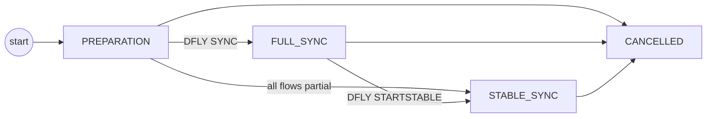
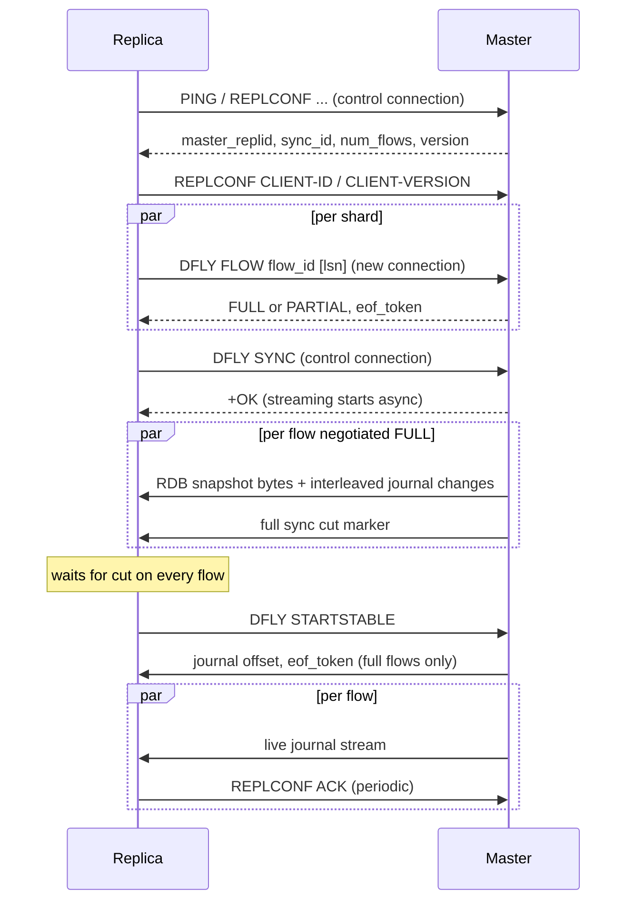
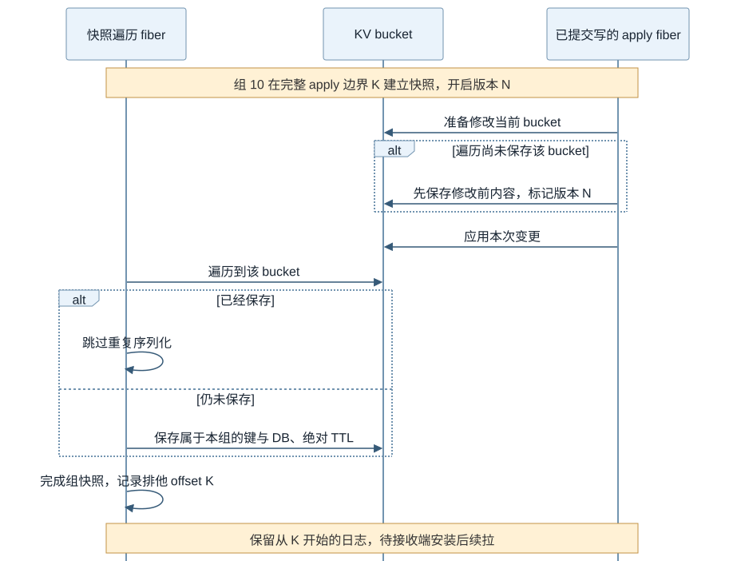
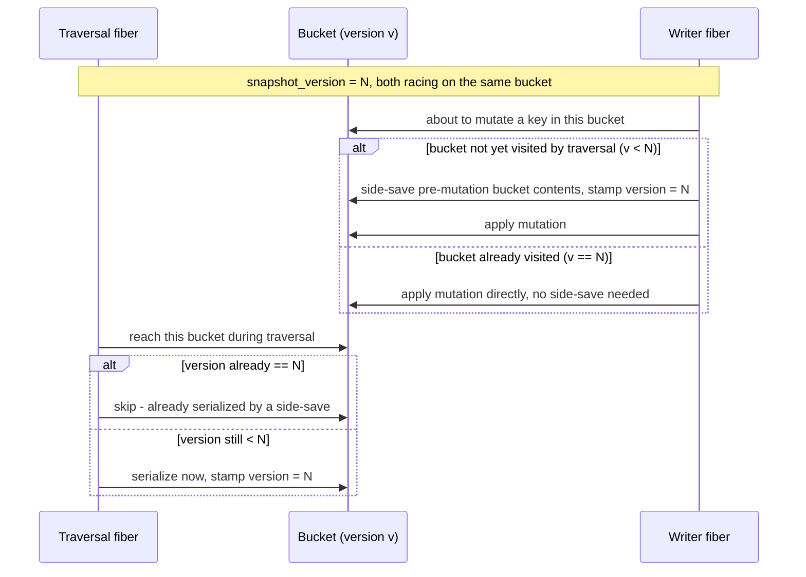
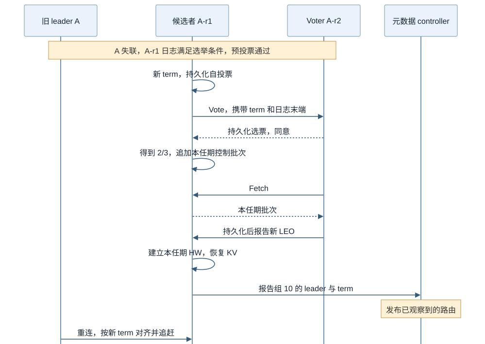
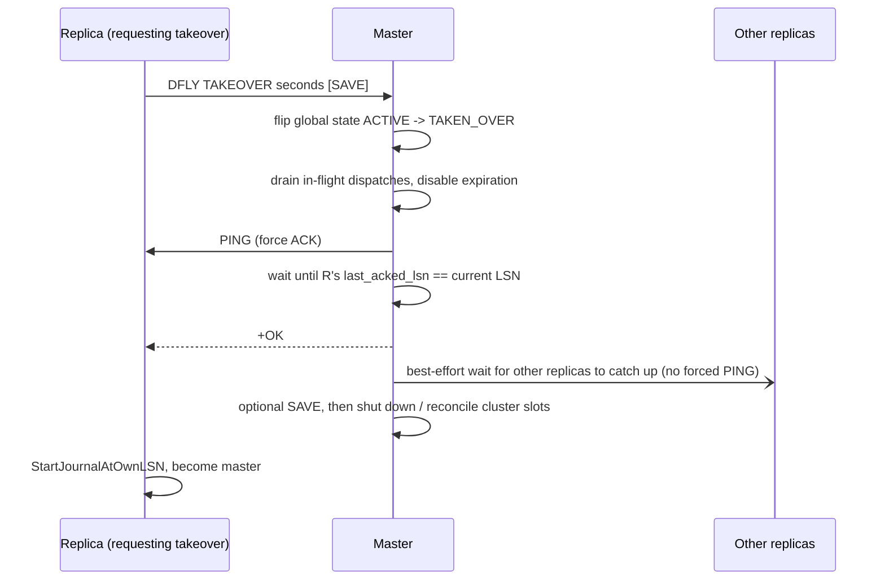

# Dragonfly 组复制设计

`--cluster_mode=yes` 的主节点按引擎线程推送 journal，副本用 LSN 报告执行进度。`--cluster_mode=raft` 的每个数据复制组拥有独立的分区日志，voter 在组内选主，按多数持久化位置确认写入。下文沿用同一组 A、A-r1 节点对照两套复制协议。Raft 示例另将 A-r2 加入组 10，使多数从 2/2 变为 2/3。slot 42 和 43 共用组 10 的日志。[集群拓扑与 slot 映射](raft-cluster-design.md) · [主从复制原图](../replication.md)

## 1. 复制状态机

原图跟踪主节点上的复制会话。Raft 图跟踪组 10 的一个 follower。组内换主时，follower 根据新 leader 的 epoch 和本地日志末端查找共同前缀。当前数据节点沿图中的日志路径恢复，图中的整组 KV 快照安装路径属于后续设计。



<details>
<summary>查看新版 Mermaid 源码</summary>

```text
flowchart TD
    start((启动)) --> PREPARATION["加载组分配与本地日志"]
    PREPARATION -->|历史仍在保留窗口| ALIGN["比较 epoch 与 offset"]
    PREPARATION -->|所需前缀已清理| FULL_SYNC["安装组 KV 快照"]
    ALIGN -->|保留共同前缀| STABLE_SYNC["按组 Fetch"]
    FULL_SYNC -->|从 cut 续拉| STABLE_SYNC
    STABLE_SYNC -->|leader epoch 变化| PREPARATION
    STABLE_SYNC -->|组副本被移除| CANCELLED["结束该组复制"]
```

</details>

<details>
<summary>展开原图 · PREPARATION / FULL_SYNC / STABLE_SYNC</summary>



</details>

## 2. 握手、全量恢复与增量拉取

`yes` 的副本与主节点协商每线程的 flow，完成同步后接收主节点推送的 journal。`raft` 的副本从元数据发现数据组的入口，由本组协议确认 leader 和 term，按日志位置拉取。两端历史一致时直接进入 Fetch 循环。图中“所需前缀已清理”分支描述接入整组 KV 快照后的追赶流程。


<details>
<summary>查看新版 Mermaid 源码</summary>

```text
sequenceDiagram
    participant R as Follower A-r1
    participant M as Leader A
    Note over R,M: 已确认组 10 的 Raft leader 和 term
    R->>M: Fetch，group 10、fetch offset、last fetched epoch
    alt 发现日志分歧
      M-->>R: diverging epoch 与 end offset
      R->>R: 对齐共同前缀，截断冲突尾部
    else 所需前缀已清理
      R->>M: 请求组 10 的 KV 镜像（Dragonfly 扩展）
      M-->>R: 校验信息、镜像数据、cut 的 epoch 与 offset
      R->>R: 完整校验后原子安装
    end
    loop 从对齐后的 offset 继续
      R->>M: Fetch，携带本地 LEO
      M-->>R: 连续批次与 leader HW
      R->>R: 持久化批次，仅应用已提交前缀
    end
```

</details>

<details>
<summary>展开原图 · 控制连接、DFLY FLOW 和 journal 推送</summary>



</details>

## 3. 快照与并发写入

| 对象 | 当前怎样生成和恢复 |
| --- | --- |
| 控制组元数据 | controller 按大小或时间阈值在稳定 offset 生成快照，恢复时从快照和后续已提交记录重建元数据。[控制器](../../src/server/cluster/raft/runtime/controller.cc) · [元数据快照](../../src/server/cluster/raft/metadata/metadata_snapshot.cc) |
| 迁槽中的单槽 RDB | 源组冻结该槽后生成 RDB，将分块和摘要写入源组日志。目标组按块拉取、在本组日志中提交并应用安装记录。恢复时重放迁槽记录即可接续。[迁槽驱动](../../src/server/cluster/raft/runtime/slot_migration_driver.cc) · [单槽 RDB](../../src/server/cluster/raft/data/kv_rdb.cc) |
| 整个数据组的 KV | 已有快照格式与分块安装的单元测试。运行中的数据节点尚未接入整组快照生成、装载及据此截断旧日志前缀的流程。当前重启依靠本组持久日志，按 offset 重放已提交的 SET 效果和迁槽记录。因此磁盘要容纳保留的日志，重启回放量随日志增长。[数据组回放](../../src/server/cluster/raft/data/set_effect.cc) · [整组快照格式测试](../../src/server/cluster/raft/data/kv_snapshot_test.cc) |

下图是整组快照的设计，沿用原图的遍历 fiber、bucket 和写 fiber。各执行线程须在同一个已应用位置建立快照，保存对应的 slot generation、冻结状态及暂存迁移数据。所有线程捕获完成后，才可发布该位置的镜像。



<details>
<summary>查看新版 Mermaid 源码</summary>

```text
sequenceDiagram
    participant T as 快照遍历 fiber
    participant B as KV bucket
    participant W as 已提交写的 apply fiber
    Note over T,W: 组 10 在完整 apply 边界 K 建立快照，开启版本 N
    W->>B: 准备修改当前 bucket
    alt 遍历尚未保存该 bucket
      W->>B: 先保存修改前内容，标记版本 N
    end
    W->>B: 应用本次变更
    T->>B: 遍历到该 bucket
    alt 已经保存
      T->>T: 跳过重复序列化
    else 仍未保存
      T->>B: 保存属于本组的键与 DB、绝对 TTL
    end
    T->>T: 完成组快照，记录排他 offset K
    Note over T,W: 保留从 K 开始的日志，待接收端安装后续拉
```

</details>

<details>
<summary>展开原图 · 同一 bucket 上的遍历与写前保存</summary>



</details>

## 4. 客户端写入何时确认


<details>
<summary>查看新版 Mermaid 源码</summary>

```text
sequenceDiagram
    participant U as Redis 客户端
    participant A as Leader A
    participant R as Voter A-r1
    participant S as Voter A-r2
    U->>A: SET，slot 42 属于组 10
    A->>A: 当前 term 追加 offset 100，持久化
    R->>A: Fetch 100
    A-->>R: 当前 term 的批次 100
    R->>R: 持久化批次
    R->>A: 下一次 Fetch 报告 LEO 101
    Note over A,S: A 与 A-r1 已达 2/3，A-r2 可暂时落后
    A->>A: 数据 HW 到 101，应用写入
    A-->>U: OK
    S->>A: 稍后 Fetch 100
    A-->>S: 批次 100 与 HW 101
```

</details>

本例假设 voter 配置稳定。组内每个 voter 持久保存本组的任期、选票和日志。leader 用每个不同 voter 的持久化日志末端计算多数位置，过滤旧 term、错误组、错误目录和重复响应。采用 KRaft 的排他 HW：当前 term 的记录到达多数后，才可据此推进提交边界，连带提交此前的前缀。应用到本地 KV 后返回原始 RESP 结果。Fetch 确认复制位置，副本 apply 位置单独用于 `WAIT`。[Kafka LeaderState](../../../kafka/raft/src/main/java/org/apache/kafka/raft/LeaderState.java)

若 A 只能联系自己，仍可能短暂认为自己是 leader，但无法为新的写入凑齐多数并返回成功。失联期间已追加但未确认的请求结果可能未知。恢复后按共同的 term/offset 截断冲突尾部，已提交前缀受 Raft 选举与日志规则保护。元数据 quorum 不可用时，健康且已配置的数据组仍能在本组选举和提交；新 slot 归属的发布需要元数据 quorum 恢复。

**成员调整。** 按动态 voter 模式格式化的数据组可以独立增删成员。新节点先以 observer 追平，再按上游的 VotersRecord 生效、提交和截断规则一次增删一个 voter。多数门槛基于协议有效的 voter 配置。更换组副本复制整组日志，迁移单个 slot 则在两个组之间切换归属。[跨组所有权切换](raft-cluster-design.md#4-单个-slot-跨组迁移)

## 5. 失主、选主与重新追赶

现有计划内 takeover 需要旧主配合排空。下图的 A 已不可用，A-r1 和 A-r2 在组 10 内交换选票。候选者的日志必须至少与投票者一样新。投票者在同一 term 只投一个候选，先持久化选票再应答。控制器用 `DescribeQuorum` 向数据组轮询选举结果，确认新 leader 和 epoch 后提交路由变更。[controller 探测数据组](../../src/server/cluster/raft/runtime/controller.cc)



<details>
<summary>查看新版 Mermaid 源码</summary>

```text
sequenceDiagram
    participant A as 旧 leader A
    participant R as 候选者 A-r1
    participant S as Voter A-r2
    participant Q as 元数据 controller
    Note over A,S: A 失联，A-r1 日志满足选举条件，预投票通过
    R->>R: 新 term，持久化自投票
    R->>S: Vote，携带 term 和日志末端
    S-->>R: 持久化选票，同意
    R->>R: 得到 2/3，追加本任期控制批次
    S->>R: Fetch
    R-->>S: 本任期批次
    S->>R: 持久化后报告新 LEO
    R->>R: 建立本任期 HW，恢复 KV
    Q->>R: DescribeQuorum，查询组 10
    R-->>Q: 返回组 10 的 leader 与 term
    Note over Q: 发布已观察到的路由
    A->>R: 重连，按新 term 对齐并追赶
```

</details>

<details>
<summary>展开原图 · REPLTAKEOVER 与旧主排空</summary>



</details>

## 6. KV 执行、快照与客户端故障语义

`yes` 通过 `Transaction::LogAutoJournalOnShard` 记录已执行的变更，各引擎线程独立分配 LSN，副本跟随指定的主节点。`raft` 的数据组 leader 将 SET 的效果追加到本组日志。各副本按组内 offset 应用已提交前缀，leader 在本地 KV 应用后回复客户端。[Journal 格式](../../src/server/journal/types.h) · [主从复制管理](../../src/server/replica_manager.cc) · [Raft 数据节点](../../src/server/cluster/raft/runtime/data_node.cc)

| 接入点 | 当前数据路径 |
| --- | --- |
| 分区日志 | 每个数据组在自己的分区目录保存批次。leader 和 follower 在持久化后推进各自的 LEO，用 epoch 和 offset 查找共同前缀，发现分歧时截断未提交的冲突尾部。[分区日志](../../src/server/cluster/raft/log/partition_log.h) |
| 写入与条件求值 | leader 在追加前检查 slot 归属、generation 和本组角色。普通 SET 产生替换记录。NX/XX 等待此前追加的记录全部应用，再求值并记录替换或空操作。条件不满足时也等这次决定提交和应用后才返回 nil。[写入入口](../../src/server/cluster/raft/runtime/data_node.cc) |
| 确定性重放 | 数据批次携带 group ID、DB ID、slot、generation、键和值。副本按提交顺序应用相同效果。迁槽也以本组记录保存冻结、分块、安装和完成进度，切主或重启后可继续执行。[效果回放](../../src/server/cluster/raft/data/set_effect.cc) · [迁槽记录](../../src/server/cluster/raft/data/slot_transfer_state.cc) |
| 读取与 WAIT | GET 由已追上本组 HW 的当前 leader 提供。WAIT 按该连接记录的写入位置，统计本组副本在当前 epoch 报告的已应用位置。[副本应用进度](../../src/server/cluster/raft/data/apply_progress.cc) · [集成测试](../../tests/integration/raft_data_group_test.py) |

**换主后的条件写。** 假设 A 已将一次 `SET k v NX` 复制给 A-r1，客户端收到回复前 A 宕机。A-r1 当选时，继承的日志可能领先于本地 KV。新 leader 在前序记录按新任期的 HW 提交并应用后，才对下一次 NX/XX 求值。失去本组多数时，节点不能确认新的条件写。[条件写实现](../../src/server/cluster/raft/runtime/data_node.cc)

**客户端故障语义。** 追加前被拒的请求尚未写入。追加成功后遇到超时、换主或丢失回复，客户端看到的结果未知。重试 NX 可能返回 nil，此时客户端无法仅凭该回复判断是哪次请求写入了值。GET 检查本地归属、角色及已应用的 HW，尚无逐请求的 quorum 读屏障。[命令分派](../../src/server/main_service.cc) · [数据组读写](../../src/server/cluster/raft/runtime/data_node.cc)

后续若扩展 TTL、淘汰、事务和脚本，日志还需记录绝对过期时间、已决定的变更和原子批次边界，使副本重放得到相同结果。这些命令不在当前数据组的读写验收范围内。
