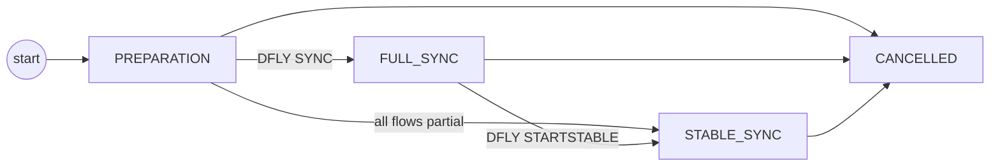
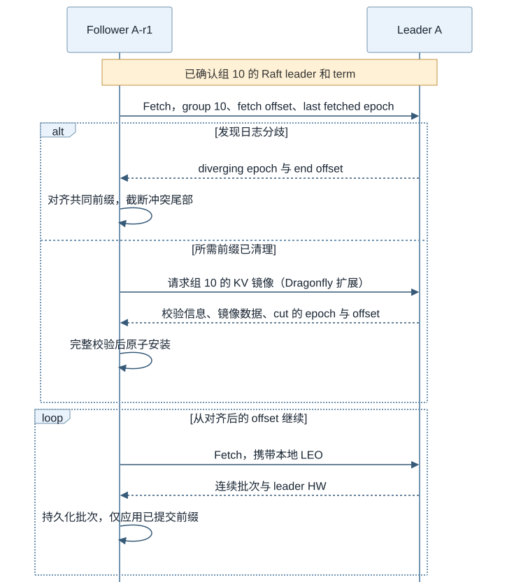
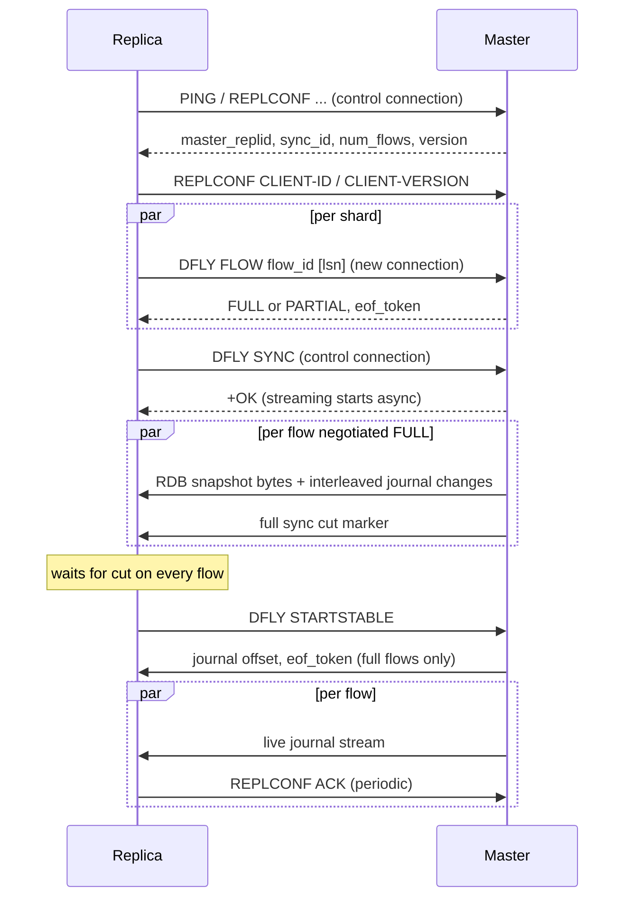
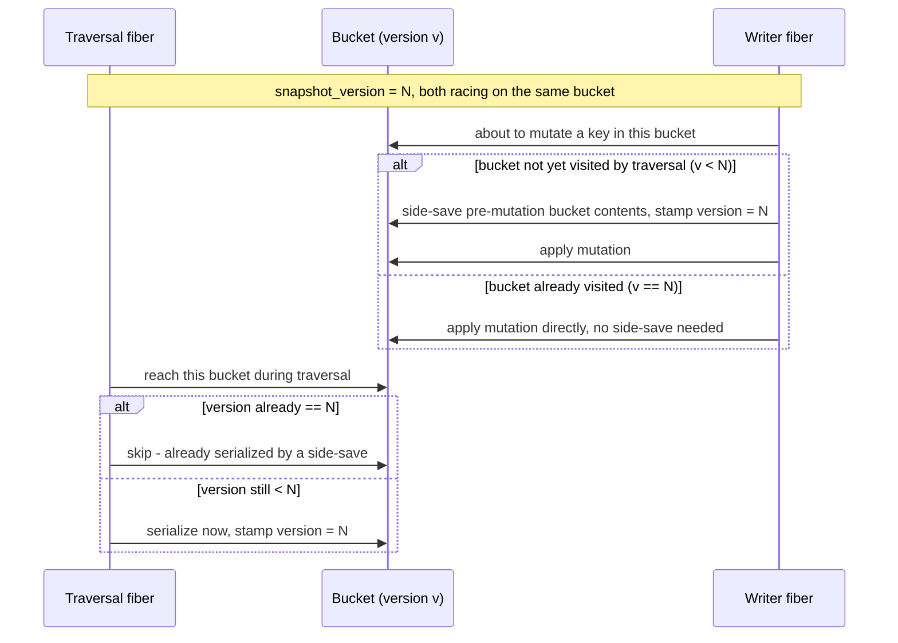
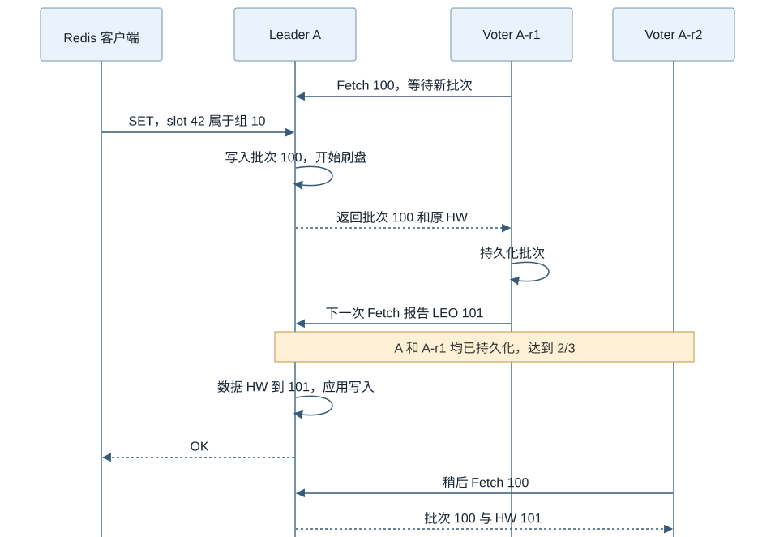
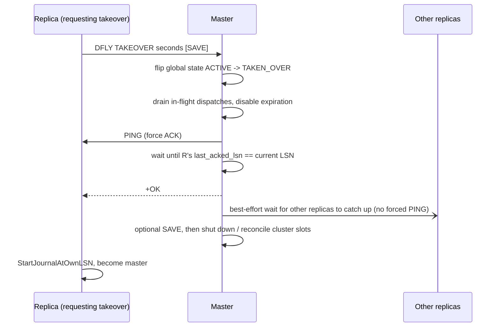

# Dragonfly 组复制设计

`--cluster_mode=yes` 的主节点按引擎线程推送 journal，副本用 LSN 报告执行进度。`--cluster_mode=raft` 的每个数据复制组拥有独立的分区日志，voter 在组内选主，按多数持久化位置确认写入。下文沿用同一组 A、A-r1 节点对照两套复制协议。Raft 示例另将 A-r2 加入组 10，使多数从 2/2 变为 2/3。slot 42 和 43 共用组 10 的日志。[集群拓扑与 slot 映射](raft-cluster-design.md) · [主从复制原图](../replication.md)

## 1. 复制状态机

原图跟踪主节点上的复制会话。Raft 图跟踪组 10 的一个 follower。组内换主时，follower 根据新 leader 的 epoch 和本地日志末端查找共同前缀。本地仍有共同日志前缀时继续增量 Fetch；落后位置早于 leader 的日志起点时，follower 安装整组 KV 快照后续拉。


<details>
<summary>查看新版 Mermaid 源码</summary>

```text
flowchart TD
    start((启动)) --> PREPARATION["加载组分配与本地日志"]
    PREPARATION -->|历史仍在保留窗口| ALIGN["比较 epoch 与 offset"]
    PREPARATION -->|所需前缀已清理| FULL_SYNC["安装组 KV 快照"]
    ALIGN -->|保留共同前缀| STABLE_SYNC["按组 Fetch"]
    FULL_SYNC -->|从 cut 续拉| STABLE_SYNC
    STABLE_SYNC -->|leader epoch 变化| PREPARATION
    STABLE_SYNC -->|组副本被移除| CANCELLED["结束该组复制"]
```

</details>

<details>
<summary>展开原图 · PREPARATION / FULL_SYNC / STABLE_SYNC</summary>



</details>

## 2. 握手、全量恢复与增量拉取

`yes` 的副本与主节点协商每线程的 flow，完成同步后接收主节点推送的 journal。`raft` 的副本从元数据发现数据组的入口，由本组协议确认 leader 和 term，按日志位置拉取。两端历史一致时直接进入 Fetch 循环。图中“所需前缀已清理”分支走 KRaft FetchSnapshot。leader 在 Fetch 中给出快照 ID，follower 从字节位置 0 开始分块拉取，安装后从快照的排他 offset 继续 Fetch。



<details>
<summary>查看新版 Mermaid 源码</summary>

```text
sequenceDiagram
    participant R as Follower A-r1
    participant M as Leader A
    Note over R,M: 已确认组 10 的 Raft leader 和 term
    R->>M: Fetch，group 10、fetch offset、last fetched epoch
    alt 发现日志分歧
      M-->>R: diverging epoch 与 end offset
      R->>R: 对齐共同前缀，截断冲突尾部
    else 所需前缀已清理
      R->>M: 请求组 10 的 KV 镜像（Dragonfly 扩展）
      M-->>R: 校验信息、镜像数据、cut 的 epoch 与 offset
      R->>R: 完整校验后原子安装
    end
    loop 从对齐后的 offset 继续
      R->>M: Fetch，携带本地 LEO
      M-->>R: 连续批次与 leader HW
      R->>R: 持久化批次，仅应用已提交前缀
    end
```

</details>

<details>
<summary>展开原图 · 控制连接、DFLY FLOW 和 journal 推送</summary>



</details>

## 3. 快照与并发写入

| 对象 | 当前怎样生成和恢复 |
| --- | --- |
| 控制组元数据 | controller 按大小或时间阈值在稳定 offset 生成快照，恢复时从快照和后续已提交记录重建元数据。[控制器](../../src/server/cluster/raft/runtime/controller.cc) · [元数据快照](../../src/server/cluster/raft/metadata/metadata_snapshot.cc) |
| 迁槽中的单槽 RDB | 源组冻结该槽后生成 RDB，将分块和摘要写入源组日志。目标组按块拉取、在本组日志中提交并应用安装记录。恢复时重放迁槽记录即可接续。[迁槽驱动](../../src/server/cluster/raft/runtime/slot_migration_driver.cc) · [单槽 RDB](../../src/server/cluster/raft/data/kv_rdb.cc) |
| 整个数据组的 KV | 每个数据副本从本组已提交、已应用的完整批次取 cut，记录 DB 中的值、已物化槽的 generation、冻结与导入进度。快照落在该副本的 `--dir/__dragonfly_data-<group_id>/` 中，文件名记录排他 offset 和 epoch。重启时先装载已提交的本组快照，再从 cut 回放后续日志。尚无快照的旧目录仍可从保留日志恢复。[快照运行时](../../src/server/cluster/raft/runtime/data_snapshot.cc) · [数据组回放](../../src/server/cluster/raft/data/set_effect.cc) |

数据节点默认在新增已应用日志达到 20 MiB 或距上次快照达到一小时且有新提交时生成快照。可通过 `--raft_data_snapshot_bytes` 和 `--raft_data_snapshot_interval_ms` 调整，时间阈值为 0 时仅按字节数触发。各执行线程在同一 cut 注册写前保存回调，随后恢复 apply，快照 fiber 继续遍历。槽及 generation 来自本组已应用的写入和迁槽记录，能覆盖控制器已发布新归属、本副本仍在回放旧记录的情况。

快照发布并持久化后，副本推进日志起点，清理已覆盖的旧段。跨过 cut 的物理段保留其末尾可读的批次。下载中断时，未发布的文件可丢弃并重新拉取。接收端在替换日志前检查成员配置、组身份、cut、分块内容和 SHA-256、迁槽进度及 RDB；恢复整个数据进程时还会清除该副本先前持有而当前镜像已移出的槽。快照捕获及装载期间会在内存中持有整组 RDB，应用层还需容纳迁槽暂存数据。写盘、校验和装载占用本组 worker，大镜像可能延迟心跳或触发重新选主。若实际装载时内存不足，节点停止对该组提供服务；释放资源并重启后，会从已持久化的快照重新装载。[日志保留](../../src/server/cluster/raft/log/partition_snapshot.cc) · [快照接收](../../src/server/cluster/raft/quorum/snapshot_transfer.cc)

已清理数据日志前缀的副本需要能装载整组快照的版本才能重启；落后于该起点的副本需要支持数据组 FetchSnapshot。

下图沿用原图的遍历 fiber、bucket 和写 fiber，展示在 cut 后继续应用写入时怎样保留旧值。


<details>
<summary>查看新版 Mermaid 源码</summary>

```text
sequenceDiagram
    participant T as 快照遍历 fiber
    participant B as KV bucket
    participant W as 已提交写的 apply fiber
    Note over T,W: 组 10 在完整 apply 边界 K 建立快照，开启版本 N
    W->>B: 准备修改当前 bucket
    alt 遍历尚未保存该 bucket
      W->>B: 先保存修改前内容，标记版本 N
    end
    W->>B: 应用本次变更
    T->>B: 遍历到该 bucket
    alt 已经保存
      T->>T: 跳过重复序列化
    else 仍未保存
      T->>B: 保存属于本组的键与 DB、绝对 TTL
    end
    T->>T: 完成组快照，记录排他 offset K
    Note over T,W: 保留从 K 开始的日志，待接收端安装后续拉
```

</details>

<details>
<summary>展开原图 · 同一 bucket 上的遍历与写前保存</summary>



</details>

## 4. 客户端写入何时确认



<details>
<summary>查看新版 Mermaid 源码</summary>

```text
sequenceDiagram
    participant U as Redis 客户端
    participant A as Leader A
    participant R as Voter A-r1
    participant S as Voter A-r2
    U->>A: SET，slot 42 属于组 10
    A->>A: 当前 term 追加 offset 100，持久化
    R->>A: Fetch 100
    A-->>R: 当前 term 的批次 100
    R->>R: 持久化批次
    R->>A: 下一次 Fetch 报告 LEO 101
    Note over A,S: A 与 A-r1 已达 2/3，A-r2 可暂时落后
    A->>A: 数据 HW 到 101，应用写入
    A-->>U: OK
    S->>A: 稍后 Fetch 100
    A-->>S: 批次 100 与 HW 101
```

</details>

本例假设 voter 配置稳定。组内每个 voter 持久保存本组的任期、选票和日志。leader 用每个不同 voter 的持久化日志末端计算多数位置，过滤旧 term、错误组、错误目录和重复响应。采用 KRaft 的排他 HW：当前 term 的记录到达多数后，才可据此推进提交边界，连带提交此前的前缀。应用到本地 KV 后返回原始 RESP 结果。Fetch 确认复制位置，副本 apply 位置单独用于 `WAIT`。[Kafka LeaderState](../../../kafka/raft/src/main/java/org/apache/kafka/raft/LeaderState.java)

若 A 只能联系自己，仍可能短暂认为自己是 leader，但无法为新的写入凑齐多数并返回成功。失联期间已追加但未确认的请求结果可能未知。恢复后按共同的 term/offset 截断冲突尾部，已提交前缀受 Raft 选举与日志规则保护。元数据 quorum 不可用时，健康且已配置的数据组仍能在本组选举和提交；新 slot 归属的发布需要元数据 quorum 恢复。

**成员调整。** 按动态 voter 模式格式化的数据组可以独立增删成员。新节点先以 observer 追平，再按上游的 VotersRecord 生效、提交和截断规则一次增删一个 voter。多数门槛基于协议有效的 voter 配置。更换组副本复制整组日志，迁移单个 slot 则在两个组之间切换归属。[跨组所有权切换](raft-cluster-design.md#4-单个-slot-跨组迁移)

## 5. 失主、选主与重新追赶

现有计划内 takeover 需要旧主配合排空。下图的 A 已不可用，A-r1 和 A-r2 在组 10 内交换选票。候选者的日志必须至少与投票者一样新。投票者在同一 term 只投一个候选，先持久化选票再应答。控制器用 `DescribeQuorum` 向数据组轮询选举结果，确认新 leader 和 epoch 后提交路由变更。[controller 探测数据组](../../src/server/cluster/raft/runtime/controller.cc)


<details>
<summary>查看新版 Mermaid 源码</summary>

```text
sequenceDiagram
    participant A as 旧 leader A
    participant R as 候选者 A-r1
    participant S as Voter A-r2
    participant Q as 元数据 controller
    Note over A,S: A 失联，A-r1 日志满足选举条件，预投票通过
    R->>R: 新 term，持久化自投票
    R->>S: Vote，携带 term 和日志末端
    S-->>R: 持久化选票，同意
    R->>R: 得到 2/3，追加本任期控制批次
    S->>R: Fetch
    R-->>S: 本任期批次
    S->>R: 持久化后报告新 LEO
    R->>R: 建立本任期 HW，恢复 KV
    Q->>R: DescribeQuorum，查询组 10
    R-->>Q: 返回组 10 的 leader 与 term
    Note over Q: 发布已观察到的路由
    A->>R: 重连，按新 term 对齐并追赶
```

</details>

<details>
<summary>展开原图 · REPLTAKEOVER 与旧主排空</summary>



</details>

## 6. KV 执行、快照与客户端故障语义

`yes` 通过 `Transaction::LogAutoJournalOnShard` 记录已执行的变更，各引擎线程独立分配 LSN，副本跟随指定的主节点。`raft` 的数据组 leader 将 SET 的效果追加到本组日志。各副本按组内 offset 应用已提交前缀，leader 在本地 KV 应用后回复客户端。[Journal 格式](../../src/server/journal/types.h) · [主从复制管理](../../src/server/replica_manager.cc) · [Raft 数据节点](../../src/server/cluster/raft/runtime/data_node.cc)

| 接入点 | 当前数据路径 |
| --- | --- |
| 分区日志 | 每个数据组在自己的分区目录保存批次。leader 和 follower 在持久化后推进各自的 LEO，用 epoch 和 offset 查找共同前缀，发现分歧时截断未提交的冲突尾部。[分区日志](../../src/server/cluster/raft/log/partition_log.h) |
| 写入与条件求值 | leader 在追加前检查 slot 归属、generation 和本组角色。普通 SET 产生替换记录。NX/XX 等待此前追加的记录全部应用，再求值并记录替换或空操作。条件不满足时也等这次决定提交和应用后才返回 nil。[写入入口](../../src/server/cluster/raft/runtime/data_node.cc) |
| 确定性重放 | 数据批次携带 group ID、DB ID、slot、generation、键和值。副本按提交顺序应用相同效果。迁槽也以本组记录保存冻结、分块、安装和完成进度，切主或重启后可继续执行。[效果回放](../../src/server/cluster/raft/data/set_effect.cc) · [迁槽记录](../../src/server/cluster/raft/data/slot_transfer_state.cc) |
| 读取与 WAIT | GET 由已追上本组 HW 的当前 leader 提供。WAIT 按该连接记录的写入位置，统计本组副本在当前 epoch 报告的已应用位置。[副本应用进度](../../src/server/cluster/raft/data/apply_progress.cc) · [集成测试](../../tests/integration/raft_data_group_test.py) |

**换主后的条件写。** 假设 A 已将一次 `SET k v NX` 复制给 A-r1，客户端收到回复前 A 宕机。A-r1 当选时，继承的日志可能领先于本地 KV。新 leader 在前序记录按新任期的 HW 提交并应用后，才对下一次 NX/XX 求值。失去本组多数时，节点不能确认新的条件写。[条件写实现](../../src/server/cluster/raft/runtime/data_node.cc)

**客户端故障语义。** 追加前被拒的请求尚未写入。追加成功后遇到超时、换主或丢失回复，客户端看到的结果未知。重试 NX 可能返回 nil，此时客户端无法仅凭该回复判断是哪次请求写入了值。GET 检查本地归属、角色及已应用的 HW，尚无逐请求的 quorum 读屏障。[命令分派](../../src/server/main_service.cc) · [数据组读写](../../src/server/cluster/raft/runtime/data_node.cc)

后续若扩展 TTL、淘汰、事务和脚本，日志还需记录绝对过期时间、已决定的变更和原子批次边界，使副本重放得到相同结果。这些命令不在当前数据组的读写验收范围内。

## 7. 数据组复制对比实测

本节保留提交 `0855b991` 上的原始对照结果。事件驱动调度改动前后的同口径数据见[第 9 节](#9-事件驱动复制的复测)。

两套集群使用同一个 Linux aarch64 Debug 二进制，在 4 vCPU 的 Colima 虚拟机中通过回环网络通信。组 10 有一个主节点和两个副本，组 20 有一个主节点和一个副本，每个数据进程使用两个引擎分片。旧版通过 `DFLYCLUSTER CONFIG` 和 `REPLICAOF` 建群。Raft 另起三个 controller，节点 13 追平后加入组 10 成为第三个 voter。两种模式依次运行，客户端始终在发送 SET 的同一条 Redis 连接上执行 WAIT。[旧版集群 fixture](../../tests/integration/async_replication_fixture.py) · [配对测试](../../tests/integration/replication_comparison_test.py)

### 落后一个副本时写入及恢复

先用 `WAIT 2` 确认三个节点就绪，再杀掉节点 13。客户端交替使用组 10 的两个 hash tag，顺序写入固定种子生成的 256 KiB 随机值，每次收到回复才发下一条。另一个副本始终在线。每个规模、每种模式各测一轮。生成数据、重启和校验均在写入计时之外。

| 有效载荷 | 模式 | 写入总耗时 | 有效载荷 MiB/s | 单次 SET P50 / P95 | 节点 13 重启至 WAIT 2 返回 2 |
| --- | --- | ---: | ---: | ---: | ---: |
| 64 MiB，256 键 | 异步 | 0.459 s | 139.38 | 1.59 / 3.17 ms | 0.308 s |
| 64 MiB，256 键 | Raft | 14.162 s | 4.52 | 55.03 / 60.68 ms | 2.910 s |
| 128 MiB，512 键 | 异步 | 0.950 s | 134.71 | 1.62 / 3.12 ms | 0.415 s |
| 128 MiB，512 键 | Raft | 28.500 s | 4.49 | 54.85 / 60.48 ms | 5.823 s |

旧版 SET 在主节点执行后即可回复。重启的节点 13 无本地 RDB，本次进程日志确认走了全量同步。Raft 的 SET 要等另一票持久化、组内 HW 推进且 leader 应用写入。本场景保留整段日志，节点 13 通过普通 Fetch 补齐。计时从启动进程前开始，包含连接建立和 WAIT 轮询。计时结束后，两套测试都直连节点 13 逐键逐字节校验全部数据。Raft 先让该节点当选，使 GET 读取它自己的 KV。这组数字对应单机 Debug、单连接、无流水线及各自的确认语义。[配对测试](../../tests/integration/replication_comparison_test.py) · [旧版同步路径](../../src/server/replica.cc) · [Raft 写入路径](../../src/server/cluster/raft/runtime/data_node.cc)

### 暂停副本时谁会阻塞

对运行中的副本发 SIGSTOP 并等待操作系统确认进程已停，保留 TCP 连接。下表给出 64 MiB 那轮测试中，单独建群执行小写入探针的结果。

| 组 10 的状态 | 旧版异步 | Raft |
| --- | --- | --- |
| 暂停一个副本 | SET 在 0.19 ms 返回 OK。`WAIT 2 500` 在 502.76 ms 返回 1 | SET 在 56.10 ms 返回 OK。`WAIT 2 500` 在 501.00 ms 返回 1 |
| 两个副本持续暂停 | SET 在 0.30 ms 返回 OK，主节点可读新值。`WAIT 2 500` 在 527.23 ms 返回 0 | leader 的 LEO 从 6 到 7，HW 停在 6。此时 SET 仍挂起，另一连接 GET 读到旧值。约 3.01 s 后客户端收到 `TRYAGAIN Outcome of Raft write is unknown`，原 leader 退位 |
| 两个副本短暂停顿后，恢复其中一票 | 上一行的异步 SET 在两个副本均暂停时已完成 | 同一个挂起的 SET 在第二票恢复后收到 OK，HW 从 5 到 6，GET 读到新值。第三票仍暂停时，`WAIT 2 500` 返回 1 |

在两个副本持续暂停期间，两种模式的组 20 均成功写入并读回。恢复两个副本后，组 10 都能读回故障前已确认的值，新写的 `WAIT 2` 恢复为 2。Raft 对已追加但超时或换主的写入报告结果未知，测试以另一次明确确认的写入检查恢复。旧版 WAIT 统计各引擎分片目标 LSN 的副本 ACK。Raft WAIT 统计已应用该连接目标 offset 的副本。前者等待 journal 进度，后者可以在 SET 已经达到多数提交后继续等待剩余副本。[故障对比测试](../../tests/integration/replication_comparison_test.py) · [两种 WAIT 实现](../../src/server/server_family.cc)

### 全量传输中途停读

**旧版全量同步的写入反压。** 在现有主从回归中，主节点填入 200,000 条、每条 1,000 B 的随机值，限制快照出口为 2 MiB/s。副本进入 full sync 后暂停读取，客户端覆盖其中 5,000 个键。关闭快照输出缓冲时，20 s 后覆盖写仍未完成。启用 256 MiB 缓冲时，同批覆盖写在 20 s 内全部完成。另两例使用 0 和 1 MiB 缓冲，观测到同一引擎分片上的探测 GET 也被阻塞。主节点断开超时副本后，读写恢复、缓冲排空，重连全量同步后主从数据一致。四组参数全部通过。这里影响写入的是未遍历 bucket 的写前序列化和下游停读。[原有全量同步回归](../../tests/dragonfly/replication_test.py)

**Raft 快照下载中断。** 让节点 13 离线，等 leader 生成含全部随机值的 checkpoint 并清理此前日志。节点 13 开始 FetchSnapshot 后，测试观察到非空且未完整的临时文件，暂停下载进程，再通过健康的两票提交一条新写。

| KV 载荷 | 快照文件 | 暂停时已下载 | 多数派 SET | WAIT 2 500 返回 1 | 强杀后重启至 WAIT 2 返回 2 |
| --- | ---: | ---: | ---: | ---: | ---: |
| 64 MiB | 67,134,160 B | 1 MiB | 35.49 ms | 502.02 ms | 2.486 s |
| 128 MiB | 134,267,632 B | 1 MiB | 34.41 ms | 502.04 ms | 4.983 s |

强杀后磁盘仍留有未完成的临时文件，已安装的快照位置没有推进。重启后旧临时文件消失，安装文件与 leader 的 SHA-256 相同。让节点 13 当选后，测试逐键校验全部随机值的 SHA-256，并读回暂停期间与重启期间的两次尾部写入。旧版试验检查写前序列化受阻，Raft 试验检查慢 voter 下载快照时健康多数的写入和目标副本的恢复，两组故障的计时边界不同。[快照停顿与恢复测试](../../tests/integration/raft_snapshot_stall_test.py)

### KRaft 用例对应

本轮从同级 Kafka `5b648ca9cb`（`4.5.0-SNAPSHOT`）选取与数据组有关的 12 个方法，实际运行 22 个参数实例，全部通过且零跳过。对照对象是 KRaft quorum 的选举、Fetch、提交及快照语义。Redis SET、WAIT、副本 KV 校验和进程停顿耗时由 Dragonfly 测试直接验证。普通 Kafka topic 的 ISR 复制有独立的确认规则。

| Kafka 上游类及方法 | Dragonfly 对应断言 |
| --- | --- |
| `LeaderStateTest.testUpdateHighWatermarkQuorumSizeTwo`、`testUpdateHighWatermarkQuorumSizeThree`、`testCheckQuorum` | 两票组需要两票，三票组需要两票。只有本组不同 voter 的有效进度能推进 HW、维持多数联系。[Kafka](../../../kafka/raft/src/test/java/org/apache/kafka/raft/LeaderStateTest.java) · [HW](../../src/server/cluster/raft/replication/high_watermark_test.cc) · [quorum 检查](../../src/server/cluster/raft/quorum/epoch_control_test.cc) |
| `KafkaRaftClientTest.testListenerCommitCallbackAfterLeaderWrite`、`testLeaderShouldResignLeadershipIfNotGetFetchRequestFromMajorityVoters`、`testFollowerReplication`、`testHandleCommitCallbackFiresAfterFollowerHighWatermarkAdvances` | 本地追加后、HW 推进前读到旧值且写入未确认。恢复一票使同一请求完成，持续失联导致退位。副本续拉后能应用并读回全部 KV。[Kafka](../../../kafka/raft/src/test/java/org/apache/kafka/raft/KafkaRaftClientTest.java) · [进程对照](../../tests/integration/replication_comparison_test.py) |
| `KafkaRaftClientFetchTest.testFetchMaxBytesAlwaysReturnsAtLeastOneBatch`、`testFetchMaxBytesWithTwoBatches` | 预算为 1 字节仍可取得完整首批。另一例的预算容纳两个完整批次以及第三批的一个字节，副本只持久化完整前缀，下次 Fetch 从第三批开始。[Kafka](../../../kafka/raft/src/test/java/org/apache/kafka/raft/KafkaRaftClientFetchTest.java) · [批次边界测试](../../src/server/cluster/raft/quorum/fetch_replication_test.cc) |
| `KafkaRaftClientSnapshotTest.testLeaderImmediatelySendsSnapshotId`、`testFetchSnapshotResponsePartialData`、`testFollowerListenerNotified` | 落后于可读起点时返回快照 ID，按字节位置分块读取，完整安装后从快照 cut 继续应用日志。[Kafka](../../../kafka/raft/src/test/java/org/apache/kafka/raft/KafkaRaftClientSnapshotTest.java) · [快照协议](../../src/server/cluster/raft/quorum/snapshot_transfer_test.cc) · [数据恢复](../../tests/integration/raft_snapshot_stall_test.py) |

### 复现

在 Linux 的 Dragonfly 仓库根目录运行。进程对比需要 Python 3.10+ 和 `redis` 包。旧版反压回归另需仓库的 pytest 依赖。测试使用独立临时目录和本地端口，各负载依次执行。两个新脚本默认使用 64 MiB。设置 `REPLICATION_TEST_MIB=128` 可放大到 512 个 256 KiB 值。每次运行输出本机测量的 JSON。

```sh
ninja -C build-dbg dragonfly raft_storage high_watermark_test epoch_control_test \
  fetch_replication_test snapshot_transfer_test
ctest --test-dir build-dbg --output-on-failure \
  -R '^(high_watermark|epoch_control|fetch_replication|snapshot_transfer)_test$'
export DRAGONFLY_PATH="$PWD/build-dbg/dragonfly"
python3 tests/integration/replication_comparison_test.py -v
python3 tests/integration/raft_snapshot_stall_test.py -v
python3 -m pytest --df force_epoll \
  tests/dragonfly/replication_test.py::test_replication_full_sync_writes_do_not_wait_for_replica \
  tests/dragonfly/replication_test.py::test_replication_full_sync_output_buffer_replica_stalls
```

在同级 Kafka 仓库使用 JDK 21 复现对应方法。

```sh
cd ../kafka
./gradlew :raft:test --rerun \
  --tests LeaderStateTest.testUpdateHighWatermarkQuorumSizeTwo \
  --tests LeaderStateTest.testUpdateHighWatermarkQuorumSizeThree \
  --tests LeaderStateTest.testCheckQuorum \
  --tests KafkaRaftClientTest.testListenerCommitCallbackAfterLeaderWrite \
  --tests KafkaRaftClientTest.testLeaderShouldResignLeadershipIfNotGetFetchRequestFromMajorityVoters \
  --tests KafkaRaftClientTest.testFollowerReplication \
  --tests KafkaRaftClientTest.testHandleCommitCallbackFiresAfterFollowerHighWatermarkAdvances \
  --tests KafkaRaftClientFetchTest.testFetchMaxBytesAlwaysReturnsAtLeastOneBatch \
  --tests KafkaRaftClientFetchTest.testFetchMaxBytesWithTwoBatches \
  --tests KafkaRaftClientSnapshotTest.testLeaderImmediatelySendsSnapshotId \
  --tests KafkaRaftClientSnapshotTest.testFetchSnapshotResponsePartialData \
  --tests KafkaRaftClientSnapshotTest.testFollowerListenerNotified
```

## 8. 串行写入和副本追平的时间花在哪里

旧版主节点按引擎分片把变更记入内存 journal，并向每个副本的对应 flow 推送。输出默认攒到 1,500 B 即可异步发送，小包由 10 ms 周期任务检查刷新。副本执行成功后推进 LSN，独立 fiber 批量报告 ACK。普通 SET 可以在 ACK 前返回，WAIT 会催发 ACK。慢副本仍能产生反压，稳定复制的待发送队列默认达到 1 MiB 时生产者会等待。旧版全量同步另走每个分片的 RDB 流，从主节点 socket 直接送到副本的 loader。[journal 推送](../../src/server/journal/streamer.cc) · [排队与反压](../../src/server/journal/buffered_socket_writer.cc) · [全量发送](../../src/server/dflycmd.cc) · [加载与 ACK](../../src/server/replica.cc)

KRaft 的 follower 在下一次 Fetch 携带本地日志末端，leader 按 voter 的位置推进 HW。上游 leader 可以合并多笔记录，在一轮 drain 后刷盘。空 Fetch 可挂起，有新记录或 HW 推进时由 `fetchPurgatory` 唤醒。第 7 节所测 Dragonfly 基线则为每个 SET 追加一个批次，每次 peer 拉取后休眠 25 ms，空 Fetch 每 25 ms 检查一次变化，SET 每 5 ms 检查本地已应用位置。只有一个在途写时，一次取走该批、下一次报告其位置，这些间隔便进入客户端等待路径。[Kafka Raft 客户端](../../../kafka/raft/src/main/java/org/apache/kafka/raft/KafkaRaftClient.java) · [Kafka 多数位置](../../../kafka/raft/src/main/java/org/apache/kafka/raft/LeaderState.java) · [Dragonfly 拉取循环](../../src/server/cluster/raft/runtime/group.cc) · [数据组 SET](../../src/server/cluster/raft/runtime/data_node.cc)

用同一 Linux Debug 构建单独诊断一次 64 MiB、256 笔串行 SET。写入时跟踪组 10 的 leader，恢复前解除跟踪。以下时间来自这次诊断。

| 观测窗口 | 直接测量 | 能解释的成本 |
| --- | --- | --- |
| 首笔 SET 发出至末笔 OK | 共 14.464 s，SET P50 / P95 为 55.74 / 60.78 ms。日志段、临时恢复边界文件、组目录各成功执行 256 次 `fsync`，累计分别为 228、170、137 ms | 768 次调用合计 0.535 s，占写入窗口 3.70%。除此之外还有 follower 持久化、网络与调度、leader 应用和客户端开销，本次只采集了 leader 的同步调用。第 7 节未跟踪的同规模写入为 14.162 s，两次单次运行相差 2.1%。[分区追加](../../src/server/cluster/raft/log/partition_log.cc) · [恢复边界发布](../../src/server/cluster/raft/log/log_files.cc) |
| 节点 13 启动至同连接 `WAIT 2` 返回 2 | 共 3.009 s，持久化 LEO 从 5 到 261。前 85 次各前进 3，最后一次前进 1。首次推进在 0.137 s，最后推进在 2.955 s，相邻推进间隔 P50 / P95 为 32.55 / 38.17 ms | 256 KiB 的值加上记录头后，1 MiB Fetch 预算只能装下三个完整 SET 批次。follower 留下完整前缀，下轮重拉残缺批次。由 86 次推进和基线的 25 ms 间隔推算，轮间休眠至少占 2.125 s，约为本轮恢复窗口的 71%。[读取字节预算](../../src/server/cluster/raft/log/partition_log.cc) · [批次边界对照](../../src/server/cluster/raft/quorum/fetch_replication_test.cc) |

复现时使用基线提交 `0855b991` 的配对测试，在首笔 SET 前向 leader 附加 `strace -f -ttt -T -yy -e trace=fsync,fdatasync -o /tmp/leader-sync.trace -p "$leader_pid"`。按首笔发出至末笔 OK 的时间戳和 `__dragonfly_data-10/` 下的文件或该目录自身筛选，排除元数据组调用。启动节点 13 前另起采样线程，每 1 ms 重新打开其 `__dragonfly_data-10/dragonfly-log-end`，直至 WAIT 完成。校验文件长度 44 和开头 `DFE2`，以 `int.from_bytes(data[32:40], "big")` 读取排他 LEO，用单调时钟记录每次变化。本轮实际采样间隔最长 3.53 ms，短于最短的 29.70 ms 推进间隔。[配对负载](../../tests/integration/replication_comparison_test.py) · [边界文件编码](../../src/server/cluster/raft/log/log_files.cc)

## 9. 事件驱动复制的复测

leader 收到合法的空 Fetch 时，在 RPC fiber 上等本组的日志末端、HW 或领导权变化。leader 持久化新记录后唤醒等待的 Fetch，超时则发送原空响应。只在收到新的副本请求时登记副本位置和联系时间。follower 持久化记录后立即发送下一次 Fetch 报告 LEO，有快照分块进展时也立即续拉。每个 peer 同时只发一个请求，错误或异常的无进展响应仍有退避。一轮正常的空长轮询等满后可以立即重新挂起。[组内事件和调度](../../src/server/cluster/raft/runtime/group.cc) · [Fetch 处理](../../src/server/cluster/raft/quorum/fetch_replication.cc)

SET 追加后，客户端 fiber 等待本组的 HW 或领导权变化，磁盘 worker 可以继续处理副本请求。每次唤醒先应用已提交前缀，再检查原写入的 epoch 和排他 offset。NX/XX 在前序记录应用后重新求值。8 条独立连接同时对同键执行 SET NX，恰有一条成功，读回值与胜者一致。监听器在停机排空连接前也会唤醒挂起的请求。[SET 确认路径](../../src/server/cluster/raft/runtime/data_node.cc) · [条件写与并发唤醒测试](../../tests/integration/raft_data_group_test.py)

**同机对照。** 以下为第 7 节同一负载，每笔仍只有一条在途 SET。Raft 的优化前后各测三轮，另两轮交换新旧二进制的测试顺序。表中各 Raft 指标取三轮中位数，P50、P95 分别取每轮对应分位数的中位数。异步数据取本次单轮重测，有效吞吐量只计业务 value 字节。重启到 WAIT 的计时包含进程启动和客户端的轮询。

| 载荷 | 复制模式 | 写入总耗时 | 有效 MiB/s | SET P50 / P95 | 日志或全量追平至 WAIT 2 |
| --- | --- | ---: | ---: | ---: | ---: |
| 64 MiB | 异步，本轮重测 | 0.382 s | 167.53 | 1.48 / 2.35 ms | 0.307 s |
| 64 MiB | Raft，原实现 | 14.162 s | 4.52 | 55.15 / 60.25 ms | 2.908 s |
| 64 MiB | Raft，事件唤醒 | 2.541 s | 25.19 | 9.47 / 12.75 ms | 1.104 s |
| 128 MiB | 异步，本轮重测 | 0.719 s | 178.00 | 1.46 / 1.98 ms | 0.408 s |
| 128 MiB | Raft，原实现 | 28.319 s | 4.52 | 54.85 / 60.07 ms | 5.718 s |
| 128 MiB | Raft，事件唤醒 | 5.282 s | 24.23 | 9.61 / 13.39 ms | 2.008 s |

**恢复走快照时。** 在独立的中断测试中，128 MiB 快照下载到 3 MiB 时暂停目标 voter，健康多数在 4.98 ms 内确认新写，`WAIT 2 500` 等了 500.78 ms 后返回 1。强杀并重启目标后，从启动到 WAIT 返回 2 的时间从基线的 4.983 s 降到 1.321 s。相同测试在 64 MiB 时从 2.486 s 降到 0.718 s。两种规模的快照摘要、目标节点的每个值和增量写入均通过校验。[中断与恢复测试](../../tests/integration/raft_snapshot_stall_test.py)

**剩余时间。** 对优化版另外做了一轮 64 MiB 双端跟踪，健康 follower 和 leader 分别执行了 768 次数据组 `fsync`。按每条请求配对，客户端发出到 leader 完成目录同步的中位数为 5.74 ms，随后到 follower 完成目录同步为 7.28 ms，再到客户端收到 OK 为 5.25 ms。这些区间还包含调度、数据传输或应用。双端 ptrace 将这一轮的写入总耗时拉长到 4.807 s，表中的延迟与吞吐均取自无跟踪运行。恢复前解除跟踪后，仍观察到 86 次 LEO 前进，相邻推进的中位间隔从 32.55 ms 降至 10.60 ms。

本轮旧版 SET 在主节点执行后即可确认。Raft 还要等两个节点的持久化以及 leader 的本地应用。Kafka 的合批刷盘可以摊薄多个并发写的磁盘成本，本表的串行负载在每笔收到回复后才产生下一个请求，没有可合并的客户端写入。高并发合批的收益要用多连接负载单独测量。[KRaft 批次累积](../../../kafka/raft/src/main/java/org/apache/kafka/raft/internals/BatchAccumulator.java) · [KRaft 日志刷盘和提交](../../../kafka/raft/src/main/java/org/apache/kafka/raft/KafkaRaftClient.java)

etcd/raft v3.6.0 提供了另一个实现参照。follower 把追加响应挂到持久化完成之后。leader 给每个副本设置在途消息数和字节数窗口，可以提前发送后续日志，收到确认才推进该副本的 `Match`。Dragonfly 若给并发 SET 做合批，可以沿用这种有界队列和落盘后确认的约束。KRaft 的 Fetch offset 还向 leader 报告已经持久化的位置，继续单飞拉取时须使用实际 LEO，不能用计划发送的位置代替。两者的共同点是清楚区分已经发出的字节和可以计入多数派的字节。[etcd 落盘后释放响应](https://github.com/etcd-io/raft/blob/f35a02212416d045c574e30aa59d4b07c4b8d732/raft.go#L544-L575) · [在途窗口](https://github.com/etcd-io/raft/blob/f35a02212416d045c574e30aa59d4b07c4b8d732/tracker/inflights.go#L42-L46) · [确认后推进 Match](https://github.com/etcd-io/raft/blob/f35a02212416d045c574e30aa59d4b07c4b8d732/raft.go#L1510-L1546)

复现优化前后结果时，分别构建 `0855b991` 和 `000fbfae`，沿用第 7 节的 Dragonfly 命令。对每个构建分别设置 `REPLICATION_TEST_MIB=64` 和 `128`。两名副本暂停时，SET 已追加但未提交，GET 读到旧值。恢复一名副本后同一请求可以完成。持续失联的请求仍返回结果未知。对应的 Kafka 长轮询回归涵盖追加唤醒、超时、HW 和退位，9 个方法共 14 个参数实例全部通过。Dragonfly 另验证了重算挂起响应只登记一次 voter 联系，以原接触时间检查多数派超时。[监听器停机回归](../../src/server/cluster/raft/transport/raft_listener_test.cc) · [Fetch 回归](../../src/server/cluster/raft/quorum/fetch_replication_test.cc)

```sh
cd ../kafka
./gradlew :raft:test --rerun \
  --tests 'KafkaRaftClientTest.testPurgatoryFetch*' \
  --tests KafkaRaftClientTest.testResignWillCompleteFetchPurgatory \
  --tests KafkaRaftClientTest.testLeaderShouldResignLeadershipIfNotGetFetchRequestFromMajorityVoters \
  --tests KafkaRaftClientFetchTest.testUnknownHwmDeferredWhenLeaderDoesNotKnowHwm \
  --tests KafkaRaftClientFetchTest.testOutdatedHwmCompletedWhenLeaderKnowsHwm \
  --tests KafkaRaftClientFetchTest.testUnchangedHighWatermarkDeferred \
  --tests KafkaRaftClientFetchTest.testUpdatedHighWatermarkCompleted
```
