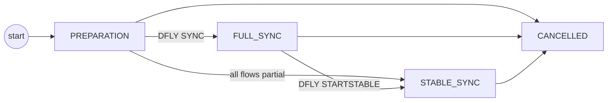
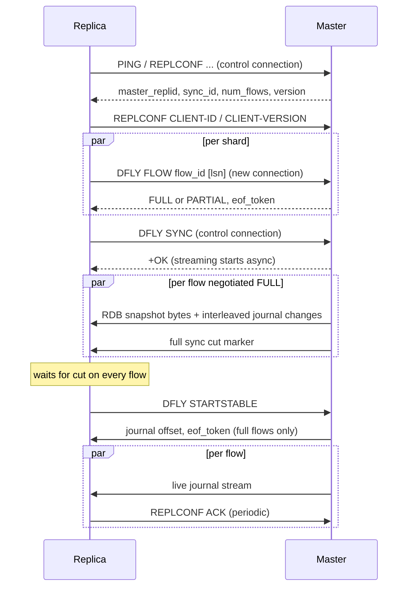
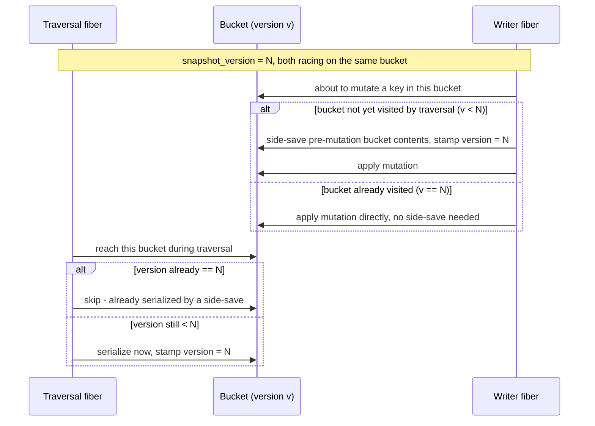
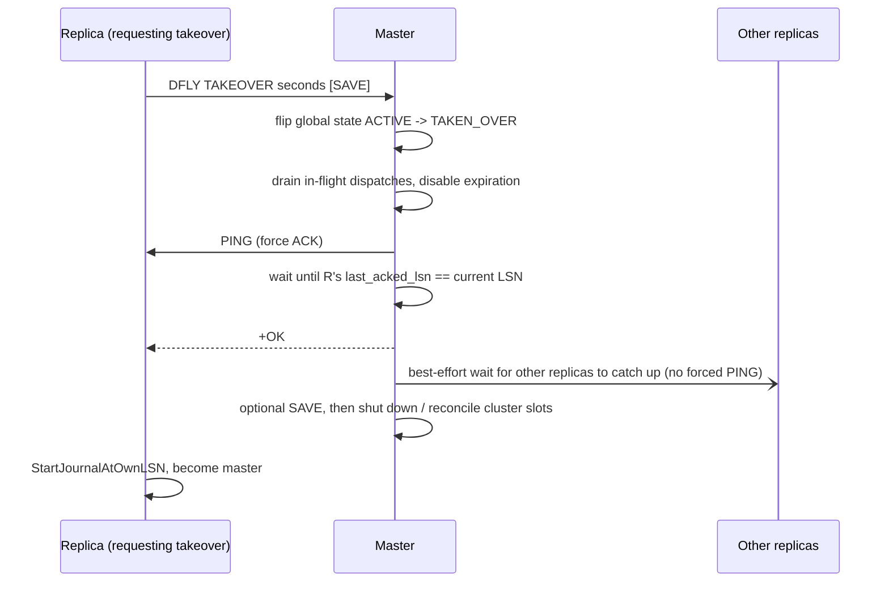

# Dragonfly 组复制设计

`--cluster_mode=yes` 的主节点按引擎线程推送 journal，副本用 LSN 报告执行进度。`--cluster_mode=raft` 的每个数据复制组拥有独立的分区日志，voter 在组内选主，按多数持久化位置确认写入。下文沿用同一组 A、A-r1 节点对照两套复制协议。Raft 示例另将 A-r2 加入组 10，使多数从 2/2 变为 2/3。slot 42 和 43 共用组 10 的日志。[集群拓扑与 slot 映射](raft-cluster-design.md) · [主从复制原图](../replication.md)

## 1. 复制状态机

原图跟踪主节点上的复制会话。Raft 图跟踪组 10 的一个 follower。组内换主时，follower 根据新 leader 的 epoch 和本地日志末端查找共同前缀。


<details>
<summary>查看新版 Mermaid 源码</summary>

```text
flowchart TD
    start((启动)) --> PREPARATION["加载组分配与本地日志"]
    PREPARATION -->|历史仍在保留窗口| ALIGN["比较 epoch 与 offset"]
    PREPARATION -->|所需前缀已清理| FULL_SYNC["安装组 KV 快照"]
    ALIGN -->|保留共同前缀| STABLE_SYNC["按组 Fetch"]
    FULL_SYNC -->|从 cut 续拉| STABLE_SYNC
    STABLE_SYNC -->|leader epoch 变化| PREPARATION
    STABLE_SYNC -->|组副本被移除| CANCELLED["结束该组复制"]
```

</details>

<details>
<summary>展开原图 · PREPARATION / FULL_SYNC / STABLE_SYNC</summary>



</details>

## 2. 握手、全量恢复与增量拉取

`yes` 的副本与主节点协商每线程的 flow，完成同步后接收主节点推送的 journal。`raft` 的副本从元数据发现数据组的入口，由本组协议确认 leader 和 term，按日志位置拉取。两端历史一致时直接进入 Fetch 循环。图中 KV 镜像属于 Dragonfly 扩展，KRaft 元数据快照有独立身份和传输路径。


<details>
<summary>查看新版 Mermaid 源码</summary>

```text
sequenceDiagram
    participant R as Follower A-r1
    participant M as Leader A
    Note over R,M: 已确认组 10 的 Raft leader 和 term
    R->>M: Fetch，group 10、fetch offset、last fetched epoch
    alt 发现日志分歧
      M-->>R: diverging epoch 与 end offset
      R->>R: 对齐共同前缀，截断冲突尾部
    else 所需前缀已清理
      R->>M: 请求组 10 的 KV 镜像（Dragonfly 扩展）
      M-->>R: 校验信息、镜像数据、cut 的 epoch 与 offset
      R->>R: 完整校验后原子安装
    end
    loop 从对齐后的 offset 继续
      R->>M: Fetch，携带本地 LEO
      M-->>R: 连续批次与 leader HW
      R->>R: 持久化批次，仅应用已提交前缀
    end
```

</details>

<details>
<summary>展开原图 · 控制连接、DFLY FLOW 和 journal 推送</summary>



</details>

## 3. 快照与并发写入

沿用原图的遍历 fiber、bucket 和写 fiber。建议复用写前保存 bucket 的方法，在同一组所有执行线程的连续 apply 边界建立 cut。组快照还需保存该边界的 slot generation、冻结状态和暂存迁移数据；过滤数据时使用 cut 对应的归属。只有组内所有参与线程完成，才能发布可供恢复的快照。


<details>
<summary>查看新版 Mermaid 源码</summary>

```text
sequenceDiagram
    participant T as 快照遍历 fiber
    participant B as KV bucket
    participant W as 已提交写的 apply fiber
    Note over T,W: 组 10 在完整 apply 边界 K 建立快照，开启版本 N
    W->>B: 准备修改当前 bucket
    alt 遍历尚未保存该 bucket
      W->>B: 先保存修改前内容，标记版本 N
    end
    W->>B: 应用本次变更
    T->>B: 遍历到该 bucket
    alt 已经保存
      T->>T: 跳过重复序列化
    else 仍未保存
      T->>B: 保存属于本组的键与 DB、绝对 TTL
    end
    T->>T: 完成组快照，记录排他 offset K
    Note over T,W: 保留从 K 开始的日志，待接收端安装后续拉
```

</details>

<details>
<summary>展开原图 · 同一 bucket 上的遍历与写前保存</summary>



</details>

## 4. 客户端写入何时确认


<details>
<summary>查看新版 Mermaid 源码</summary>

```text
sequenceDiagram
    participant U as Redis 客户端
    participant A as Leader A
    participant R as Voter A-r1
    participant S as Voter A-r2
    U->>A: SET，slot 42 属于组 10
    A->>A: 当前 term 追加 offset 100，持久化
    R->>A: Fetch 100
    A-->>R: 当前 term 的批次 100
    R->>R: 持久化批次
    R->>A: 下一次 Fetch 报告 LEO 101
    Note over A,S: A 与 A-r1 已达 2/3，A-r2 可暂时落后
    A->>A: 数据 HW 到 101，应用写入
    A-->>U: OK
    S->>A: 稍后 Fetch 100
    A-->>S: 批次 100 与 HW 101
```

</details>

本例假设 voter 配置稳定。组内每个 voter 持久保存本组的任期、选票和日志。leader 用每个不同 voter 的持久化日志末端计算多数位置，过滤旧 term、错误组、错误目录和重复响应。采用 KRaft 的排他 HW：当前 term 的记录到达多数后，才可据此推进提交边界，连带提交此前的前缀。应用到本地 KV 后返回原始 RESP 结果。Fetch 确认复制位置，副本 apply 位置单独用于 `WAIT`。[Kafka LeaderState](../../../kafka/raft/src/main/java/org/apache/kafka/raft/LeaderState.java)

若 A 只能联系自己，仍可能短暂认为自己是 leader，但无法为新的写入凑齐多数并返回成功。失联期间已追加但未确认的请求结果可能未知。恢复后按共同的 term/offset 截断冲突尾部，已提交前缀受 Raft 选举与日志规则保护。元数据 quorum 不可用时，健康且已配置的数据组仍能在本组选举和提交；新 slot 归属的发布需要元数据 quorum 恢复。

**成员调整。** 每个数据组独立运行 KRaft 动态 voter 协议。新节点先以 observer 追平，再按上游的 VotersRecord 生效、提交和截断规则一次增删一个 voter。多数门槛基于协议有效的 voter 配置，不能随在线节点数量下调。更换组副本复制整组日志；迁移单个 slot 使用[跨组所有权切换](raft-cluster-design.md#4-单个-slot-跨组迁移)。

## 5. 失主、选主与重新追赶

现有计划内 takeover 需要旧主配合排空。下图的 A 已不可用，A-r1 和 A-r2 在组 10 内交换选票。候选者的日志必须至少与投票者一样新；投票者在同一 term 只投一个候选，先持久化选票再应答。controller 收到结果后发布路由，组内多数独立确立领导权。


<details>
<summary>查看新版 Mermaid 源码</summary>

```text
sequenceDiagram
    participant A as 旧 leader A
    participant R as 候选者 A-r1
    participant S as Voter A-r2
    participant Q as 元数据 controller
    Note over A,S: A 失联，A-r1 日志满足选举条件，预投票通过
    R->>R: 新 term，持久化自投票
    R->>S: Vote，携带 term 和日志末端
    S-->>R: 持久化选票，同意
    R->>R: 得到 2/3，追加本任期控制批次
    S->>R: Fetch
    R-->>S: 本任期批次
    S->>R: 持久化后报告新 LEO
    R->>R: 建立本任期 HW，恢复 KV
    R->>Q: 报告组 10 的 leader 与 term
    Note over Q: 发布已观察到的路由
    A->>R: 重连，按新 term 对齐并追赶
```

</details>

<details>
<summary>展开原图 · REPLTAKEOVER 与旧主排空</summary>



</details>

## 6. KV 执行、快照与客户端故障语义

`yes` 通过 `Transaction::LogAutoJournalOnShard` 记录已执行的变更，各引擎线程独立分配 LSN，副本跟随指定的主节点。`raft` 的数据组 leader 将 SET 的效果追加到本组日志。各副本按组内 offset 应用已提交前缀，leader 在本地 KV 应用后回复客户端。[Journal 格式](../../src/server/journal/types.h) · [主从复制管理](../../src/server/replica_manager.cc) · [Raft 数据节点](../../src/server/cluster/raft/runtime/data_node.cc)

| 接入点 | 建议实现 |
| --- | --- |
| 分区日志 | 按 topic ID、group ID 和 offset 定位日志记录，用 leader epoch 验证历史；从记录中的 slot 和 DB ID 定位 KV。实现批量 append、offset/epoch 查询、截断、恢复和保留。现有 per-shard LSN 不能跨线程比较。可复用 AOF 的异步 I/O 和原子落盘做法，需要补充分区索引、HW checkpoint 和 epoch 历史。逻辑数据日志数随复制组数增长；16,384 项 slot 路由表可按范围持久化。[AOF segment writer](../../src/server/journal/aof_segment_writer.h) · [现有复制设计](../replication.md) |
| 写入、可见性和读 | 建议首版采用多数提交后回复、由 leader 提供读服务。对应执行线程在私有暂存状态上求出 Redis 回复和确定性变更，以 slot generation 和组 leader epoch 校验后向组日志追加一笔批次。达到该组 HW 后按组 offset 顺序发布给读者，再回原始结果。首版可限制每 slot 一笔在途逻辑写；网络等待时释放 CPU 和 shard 锁。后续流水化须让条件写看到前序待提交效果，同时隔离读者。新 leader 恢复本地 KV，并追上请求所需的提交前缀后开放服务。 |
| 确定性重放 | 保存变更、DB ID、绝对过期时间及必要的类型信息。相对 TTL、淘汰、脚本中的时间或随机结果，需要记录已决定的效果。副本不得自行淘汰出不同结果。换主时丢弃旧 epoch 暂存视图；已追加的尾巴按 epoch 对齐结果保留或截断。快照中记录已 apply 的排他 offset，只把其后连续且已提交的完整批次应用一次。[现有回放入口](../../src/server/journal/journal_applier.h) |
| 事务、后台变更与管理命令 | 同 slot 的 `MULTI/EXEC`、脚本及跨 DB 操作生成一个原子效果批次，保留 Redis 的逐命令返回和运行时错误语义；跨 slot 执行遵循现有 `CROSSSLOT`。审计直接改 DB 和自写 journal 的路径，覆盖 TTL、eviction、阻塞命令和脚本。默认布局下，节点本地 `FLUSHDB/FLUSHALL` 按原作用域清理本组对应 DB；同进程多组时仍按请求进入的逻辑节点确定作用域。`WAIT` 按该连接所属组及副本 apply 进度计算，单独验收超时和角色变化。[现有集群命令范围](../cluster-mode.md) |
| 快照重建 | 以 topic ID、group ID、leader epoch、组已 apply 的排他 offset 和校验值标记组快照，覆盖该前缀对应的所有 slots、DB、类型与绝对 TTL，以及迁移的冻结标记、暂存数据和 generation。保留 cut 之后的连续日志；接收端构建临时镜像，校验完整后原子安装，从 cut 续拉。源 leader 改变须验证 cut 属于新历史。日志清理前须能从现存镜像和后续日志重建该分区。[现有快照实现](../../src/server/snapshot.cc) |

**换主时的条件写。** 例如 A 领写时已把一条 INCR 复制给 A-r1，回复客户端前 A 宕机；A-r1 的日志可能包含这条记录，而本地 KV 镜像只应用到了上一个 HW。A-r1 经选举成为 leader 后，先冻结新写，记下继承日志的 LEO。完成 epoch 校验，在新任期确认保留前缀，等数据 HW 和本地 apply 均到达该 LEO，再对外执行依赖旧值的命令。若无法取得本组多数，导致 HW 停滞，保持恢复状态并对请求返回可重试错误。否则第二次 INCR 可能从错误的旧值计算，即使两条日志最终都复制成功。这个开放服务的屏障是 Dragonfly 为 KV 求值引入的适配。

**客户端故障语义。** append 前被拒可以确定未写入；append 后超时、换主或响应丢失，客户端看到的是结果未知。自动重试 `INCR` 可能执行两次。Raft 的写提交规则本身也不保证一个与新元数据隔离的旧 leader 提供线性一致 KV 读。若新模式要求这种读保证，需要额外定义读协议，并以隔离旧主的读写序列验收。
